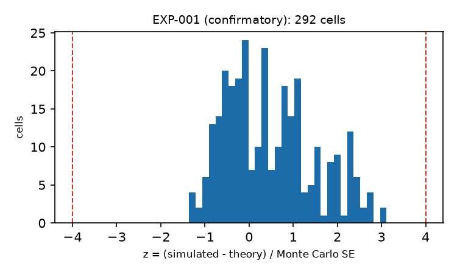

<!-- SPDX-License-Identifier: LicenseRef-PARADOX-NC-Research-1.0 -->
# EXP-001 report: engine and theoretical-baseline validation

## 1. Identification

| Field | Value |
|---|---|
| Experiment | EXP-001, engine and theoretical-baseline validation |
| Status | **Confirmatory, complete. Verdict: PASS** (engine validated; the stop rule allows EXP-002 to EXP-004) |
| Report date | 2026-11-25, written from committed results (owner decision D-013); run 2026-11-24 23:36:46 to 23:38:16 UTC |
| Protocol | `protocol.md` v1.0, frozen 2026-11-24 (owner-approved), SHA-256 `3e5f7992cba2a5769aabbb2072d98cc2885d4ba76bd8e28d2de914639dfc8c16` |
| Main protocol | `research/protocol.md` v1.0, SHA-256 `68ce4b150fc8350b66a2e89d6c9049e241555a05bb7e381243b42a7dd5654de9` |
| Config | `config.json`, canonical SHA-256 `ec431b20bff323bb1c6e8461d721c25909e3522c839f03e0cc212775ec906709` |
| Provenance revision | `d997cf81784aaf136e385e489febaade7e18e55c` (clean tree); results committed in `84b1d14` |
| Author | Mohamed Bechir Kefi, independent researcher. An AI system (Claude, Anthropic) assisted with code, runs and drafting as a research and development assistant; it is not an author. |

## 2. Executive summary

**Question.** Does the simulation engine reproduce the closed-form accuracy of majority voting (MV) for independent, common-shock correlated, two-class mixture and Bahadur second-order models?

**Method.** Validation cells (model x parameters x group size `n` in {1, 3, 5, 9, 15, 31}); in each, 30 confirmatory seeds of 20,000 items (`N = 600,000`), with simulated MV accuracy compared with the exact formula at a tolerance of 4 Monte Carlo standard errors; four golden fixtures.

**Outcome.** 292 cells were run and 20 Bahadur cells were excluded as inadmissible, exactly as the frozen protocol lists. No cell failed: the largest standardised deviation was abs z = 3.116, below the tolerance of 4. All four golden fixtures were reproduced. Under the frozen rule the engine is validated.

**Principal caveat.** Cells share seeds (decision D-008), so they are not independent. 30 cells have abs z > 2. Most are S6 mixture cells, which all deviate in the same direction because they share one realised share of hard items (section 8.3). The verdict is per cell and is unaffected.

## 3. Rationale and literature

Every later conclusion relies on the engine, so the protocol runs this verification first, with a stop rule. Reference values come from three sources:

- the Condorcet binomial sum;
- the common-shock formula `G(n, p, lambda)`, derived in `research/protocol.md` section 2.7 from the opinion-leader structure (Boland 1989; Boland, Proschan and Tong 1989, both **unverified**, known only from secondary descriptions);
- Kaniovski (2008, working paper, Theorem 1, full text pages 1 to 13 read) for the Bahadur model.

The gap is internal: a simulator that does not match exact theory where theory exists cannot be trusted where it does not.

## 4. Hypotheses and operational definitions

- **H0 (engine correct).** For every admissible cell, `|A_sim - A_theory| <= 4 SE_MC`, with `SE_MC = sqrt(A_theory (1 - A_theory) / N)`, `N = 600,000`.
- **Contradiction.** Any cell outside 4 SE, or a golden fixture not reproduced (Bahadur `p = 0.55, c = 0.4`: 0.54505 at `n = 3`, 0.5196194 at `n = 5`; Condorcet `p = 0.55`: 0.57475 at `n = 3`, 0.5931269 at `n = 5`).
- **Accuracy** `A`: proportion of items on which the strict majority of `n` (odd) binary votes is correct; unit: proportion in [0, 1]. `z = (A_sim - A_theory) / SE_MC`.

## 5. Methodology

- **Engine.** `src/paradox/generator.py` draws, per item, the ground truth, the difficulty class, a shared latent answer, each reasoner's adoption of it (probability `lambda`) and each private answer. MV is `rules.majority`. Bahadur cells sample the number of correct votes from the exact Bahadur profile distribution (`dependence.sample_k`).
- **Grid** (`config.json`).
  - Common-shock: `p` in {0.45, 0.5, 0.55, 0.6, 0.8} x `lambda` in {0, 0.25, 0.5, 0.75, 1} x 6 values of `n` (`lambda = 0` is labelled `independent`, `lambda = 1` `perfect_correlation`).
  - Mixture: S4, S5, S6 x `lambda` in {0, 0.25, 0.5, 0.75} x 6 values of `n`.
  - Bahadur: the same `p` x `c` in {0, 0.1, 0.4} x 6 values of `n`.
- **Seeds.** `SeedSequence(20261124).spawn(30)`, the held-out confirmatory entropy; the same list in every cell.
- **Data.** Synthetic only (common decision C1); `data/manifest.json` SHA-256 `b2881ad496e68f02f56027c1e01eeafa3ce62e86d62b7413a9d25781c2a116a0`.
- **Hardware and software** (from `run_manifest.json`): Apple M1 Pro, arm64, macOS 15.3.1 (Darwin 24.3.0); Python 3.12.1, numpy 2.5.4, matplotlib 3.11.2, jsonschema 4.26.0, typst 0.15.2. One process at `nice 10`.
- **Statistical plan.** Per-cell check as in section 4, with no multiplicity adjustment (protocol section 7 sets 4 SE so that a correct engine rarely fails a cell).

## 6. Implementation verification

- Test suite at the provenance revision: 321 passed (`progress.md`, M3 entry). It covers the golden fixtures, the independence and perfect-correlation identities, tie handling, budget accounting and deterministic reruns.
- Before any confirmatory run, the exploratory smoke run on exploratory seeds passed, with 32 of 32 metric checks on hand-computed cases and closed forms (journal J-0009; `results/exploratory/m3-smoke/metric_check.json`).
- The run guard accepted the config only after matching the main protocol, this protocol and the config against `research/freeze.json`.
- The production MV rule on engine draws is compared with an independent closed-form computation in `theory.py`, which is what the hypothesis asks.

## 7. Execution record

- **Command:** `scripts/m3_run.sh EXP-001`. It runs `nice -n 10 .venv/bin/paradox run --config research/experiments/EXP-001/config.json --out results/EXP-001 --pdf`, then `python -m paradox.analysis EXP-001 results/EXP-001 --exit-status 0`.
- **Times:** 2026-11-24 23:36:46Z to 23:38:16Z; runtime 89.1 s; peak RSS 573.2 MiB; exit status 0 (`results/EXP-001/exit_status.json`).
- **Run ids:** CELL-0001 to CELL-0312 (292 run, 20 excluded), one row each in `results/EXP-001/provenance.csv`.
- **Excluded cells (a design property, not based on outcomes):** Bahadur `c = 0.1` at `n = 31` and `c = 0.4` at `n` in {9, 15, 31}, for each `p`: 20 cells, as protocol section 8 lists.
- **Failed or dropped runs:** none. **Retries:** none.
- **Deviations from the frozen protocol:** none. The analysis code and its readings (D-011) were committed before the run. Owner decision D-013 (2026-11-25) authorised writing this report afterwards from committed results; it changes no number.

## 8. Results

### 8.1 Golden fixtures

| Check | Expected | Got | Pass |
|---|---|---|---|
| Bahadur `M^B_3(0.55, 0.4)` | 0.54505 | 0.5450500000 | yes |
| Bahadur `M^B_5(0.55, 0.4)` | 0.5196194 | 0.5196193750 | yes |
| Condorcet `M_3(0.55)` | 0.57475 | 0.5747500000 | yes |
| Condorcet `M_5(0.55)` | 0.5931269 | 0.5931268750 | yes |

### 8.2 Monte Carlo cells

| Model | Cells run | Failing (abs z > 4) | Max abs z |
|---|---|---|---|
| independent (`lambda = 0`) | 30 | 0 | 2.973 |
| common_shock (`0 < lambda < 1`) | 90 | 0 | 2.747 |
| perfect_correlation (`lambda = 1`) | 30 | 0 | 1.087 |
| two-class mixture | 72 | 0 | 3.116 |
| Bahadur | 70 | 0 | 1.323 |
| **All** | **292** | **0** | **3.116** |

abs z > 2 in 30 cells and abs z > 3 in 1 cell (mixture S6, `lambda = 0.5`, `n = 5`). Per-cell simulated and exact values are in `results/EXP-001/report.md` (generated) and `results/EXP-001/results.json`. The rule application is in `results/EXP-001/analysis/analysis.md`.

*Figure FIG-001-1. Standardised deviation `z = (A_sim - A_theory) / SE_MC` per validation cell (292 cells, `N = 600,000` items each from 30 seeds). Dashed lines: the 4 SE tolerance. Cells share seeds, so they are not independent draws.*

### 8.3 Distribution of deviations (descriptive)

- 17 of the 30 cells with abs z > 2 are S6 mixture cells, and every S6 cell with `n >= 3` has a positive z.
- A post-hoc exploratory diagnostic (journal J-0011) measured the realised share of hard items in the draws that all S6 cells share: 0.49886 against `h = 0.5` (z = -1.76). Fewer hard items raise MV accuracy in every S6 cell at once. The realised shares for S4 and S5 deviate by z = -0.96 and -0.77.
- This is the expected effect of common random numbers (D-008), not an engine defect. It was diagnosed after the verdict and changed nothing.

## 9. Interpretation

**Expected versus observed.** A correct engine should leave no cell outside 4 SE and reproduce every fixture, and that is exactly what was observed.

- **Measured:** MV accuracy agrees with the exact formulas in every admissible cell, and the fixtures hold.
- **Inference:** within this grid, the generator, the MV rule and the closed forms are mutually consistent, so the common-shock and mixture formulas can serve as references in EXP-002 and EXP-003.
- **Limits:** agreement does not establish correctness outside the grid. It cannot detect an error shared by the formula and the engine, because both implement the same model definition. The 4 SE criterion is a tolerance, not an equivalence test.

## 10. Threats to validity

- **Internal.** Cells are correlated through shared seeds (section 8.3). The protocol's false-alarm estimate treats them as independent, so it is approximate. A shared error in the model definition would not be detected.
- **Construct.** Only MV is validated against theory; CW and SEQ have no closed form.
- **Statistical.** 292 unadjusted checks at 4 SE; per-cell values are reported in full.
- **External.** None claimed; this is a software verification.

## 11. Conclusion and next experiment

Verdict under the frozen rule: **PASS**. The stop rule does not trigger. EXP-002 and EXP-003 were started after this verdict, then the optional EXP-004.

## 12. Reproduction appendix

See [`reproduction.md`](reproduction.md).

- **Raw outputs:** `results/EXP-001/` (`results.json` SHA-256 `c79d15c55b9cedc9c52caf96360edbc39b56d4606da93037907b4a75a5778d76`). Every file is hashed in `results/EXP-001/sha256_manifest.json`.
- **Copies in this folder:** `run_manifest.json`, `metrics.csv`, `figures/`.
- **Records:** claim CLM-001; journal J-0009 to J-0011.
- **References:** Kaniovski (2008) working paper, verified (SHA-256 in `research/literature_review.md`); Boland (1989) and Boland, Proschan and Tong (1989) unverified.
