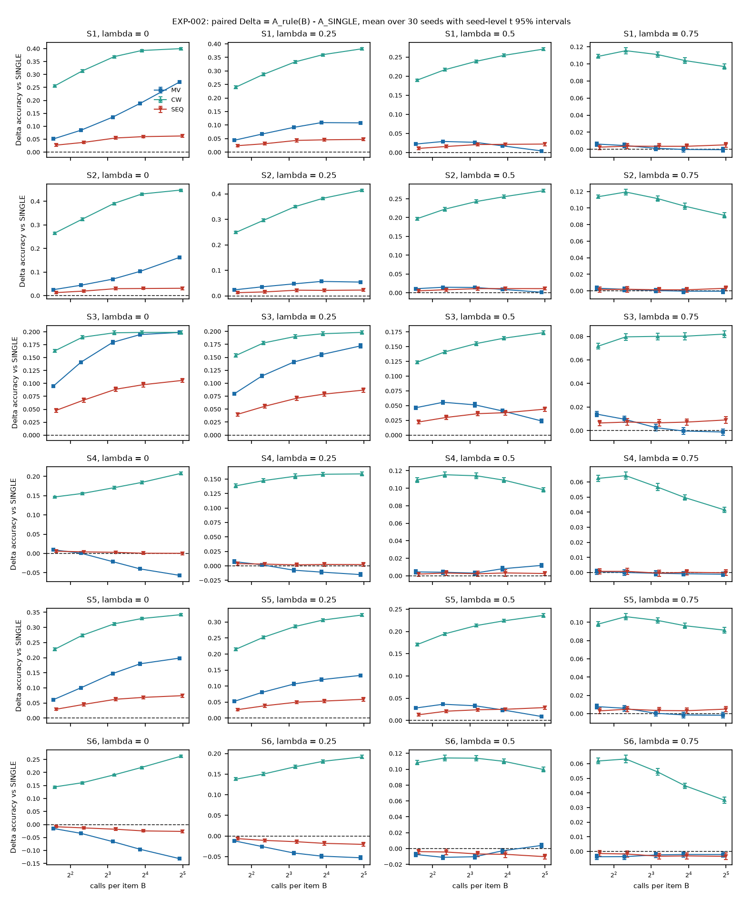

<!-- SPDX-License-Identifier: LicenseRef-PARADOX-NC-Research-1.0 -->
# EXP-002 report: equal-budget aggregation map (primary)

## 1. Identification

| Field | Value |
|---|---|
| Experiment | EXP-002, equal-budget aggregation map (primary experiment) |
| Status | **Confirmatory, complete (720 of 720 runs, 0 excluded). Verdict: H0 rejected**: degradation exists in 32 of 240 MV and SEQ cells |
| Report date | 2026-11-25, written from committed results (owner decision D-013); run 2026-11-24 23:38:29 to 23:38:56 UTC |
| Protocol | `protocol.md` v1.0, frozen 2026-11-24 (owner-approved), SHA-256 `93a7b67515c971ac47e0e6faaeca4e12bea00c8470060068d4f8cec950562358`; main protocol SHA-256 `68ce4b150fc8350b66a2e89d6c9049e241555a05bb7e381243b42a7dd5654de9` |
| Config | `config.json`, canonical SHA-256 `a69b5eb8cedca9e14027b68fde479fbfaf2d1b25ddb6ead6c5cf66360f89ae2b` |
| Provenance revision | `d997cf81784aaf136e385e489febaade7e18e55c` (clean tree); results committed in `84b1d14` |
| Precondition | EXP-001 passed before this run started |
| Author | Mohamed Bechir Kefi, independent researcher. An AI system (Claude, Anthropic) assisted with code, runs and drafting as a research and development assistant; it is not an author. |

## 2. Executive summary

**Question.** At an equal budget of `B` reasoner calls per item, where do majority voting (MV), confidence-weighted voting (CW) and sequential public voting (SEQ) improve or degrade accuracy relative to one reasoner making one call (SINGLE)?

**Method.**
- Design: six scenarios (S1 to S6) x `lambda` in {0, 0.25, 0.5, 0.75} x 30 confirmatory seeds = 720 runs of 2000 items.
- All rules and budgets `B` in {1, 3, 5, 9, 15, 31} share common random numbers.
- Primary estimand: the paired difference `Delta_r = A_r(B) - A_SINGLE`.
- Statistics: seed-level t intervals, and Holm's adjustment over the 240 MV and SEQ cells with `B >= 3`.

**Outcome.**
- **H0 rejected.** H0 says that no cell degrades. 32 cells have a Holm-adjusted one-sided upper bound below 0, and all of them are in S4 and S6, the two scenarios where theory predicts degradation.
- **Largest degradation:** MV in S6 at `lambda = 0`, `B = 31`: `Delta = -0.1313` (t 95% interval -0.1350 to -0.1276).
- **P1 supported** in all six scenarios.
- **P2 (herding reduces the gain) disconfirmed** in 9 of 30 cells: in S4 (`B >= 5`) and S6 (all `B`), SEQ loses less than MV.
- **P3 supported** in 43 of 45 comparisons and inconclusive in 2.

**Principal caveat.** These are synthetic reasoners in a stated model. MV results largely follow from closed forms. CW results depend on an assumed confidence model and are descriptive only.

## 3. Rationale and literature

- **Condorcet-type amplification** predicts gains from majority voting when competence exceeds one half and votes are independent.
- **Difficulty diversity.** Chen et al. (2024, arXiv:2403.02419; full text of v2 opened at M6, claim checked at the abstract, section 1 and Theorem 2) report that majority-vote performance of LLM systems can rise and then fall with the number of calls, and attribute this to query difficulty diversity.
- **Correlation.** Kaniovski (2008, verified) shows that positive correlation lowers jury competence.
- **Information sharing.** Golub and Jackson (2010; full text of the authors' version opened at M6, claim checked at the abstract and section III) and Mavrodiev, Tessone and Schweitzer (2012; full text opened at M6, claim checked at the abstract) show that information sharing can help or hurt. Lorenz et al. (2011) is relevant but unverified.

The gap addressed is a controlled, equal-budget map that separates difficulty heterogeneity, correlation and herding within one model, with paired uncertainty.

## 4. Hypotheses and operational definitions

- **Accuracy** `A = (1/I) sum_i 1[yhat_i = y_i]` (proportion). **Primary estimand** `Delta_r(cell) = A_r(B) - A_SINGLE`, paired by item and seed, for `r` in {MV, SEQ}; cells are scenario x `lambda` x `B >= 3`.
- **H0 (no degradation):** `Delta_r >= 0` in every cell. **H1:** `Delta_r < 0` in at least one cell.
- **Decision rule (frozen):** reject H0 if at least one cell has a Holm-adjusted one-sided 95% upper confidence bound below 0 (family: the 240 MV and SEQ cells). This is applied as Holm's step-down on the one-sided t-test p-values (`p_Holm < 0.05`). At step `k` this is the same as the one-sided upper bound at level `0.05 / (m - k)` lying below 0 (reading D-011, fixed before the run).
- **P1:** at `lambda = 0`, `B = 31`, `Delta_MV < 0` where `(1 - h)(1 - p_easy) < h p_hard` (S4, S6), and `> 0` otherwise. Disconfirmed if a predicted-negative cell has a lower bound above 0, or a predicted-positive cell an upper bound below 0.
- **P2:** at `lambda = 0` and every `B >= 3`, `Delta_SEQ < Delta_MV`. Disconfirmed if `Delta_SEQ - Delta_MV` has a lower bound above 0 in any such cell.
- **P3:** in homogeneous scenarios (S1 to S3), `Delta_MV` decreases as `lambda` increases at fixed `B`. Disconfirmed by an increase whose lower bound is above 0. Compared over consecutive `lambda` levels at each `B >= 3` (D-011).
- **Bounds for P1 to P3:** seed-level two-sided t 95% intervals, unadjusted (D-011). P2 and P3 use paired per-seed differences.
- **Controls:** SINGLE is reasoner 1 of the same run; the budget is matched by construction; common random numbers; fixed `w = 0.5`, `delta = 1`, `tau = 1`, coin tie rule.

## 5. Methodology

- **Model and rules:** `research/protocol.md` sections 2.1 to 2.6. DELIB was dropped (owner-approved amendment 2).
- **Scenarios:**
  - Homogeneous: S1 (`p` 0.60), S2 (0.55), S3 (0.80).
  - Two-class mixtures, given as `p_easy`, `h`, `p_hard`: S4 (0.90, 0.4, 0.30), S5 (0.70, 0.2, 0.45), S6 (0.95, 0.5, 0.35).
- **Seeds:** `SeedSequence(20261124).spawn(30)`, shared across cells (D-008).
- **Data:** synthetic only; `data/manifest.json` SHA-256 `b2881ad496e68f02f56027c1e01eeafa3ce62e86d62b7413a9d25781c2a116a0`.
- **Hardware and software** (from `run_manifest.json`): Apple M1 Pro, macOS 15.3.1; Python 3.12.1, numpy 2.5.4, matplotlib 3.11.2. One process at `nice 10`, running alongside EXP-003 (two processes in total).
- **Statistics:** per run, the paired `Delta`. Across the 30 seed-runs: mean, SD, t 95% interval, seed-level percentile bootstrap (10,000 resamples) and one-sided t p-value. Holm within the primary family. Secondary metrics are descriptive.

## 6. Implementation verification

- Test suite at the provenance revision: 321 passed. The exploratory smoke run and 32 of 32 metric checks passed before any confirmatory run (journal J-0009).
- Per-run invariants (vote counts equal `n`, calls equal `B`, reasoner-1 accuracy within 4 SE of `mu`): no run was excluded, so all 720 passed.
- EXP-001 validated the MV engine against theory (PASS). The generated table in `results/EXP-002/report.md` shows the closed-form MV accuracy next to each simulated value. CW and SEQ have no closed form.

## 7. Execution record

- **Command:** `scripts/m3_run.sh EXP-002`. It runs `nice -n 10 .venv/bin/paradox run --config research/experiments/EXP-002/config.json --out results/EXP-002 --pdf`, then `python -m paradox.analysis EXP-002 results/EXP-002 --exit-status 0`.
- **Times:** 2026-11-24 23:38:29Z to 23:38:56Z; runtime 26.3 s; peak RSS 174.5 MiB; exit status 0.
- **Run ids:** RUN-0001 to RUN-0720, one row each in `results/EXP-002/provenance.csv` (seed, config hash, revision, data manifest hash, hardware, times, exit status).
- **Sample counts:** 720 runs x 2000 items; 30 seed-runs per cell; 0 excluded, 0 failed, 0 dropped.
- **Deviations from the frozen protocol:** none. Owner decision D-013 (2026-11-25) authorised writing this report from committed results; it changes no number.

## 8. Results

### 8.1 Primary decision

240 cells in the family; **32 rejected**. All 240 cells, with bootstrap intervals, Holm-adjusted p-values and Holm step bounds, are in `results/EXP-002/analysis/analysis.md` and `analysis.json`.

| Scenario | lambda | Rule | B | Delta | t95 low | t95 high |
|---|---|---|---|---|---|---|
| S4 | 0 | MV | 9 | -0.0213 | -0.0246 | -0.0180 |
| S4 | 0 | MV | 15 | -0.0403 | -0.0434 | -0.0372 |
| S4 | 0 | MV | 31 | -0.0570 | -0.0602 | -0.0537 |
| S4 | 0.25 | MV | 9 | -0.0074 | -0.0107 | -0.0042 |
| S4 | 0.25 | MV | 15 | -0.0107 | -0.0142 | -0.0072 |
| S4 | 0.25 | MV | 31 | -0.0150 | -0.0185 | -0.0116 |
| S6 | 0 | MV | 3 | -0.0153 | -0.0182 | -0.0123 |
| S6 | 0 | MV | 5 | -0.0340 | -0.0374 | -0.0307 |
| S6 | 0 | MV | 9 | -0.0658 | -0.0695 | -0.0621 |
| S6 | 0 | MV | 15 | -0.0955 | -0.0995 | -0.0915 |
| S6 | 0 | MV | 31 | -0.1313 | -0.1350 | -0.1276 |
| S6 | 0 | SEQ | 3 | -0.0087 | -0.0115 | -0.0059 |
| S6 | 0 | SEQ | 5 | -0.0132 | -0.0171 | -0.0092 |
| S6 | 0 | SEQ | 9 | -0.0182 | -0.0222 | -0.0143 |
| S6 | 0 | SEQ | 15 | -0.0247 | -0.0291 | -0.0202 |
| S6 | 0 | SEQ | 31 | -0.0266 | -0.0316 | -0.0216 |
| S6 | 0.25 | MV | 3 | -0.0118 | -0.0150 | -0.0085 |
| S6 | 0.25 | MV | 5 | -0.0255 | -0.0286 | -0.0224 |
| S6 | 0.25 | MV | 9 | -0.0411 | -0.0454 | -0.0369 |
| S6 | 0.25 | MV | 15 | -0.0487 | -0.0531 | -0.0443 |
| S6 | 0.25 | MV | 31 | -0.0527 | -0.0571 | -0.0483 |
| S6 | 0.25 | SEQ | 3 | -0.0064 | -0.0093 | -0.0034 |
| S6 | 0.25 | SEQ | 5 | -0.0107 | -0.0146 | -0.0068 |
| S6 | 0.25 | SEQ | 9 | -0.0139 | -0.0180 | -0.0097 |
| S6 | 0.25 | SEQ | 15 | -0.0178 | -0.0222 | -0.0134 |
| S6 | 0.25 | SEQ | 31 | -0.0203 | -0.0246 | -0.0159 |
| S6 | 0.5 | MV | 3 | -0.0074 | -0.0102 | -0.0047 |
| S6 | 0.5 | MV | 5 | -0.0111 | -0.0139 | -0.0082 |
| S6 | 0.5 | MV | 9 | -0.0103 | -0.0133 | -0.0072 |
| S6 | 0.5 | SEQ | 9 | -0.0068 | -0.0103 | -0.0034 |
| S6 | 0.5 | SEQ | 31 | -0.0102 | -0.0134 | -0.0069 |
| S6 | 0.75 | MV | 3 | -0.0036 | -0.0054 | -0.0018 |

20 of the rejected cells are MV and 12 are SEQ. None are in S1, S2, S3 or S5. (Corrected in the M4 evidence audit, 2026-11-25: the first version of this report said 24 MV and 8 SEQ; the table above and `analysis.json` give 20 and 12. No verdict changes.)

### 8.2 Accuracy change at the largest budget (B = 31)

The table gives `Delta` against SINGLE with seed-level t 95% intervals; 30 seeds per cell. Values are from the generated table in `results/EXP-002/report.md`.

| Scenario | lambda | SINGLE accuracy | MV Delta [t95] | SEQ Delta [t95] | CW Delta [t95] (descriptive) |
|---|---|---|---|---|---|
| S1 | 0 | 0.5997 | +0.2708 [+0.2666, +0.2749] | +0.0624 [+0.0567, +0.0680] | +0.4001 [+0.3964, +0.4038] |
| S1 | 0.75 | 0.6006 | -0.0005 [-0.0033, +0.0024] | +0.0052 [+0.0024, +0.0081] | +0.0969 [+0.0937, +0.1000] |
| S2 | 0 | 0.5509 | +0.1620 [+0.1568, +0.1672] | +0.0311 [+0.0251, +0.0372] | +0.4478 [+0.4440, +0.4516] |
| S3 | 0 | 0.8012 | +0.1988 [+0.1953, +0.2022] | +0.1059 [+0.1023, +0.1096] | +0.1988 [+0.1954, +0.2023] |
| S4 | 0 | 0.6645 | -0.0570 [-0.0602, -0.0537] | +0.0003 [-0.0034, +0.0039] | +0.2080 [+0.2048, +0.2112] |
| S4 | 0.5 | 0.6628 | +0.0119 [+0.0097, +0.0141] | +0.0026 [+0.0004, +0.0048] | +0.0984 [+0.0958, +0.1009] |
| S5 | 0 | 0.6534 | +0.1984 [+0.1938, +0.2030] | +0.0742 [+0.0687, +0.0798] | +0.3422 [+0.3388, +0.3456] |
| S6 | 0 | 0.6570 | -0.1313 [-0.1350, -0.1276] | -0.0266 [-0.0316, -0.0216] | +0.2628 [+0.2588, +0.2668] |
| S6 | 0.5 | 0.6556 | +0.0040 [+0.0011, +0.0068] | -0.0102 [-0.0134, -0.0069] | +0.0997 [+0.0967, +0.1026] |

At `lambda = 0.75` and `B = 31`, MV `Delta` is -0.0005 (S1), -0.0004 (S2), -0.0012 (S3), -0.0011 (S4), -0.0018 (S5) and -0.0021 (S6). Only S6 has an interval wholly below 0 (-0.0040 to -0.0002), and that cell is not rejected after Holm adjustment. All cells and budgets, with closed-form MV accuracy next to the simulated values, are in `results/EXP-002/report.md` and `metrics.csv`.

*Figure FIG-002-1. Paired `Delta = A_rule(B) - A_SINGLE` (proportion of items) against calls per item `B` (log2 axis), mean over 30 seed-runs of 2000 items. Error bars are seed-level t 95% intervals, often narrower than the markers. Dashed line: no change. CW is descriptive (its confidence model is assumed). The generated accuracy figure `figures/accuracy_vs_budget.png` shows absolute accuracy with seed-range bands.*

### 8.3 Directional predictions

- **P1: not disconfirmed; supported in 6 of 6.**
  - Predicted gain: S1 +0.2708 [+0.2666, +0.2749], S2 +0.1620 [+0.1568, +0.1672], S3 +0.1988 [+0.1953, +0.2022], S5 +0.1984 [+0.1938, +0.2030].
  - Predicted degradation: S4 -0.0570 [-0.0602, -0.0537], S6 -0.1313 [-0.1350, -0.1276].
- **P2: disconfirmed (9 of 30 cells).** The quantity is `Delta_SEQ - Delta_MV` at `lambda = 0`, with t95 intervals.
  - Supported (interval below 0), 21 cells: S1, S2, S3 and S5 at every `B`, and S4 at `B = 3` (-0.0036 [-0.0059, -0.0014]).
  - Disconfirmed in S4: +0.0035 [+0.0003, +0.0066] (`B = 5`), +0.0241 [+0.0214, +0.0268] (`B = 9`), +0.0408 [+0.0380, +0.0437] (`B = 15`), +0.0572 [+0.0549, +0.0595] (`B = 31`).
  - Disconfirmed in S6: +0.0066 [+0.0043, +0.0089] (`B = 3`), +0.0209 [+0.0183, +0.0235] (`B = 5`), +0.0475 [+0.0446, +0.0505] (`B = 9`), +0.0709 [+0.0679, +0.0738] (`B = 15`), +0.1047 [+0.1021, +0.1073] (`B = 31`).
- **P3: not disconfirmed; supported in 43 of 45 comparisons, inconclusive in 2, disconfirmed in 0.**
  - Inconclusive: S2, `B = 3`, `lambda` 0 to 0.25: -0.0016 [-0.0055, +0.0022].
  - Inconclusive: S2, `B = 31`, `lambda` 0.5 to 0.75: -0.0020 [-0.0056, +0.0017].
  - All 45 comparisons are in `results/EXP-002/analysis/analysis.md`.

### 8.4 Secondary metrics (descriptive)

Brier score, ECE and the share of non-unanimous votes for every cell are in `results/EXP-002/report.md` and `metrics.csv`. Example (S1, `lambda = 0`):

| Metric | SINGLE | MV (`B = 31`) | SEQ (`B = 31`) | CW (`B = 31`) |
|---|---|---|---|---|
| Brier | 0.1919 | 0.1682 | 0.2081 | 0.0409 |
| ECE | 0.2072 | 0.2588 | 0.1291 | 0.1908 |

Across the 432 non-baseline cells, the between-seed SD of `Delta` ranges from 0.0000 to 0.0162 (median 0.0087).

## 9. Interpretation

**Expected versus observed.**
- **P1** expected gains in S1, S2, S3 and S5 and losses in S4 and S6 at `B = 31`, `lambda = 0`. All six signs were observed, each with an interval excluding 0.
- **P3** expected MV gains to shrink with correlation in homogeneous scenarios. This was observed in 43 of 45 steps, with no increase anywhere.
- **P2** expected SEQ below MV everywhere at `lambda = 0`. This held where aggregation helps and was contradicted where MV degrades: in S4 (`B >= 5`) and S6, SEQ is above MV.

**Observed patterns.**
- Equal-budget aggregation is not uniformly beneficial in this model. MV degrades accuracy where a large share of items is below chance (S4, S6), and the loss grows with `B`.
- Common-shock correlation pulls MV towards SINGLE. In S4 at `B = 31`, MV is below SINGLE at `lambda = 0` (-0.0570) and above it at `lambda = 0.5` (+0.0119).
- SEQ moves less than MV in both directions.

**P2 contradicted.** The preregistered expectation is reported as disconfirmed, not reinterpreted. A plausible mechanism, which is a model-dependent inference not tested here, is that herding makes the final vote follow early voters and so keeps SEQ close to the accuracy of a few reasoners. EXP-004 is consistent with this but is descriptive on the point: with weaker herding (`w = 0.25`), SEQ in S4 at `lambda = 0`, `B = 31` falls to -0.0340.

**CW.** CW is above SINGLE in every cell, by up to +0.4478. This reflects the assumed confidence model (`delta = 1` gives each reasoner a strong private signal of its own correctness). It is not evidence about aggregation; this is a stated limitation, and amendment A-3 was not adopted.

**Not shown.**
- A non-rejected cell is not evidence of no degradation.
- No statement about LLMs, people or products follows (protocol section 9).
- MV values follow closed forms, so the simulation adds paired uncertainty rather than independent evidence for MV.
- EXP-003 restricts the interpretation of these degradations (see its report).

### 9.1 M4 addendum: competing explanations and exploratory checks (EXPLORATORY, 2026-11-25)

These checks were made in M4, after every confirmatory verdict. They are exploratory (journal J-0015 and J-0016), kept in `results/exploratory/m4-analytic/` and `results/exploratory/m4-cw-delta/`, and change no verdict above.

- **Finite budget (protocol competing explanation "convergence not reached at `B = 31`").** Exact closed-form MV values (no simulation) show that the `lambda = 0` signs at `B = 31` are those of the large-`n` limit: S4 -0.05618 at `n = 31` against a limit of -0.06000, S6 -0.12881 against -0.15000. At `lambda > 0` this is not so. In S6 at `lambda = 0.25` the exact value is -0.05215 at `n = 31` and -0.03311 at `n = 301`, but the limit is +0.02500: the degradation in that row is a finite-budget property. In S1 at `lambda = 0.25` the gain peaks near `B = 31` (+0.10900) and falls towards 0. Statements such as "the loss grows with `B`" and "correlation pulls MV towards SINGLE" therefore hold for `B <= 31` in this grid, not in general; in S5 the large-`n` limit is higher at `lambda = 0.25` (+0.24000) than at `lambda = 0` (+0.15000).
- **Agreement with theory.** The exact MV value lies inside the seed-level t 95% interval in 116 of 120 MV cells. All 20 Holm-rejected MV cells have a negative exact value. In S6 at `lambda = 0.75` and `B = 31`, the interval -0.0040 to -0.0002 (not rejected after Holm) surrounds an observed -0.0021 while the exact value is +0.00002: that interval reflects the realised samples shared by the cells (D-008), not a real degradation.
- **Confidence model behind CW.** With 10 exploratory seeds (entropy 0) at `lambda = 0`, setting the confidence informativeness `delta` to 0 makes CW degrade like MV: at `B = 31`, CW -0.0529 [-0.0591, -0.0467] in S4 and -0.1197 [-0.1252, -0.1143] in S6, against MV -0.0573 and -0.1304 on the same seeds. At `delta = 0.5` CW is above SINGLE in both (+0.0312 and +0.0554). CW's dominance in this experiment is thus a consequence of the assumed `delta = 1`, as section 9 states.
- **Below-chance mass versus mean competence.** Mean competence is matched across S4 to S6 (0.66, 0.65, 0.65) by design, yet S5 gains and S4 and S6 degrade, so mean competence does not explain the sign. The P1 margin `h p_hard - (1 - h)(1 - p_easy)` is +0.06 in S4 and +0.15 in S6, matching the order of the degradation at `B = 31` (design arithmetic).
- **Not addressed.** SEQ order effects remain averaged over seeds rather than separated; the S3 ceiling (MV at `B = 31`, `lambda = 0` has mean accuracy 0.9999) limits contrasts there.

## 10. Threats to validity

- **Construct:** binary synthetic reasoners; the budget is a call count; a single herding rule; CW driven by an assumed confidence model.
- **Internal:** cells share seeds (D-008), so they are correlated. Holm's procedure controls the family-wise error under arbitrary dependence, but counts of significant cells are not counts of independent findings. Exploratory S1/S4 values at `lambda` in {0, 0.5} were seen before the freeze with exploratory seeds (disclosed in `research/freeze.json`); the confirmatory seeds were held out.
- **Statistical:** 30 seed-runs per cell; seed-level t intervals are approximate; the P1 to P3 bounds are unadjusted.
- **External:** parameter ranges are design choices, not estimates of any real population. EXP-003 shows that the sign of the MV effect depends on the dependence model at matched first and second moments.

## 11. Conclusion and next experiment

Verdict under the frozen rule: **H0 rejected**. Equal-budget aggregation degrades accuracy in 32 cells, all in the two scenarios with substantial below-chance item mass, at `lambda` from 0 to 0.75. P1 and P3 are supported. P2 is disconfirmed in the same two scenarios. The claim holds within the common-shock and mixture models only (EXP-003). EXP-004 checked robustness to secondary choices.

## 12. Reproduction appendix

See [`reproduction.md`](reproduction.md).

- **Raw outputs:** `results/EXP-002/` (`results.json` SHA-256 `08c5b493cec61c7edd235492f1f906539ec26633362689ea3f225c812fb641bb`). Every file is hashed in `results/EXP-002/sha256_manifest.json`.
- **Copies in this folder:** `run_manifest.json`, `metrics.csv`, `figures/`.
- **Records:** claims CLM-002 to CLM-007; journal J-0012.
- **References** (verified as stated in `research/literature_review.md`): Chen et al. 2024 (full text opened at M6, claim checked), Kaniovski 2008 (full text pp. 1 to 13), Golub and Jackson 2010 (full text opened at M6, claim checked), Mavrodiev et al. 2012 (full text opened at M6, claim checked). Lorenz et al. 2011 is unverified.
