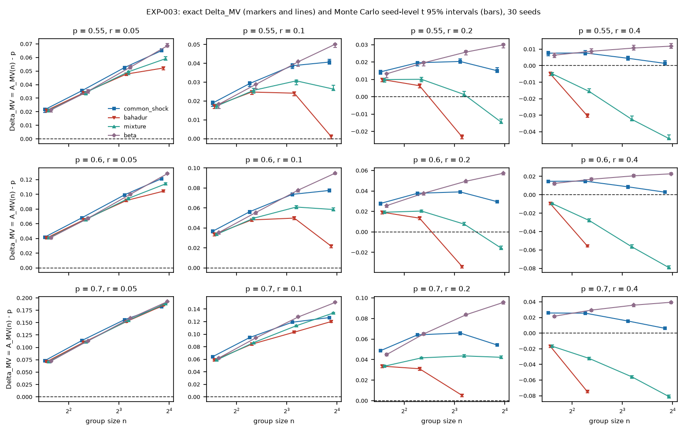

<!-- SPDX-License-Identifier: LicenseRef-PARADOX-NC-Research-1.0 -->
# EXP-003 report: dependence-structure sensitivity

## 1. Identification

| Field | Value |
|---|---|
| Experiment | EXP-003, dependence-structure sensitivity |
| Status | **Confirmatory, complete (183 model cells run, 9 excluded as specified). Verdict: H0 rejected (H1)**: the sign of `Delta_MV` depends on the dependence model in 16 of 48 matched cells |
| Report date | 2026-11-25, written from committed results (owner decision D-013); run 2026-11-24 23:38:29 to 23:39:40 UTC |
| Protocol | `protocol.md` v1.0, frozen 2026-11-24 (owner-approved), SHA-256 `8e59d02e5e5bd317ba1b98d7cb2d0d5506cbb8b30ffb83e5b55104b1c24d3c8b`; main protocol SHA-256 `68ce4b150fc8350b66a2e89d6c9049e241555a05bb7e381243b42a7dd5654de9` |
| Config | `config.json`, canonical SHA-256 `70d5474b2e27cb3ae2314c13e7f8a6c51a79326eca7856e9a43a0a89ea93122c` |
| Provenance revision | `d997cf81784aaf136e385e489febaade7e18e55c` (clean tree); results committed in `84b1d14` |
| Precondition | EXP-001 passed before this run started |
| Author | Mohamed Bechir Kefi (no affiliation). An AI system (Claude, Anthropic) assisted with code, runs and drafting as a research and development assistant; it is not an author. |

## 2. Executive summary

**Question.** At matched marginal competence `p` and matched pairwise correlation of correctness `r`, does the sign of `Delta_MV = A_MV(n) - p` depend on the dependence model?

**Method.** Four models (common-shock, Bahadur second-order, symmetric two-class mixture, Beta difficulty) over `p` in {0.55, 0.6, 0.7}, `r` in {0.05, 0.1, 0.2, 0.4} and `n` in {3, 5, 9, 15}. That gives 48 matched cells and 192 model cells. Each model cell has an exact analytic `Delta_MV`, plus a Monte Carlo check with 30 confirmatory seeds of 20,000 items.

**Outcome.**
- The signs disagree in **16 of 48** matched cells, so H0 is rejected.
- Common-shock and Beta never give a negative `Delta_MV` in the grid (48 of 48 positive each). Bahadur is negative in 8 of 39 admissible cells, and the mixture in 14 of 48.
- Every disagreement occurs at `r >= 0.2`.
- The Bahadur model has no below-chance items. Its degradation meets the condition in protocol section 7 that invalidates the reading "degradation is driven by below-chance item mass".

**Principal caveat.** The verdict rests on exact formulas and is a statement about these four models on this grid. Pairwise correlation does not determine the sign of the majority effect.

## 3. Rationale and literature

A natural reading of EXP-002 is that aggregation degrades when enough items are below chance, and that correlation only shrinks the gain. Kaniovski (2008, Theorem 1, verified) implies that this reading can fail. In the Bahadur model every reasoner has competence `p > 0.5` on every item, yet `p = 0.55, c = 0.4, n = 3` gives 0.54505 < 0.55. This experiment tests how widely the sign of the majority effect depends on the dependence structure at matched first and second moments.

## 4. Hypotheses and operational definitions

- `Delta_MV(model, p, r, n) = A_MV(n) - p`, where `A_MV(n)` is the probability that a strict majority of `n` (odd) votes is correct; unit: proportion.
- **Matching:**
  - common-shock: `lambda = sqrt(r)` with homogeneous `p`;
  - Bahadur: correlation `c = r`;
  - mixture: `(p_easy, h = 0.5, p_hard)` symmetric around `p`, with induced correlation `r`;
  - Beta: `(a, b)` with mean `p` and `1 / (a + b + 1) = r`.
  
  Parameters are recorded per cell in `results.json`.
- **H0:** the sign of `Delta_MV` at matched `(p, r, n)` is the same across the four models in every admissible cell. **H1:** it differs between at least two models in at least one cell.
- **Decision rule (reading D-011, fixed before the run):** signs come from the exact analytic values, which exist for all four models; Monte Carlo intervals check them. Where the Bahadur model is inadmissible, agreement is assessed over the remaining three models, as protocol section 5 states.

## 5. Methodology

- **Code:**
  - `dependence.model_parameters` and `dependence.analytic_mv`;
  - closed forms in `theory.py`: the common-shock formula, Kaniovski Theorem 1, the mixture of binomials and the beta-binomial;
  - `dependence.sample_k` for the Monte Carlo check.
- **Seeds:** `SeedSequence(20261124).spawn(30)`, shared across cells (D-008); 20,000 items per seed.
- **Data:** synthetic only; `data/manifest.json` SHA-256 `b2881ad496e68f02f56027c1e01eeafa3ce62e86d62b7413a9d25781c2a116a0`.
- **Hardware and software** (from `run_manifest.json`): Apple M1 Pro, macOS 15.3.1; Python 3.12.1, numpy 2.5.4. One process at `nice 10`, alongside EXP-002.
- **Statistics:** exact analytic values are reported without intervals; Monte Carlo seed-level t 95% intervals serve as a check.

## 6. Implementation verification

- Test suite at the provenance revision: 321 passed. This includes the Kaniovski golden fixtures and agreement of the Bahadur closed form with enumeration.
- EXP-001 validated the common-shock, mixture and Bahadur samplers against theory (PASS; 292 cells, max abs z 3.116).
- **Monte Carlo check here.** The exact value lies outside the seed-level t 95% interval in 3 of 183 model cells, all Beta (cells listed in `analysis.json`, `mc_check`). By interval position: 160 intervals lie above 0, 22 below 0 and 1 includes 0. The 22 below 0 match the 22 negative exact values (8 Bahadur and 14 mixture).

## 7. Execution record

- **Command:** `scripts/m3_run.sh EXP-003`. It runs `nice -n 10 .venv/bin/paradox run --config research/experiments/EXP-003/config.json --out results/EXP-003 --pdf`, then `python -m paradox.analysis EXP-003 results/EXP-003 --exit-status 0`.
- **Times:** 2026-11-24 23:38:29Z to 23:39:40Z; runtime 70.3 s; peak RSS 226.4 MiB; exit status 0.
- **Run ids:** CELL-0001 to CELL-0192, one row each in `results/EXP-003/provenance.csv`.
- **Excluded (a design property, as protocol section 5 lists):** Bahadur `(r = 0.2, n = 15)` and `(r = 0.4, n` in {9, 15}`)` for each `p`, 9 of 48 Bahadur cells. 0 failed, 0 dropped.
- **Deviations from the frozen protocol:** none. Owner decision D-013 (2026-11-25) authorised writing this report from committed results; it changes no number.

## 8. Results

### 8.1 Sign counts

| Model | Cells | Negative `Delta_MV` | Positive |
|---|---|---|---|
| common-shock | 48 | 0 | 48 |
| Bahadur | 39 (9 excluded) | 8 | 31 |
| two-class mixture | 48 | 14 | 34 |
| Beta difficulty | 48 | 0 | 48 |

### 8.2 Matched cells with disagreement (16 of 48)

Exact `Delta_MV` from the generated table in `results/EXP-003/report.md`:

| p | r | n | Negative models (exact `Delta_MV`) | Positive models |
|---|---|---|---|---|
| 0.55 | 0.2 | 9 | Bahadur -0.02314 | common-shock, mixture, Beta |
| 0.55 | 0.2 | 15 | mixture -0.01461 | common-shock, Beta (Bahadur excluded) |
| 0.55 | 0.4 | 3 | Bahadur -0.00495, mixture -0.00495 | common-shock, Beta |
| 0.55 | 0.4 | 5 | Bahadur -0.03038, mixture -0.01568 | common-shock, Beta |
| 0.55 | 0.4 | 9 | mixture -0.03258 | common-shock, Beta (Bahadur excluded) |
| 0.55 | 0.4 | 15 | mixture -0.04417 | common-shock, Beta (Bahadur excluded) |
| 0.6 | 0.2 | 9 | Bahadur -0.03378 | common-shock, mixture, Beta |
| 0.6 | 0.2 | 15 | mixture -0.01579 | common-shock, Beta (Bahadur excluded) |
| 0.6 | 0.4 | 3 | Bahadur -0.00960, mixture -0.00960 | common-shock, Beta |
| 0.6 | 0.4 | 5 | Bahadur -0.05568, mixture -0.02803 | common-shock, Beta |
| 0.6 | 0.4 | 9 | mixture -0.05667 | common-shock, Beta (Bahadur excluded) |
| 0.6 | 0.4 | 15 | mixture -0.07927 | common-shock, Beta (Bahadur excluded) |
| 0.7 | 0.4 | 3 | Bahadur -0.01680, mixture -0.01680 | common-shock, Beta |
| 0.7 | 0.4 | 5 | Bahadur -0.07476, mixture -0.03242 | common-shock, Beta |
| 0.7 | 0.4 | 9 | mixture -0.05591 | common-shock, Beta (Bahadur excluded) |
| 0.7 | 0.4 | 15 | mixture -0.08109 | common-shock, Beta (Bahadur excluded) |

Signs agree in the other 32 matched cells, including every cell with `r <= 0.1` and every cell with `p = 0.7, r = 0.2`. Exact and Monte Carlo values for all cells are in `results/EXP-003/report.md`, `analysis/analysis.json` and `results.json`.

*Figure FIG-003-1. Exact `Delta_MV = A_MV(n) - p` (proportion) against group size `n` (log2 axis) for four dependence models at matched `p` and `r`. Bars are Monte Carlo seed-level t 95% intervals (30 seeds x 20,000 items), mostly narrower than the markers. Missing Bahadur points are inadmissible cells. Dashed line: no change.*

## 9. Interpretation

**Expected versus observed.** The protocol registered the outcome as genuinely uncertain. The Kaniovski fixture showed that disagreement can occur. Disagreement was observed in 16 of 48 cells, all at `r >= 0.2`.

**Observed.** At the same `p` and the same pairwise correlation, majority voting helps under one dependence model and hurts under another. At `n = 3` the Bahadur and mixture values coincide, yet common-shock and Beta are positive there. A model-based reading is that both models have the same pairwise correlation and no third-order correlation, the mixture because it is symmetric around `p`.

**Against the preferred interpretation.** The protocol states that the reading "MV degrades because of below-chance item mass; correlation alone only shrinks the gain" is invalidated if a homogeneous model without below-chance items (Bahadur) also degrades at matched `p` and `r`.
- It does, in 8 of 39 admissible cells; for example `p = 0.7, r = 0.4, n = 5` gives -0.07476.
- Conversely, the Beta model places probability mass below one half at every tested `p` and `r`, yet it never degrades at `n <= 15`.
- So below-chance mass is neither necessary (Bahadur) nor sufficient at these group sizes (Beta).
- The EXP-002 interpretation must therefore be restricted to the common-shock and two-class mixture families, as the protocol foresaw. Pairwise correlation is not a sufficient summary of dependence for predicting the sign.

**Model-dependent inference.** Dependence beyond pairs (the full distribution of the number of correct votes) determines the outcome. The Bahadur model sets all higher-order correlations to zero, which is a strong assumption, and it is admissible only in part of the grid.

## 10. Threats to validity

- **Construct:** four parametric families only; the symmetric mixture fixes `h = 0.5`; matching is on two moments only, by design.
- **Internal:** the Bahadur model is excluded where inadmissible, so its comparison covers 39 of 48 cells.
- **Statistical:** the verdict uses exact values. The Monte Carlo check shares seeds across cells (D-008).
- **External:** no claim about real reasoner populations; `r` up to 0.4 is a design choice.

## 11. Conclusion and next experiment

Verdict under the frozen rule: **H1**. In this grid, the sign of the majority-vote effect depends on the dependence model at matched marginal competence and pairwise correlation (16 of 48 cells, all at `r >= 0.2`). EXP-002 claims about when aggregation degrades are restricted to the common-shock and mixture models. A follow-up could characterise degradation through the distribution of the vote count rather than through pairwise correlation; it would need a new, separately frozen protocol.

## 12. Reproduction appendix

See [`reproduction.md`](reproduction.md).

- **Raw outputs:** `results/EXP-003/` (`results.json` SHA-256 `072d6cecf45405254949c1b97436c2d6d0461c7176fb93c4bd27413586ca5a78`). Every file is hashed in `results/EXP-003/sha256_manifest.json`.
- **Copies in this folder:** `run_manifest.json`, `metrics.csv`, `figures/`.
- **Records:** claims CLM-008 and CLM-009; journal J-0013.
- **References:** Kaniovski (2008) working paper, verified (full text pp. 1 to 13).
