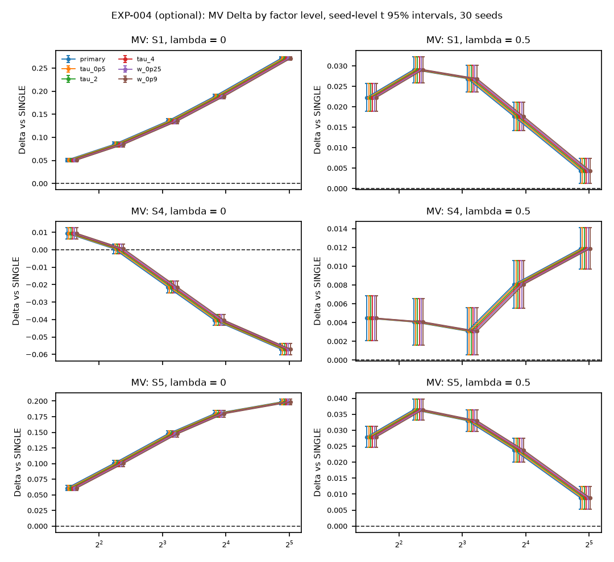
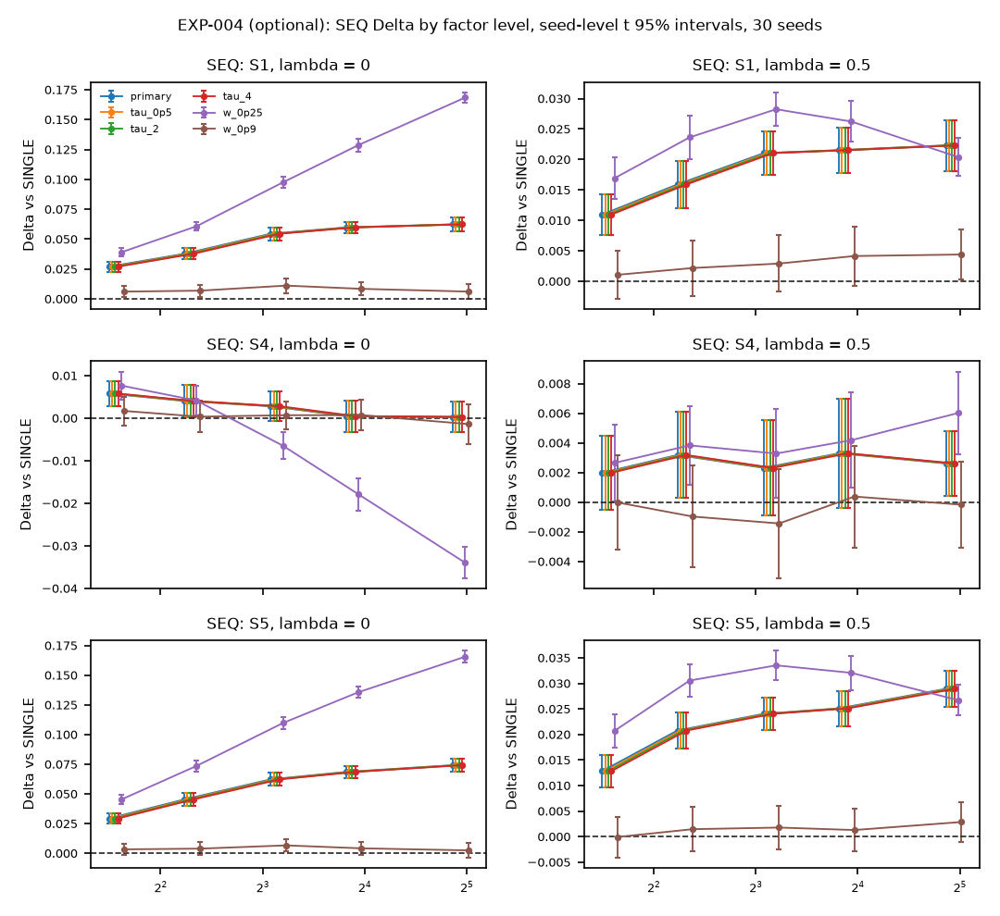
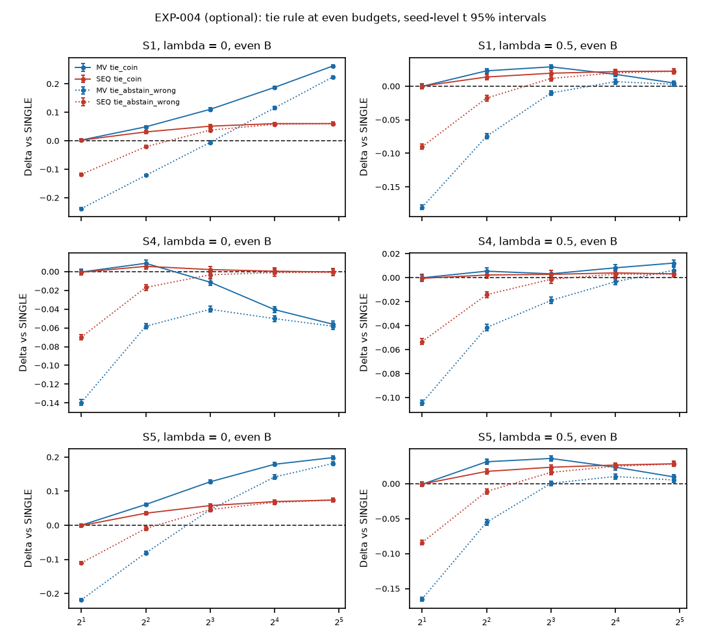

<!-- SPDX-License-Identifier: LicenseRef-PARADOX-NC-Research-1.0 -->
# EXP-004 report: robustness to secondary design choices (optional)

## 1. Identification

| Field | Value |
|---|---|
| Experiment | EXP-004, robustness to secondary design choices. **Optional experiment** (owner decision O-5, amendment 3) |
| Status | **Confirmatory, complete (1440 of 1440 runs, 0 excluded). Verdict: H0 retained**: no factor level reverses the sign of any Holm-significant cell in scope (0 of 18 checks) |
| Report date | 2026-11-25, written from committed results (owner decision D-013); run 2026-11-24 23:39:51 to 23:40:36 UTC |
| Protocol | `protocol.md` v1.0, frozen 2026-11-24 (owner-approved), SHA-256 `55c261f93b3a5549f4f2a36b3eb8a43b80166d3ff91b9aee89807d113303ca02`; main protocol SHA-256 `68ce4b150fc8350b66a2e89d6c9049e241555a05bb7e381243b42a7dd5654de9` |
| Config | `config.json`, canonical SHA-256 `9f7e8cbf704f804170bbded5878e39d594afe418b582592db786be239efb1807` |
| Provenance revision | `d997cf81784aaf136e385e489febaade7e18e55c` (clean tree); results committed in `84b1d14` |
| Precondition | EXP-002 complete before this run started |
| Author | Mohamed Bechir Kefi (no affiliation). An AI system (Claude, Anthropic) assisted with code, runs and drafting as a research and development assistant; it is not an author. |

## 2. Executive summary

**Question.** Are the EXP-002 conclusions robust to the tie rule at even budgets, to counting messages read as cost, to confidence miscalibration (`tau`) and to herding strength (`w`)?

**Method.**
- Eight one-factor variants around the EXP-002 primary setting: `primary`, `tie_coin`, `tie_abstain_wrong`, `tau_0p5`, `tau_2`, `tau_4`, `w_0p25`, `w_0p9`.
- Each variant covers scenarios S1, S4 and S5 x `lambda` in {0, 0.5} x 30 confirmatory seeds of 2000 items, giving 1440 runs.

**Outcome.**
- **No sign reversal: H0 retained.**
- Only 3 Holm-significant EXP-002 cells fall inside EXP-004's scenarios and `lambda` levels: S4, `lambda = 0`, MV at `B` 9, 15 and 31. None changes sign under any `tau` or `w` level.
- For the tie factor, the 3 cells significant under the primary coin rule (S4, `lambda = 0`, MV at `B` 8, 16, 30) also keep their sign when a tie abstains and counts as wrong.
- The `primary` variant reproduces EXP-002 exactly, per seed.
- **Descriptive:** the sign of the mean `Delta` changes in 32 of 360 variant-versus-reference comparisons. Most are under "abstain counted as wrong" at small even budgets.

**Principal caveat.** The check covers 3 of the 32 significant EXP-002 cells. It says nothing about S6, where most EXP-002 degradation lies.

## 3. Rationale and literature

EXP-002 fixes several secondary choices: coin tie-breaking, cost counted as calls, `tau = 1` and `w = 0.5`. A conclusion that depends on them would be fragile. Two parts of the design draw on the literature:

- the herding factor follows the information-sharing literature cited in the EXP-002 report (Golub and Jackson 2010; Mavrodiev et al. 2012; full texts opened at M6 and the cited claims checked);
- the cost factor reflects that real systems pay for reading messages.

## 4. Hypotheses and operational definitions

- **H0:** for every factor level, the sign of `Delta_r` in each EXP-002 cell that was significant (Holm) is unchanged. **H1:** at least one factor level reverses a sign. A reversal is reported as a limitation of EXP-002, not as a new finding.
- **Readings (D-011, fixed before the run):**
  - "Significant (Holm)" cells are EXP-002 primary-family cells with Holm-adjusted p below 0.05. Because the family is one-sided, these are cells with significant degradation.
  - A sign is reversed when the variant's seed-level t 95% interval for the same cell lies above 0.
  - For the tie factor, whose even budgets do not exist in EXP-002, the reference is the primary tie level (`tie_coin`) with its own Holm family. The protocol does not spell this out, so it is an interpretation.
- **Cost accounting:** calls plus messages read. With this cost, budgets are no longer matched, so the results are reported as accuracy against cost (descriptive).
- `tau` affects only the confidences, so only CW and the calibration metrics. MV and SEQ accuracy are therefore identical across the `tau` levels by construction.

## 5. Methodology

- **Config:** one config with eight variants. Each variant overrides one factor; the tie variants use even budgets {2, 4, 8, 16, 30} plus the SINGLE baseline, and rules SINGLE, MV and SEQ. DELIB was dropped (amendment 2).
- **Seeds:** `SeedSequence(20261124).spawn(30)`, shared across cells and with EXP-002 (D-008).
- **Data:** synthetic only; `data/manifest.json` SHA-256 `b2881ad496e68f02f56027c1e01eeafa3ce62e86d62b7413a9d25781c2a116a0`.
- **Hardware and software** (from `run_manifest.json`): Apple M1 Pro, macOS 15.3.1; Python 3.12.1, numpy 2.5.4. One process at `nice 10`, alongside the end of EXP-003.
- **Statistics:** as EXP-002. Seed-level t and bootstrap intervals, with Holm within each variant. Nothing is marked as a primary family.

## 6. Implementation verification

- Test suite at the provenance revision: 321 passed. It includes the `abstain_wrong` tie rule and the variant mechanism (D-010).
- **Consistency check:** the `primary` variant matches EXP-002 per seed in 3420 values, with a maximum absolute difference of 0.0.
- The SEQ message count follows `n(n - 1) / 2`: 3, 10, 36, 105 and 465 messages per item at `B` 3, 5, 9, 15 and 31. This was also checked in the smoke metric validation (J-0009).

## 7. Execution record

- **Command:** `scripts/m3_run.sh EXP-004`. It runs `nice -n 10 .venv/bin/paradox run --config research/experiments/EXP-004/config.json --out results/EXP-004 --pdf`, then `python -m paradox.analysis EXP-004 results/EXP-004 --exit-status 0 --exp002 results/EXP-002`.
- **Times:** 2026-11-24 23:39:51Z to 23:40:36Z; runtime 43.7 s; peak RSS 223.2 MiB; exit status 0.
- **Run ids:** RUN-0001 to RUN-1440, one row each in `results/EXP-004/provenance.csv`.
- **Sample counts:** 1440 runs x 2000 items; 0 excluded, 0 failed, 0 dropped.
- **Storage (D-012):** the results folder totals 22 MB. `results.json` and `metrics.csv` are git-ignored, and their SHA-256 are in `results/EXP-004/sha256_manifest.json`. The analysis, provenance table, run manifest, generated report and figures are committed.
- **Deviations from the frozen protocol:** none. Owner decision D-013 (2026-11-25) authorised writing this report from committed results; it changes no number.

## 8. Results

### 8.1 Frozen-rule checks (18 checks, 0 reversed)

| Factor level | Scenario | lambda | Rule | B | Reference Delta | Variant Delta | t95 low | t95 high | Reversed |
|---|---|---|---|---|---|---|---|---|---|
| tau 0.5, tau 2, tau 4, w 0.25, w 0.9 (each) | S4 | 0 | MV | 9 | -0.0213 | -0.0213 | -0.0246 | -0.0180 | no |
| tau 0.5, tau 2, tau 4, w 0.25, w 0.9 (each) | S4 | 0 | MV | 15 | -0.0403 | -0.0403 | -0.0434 | -0.0372 | no |
| tau 0.5, tau 2, tau 4, w 0.25, w 0.9 (each) | S4 | 0 | MV | 31 | -0.0570 | -0.0570 | -0.0602 | -0.0537 | no |
| tie abstain counted as wrong (reference tie_coin) | S4 | 0 | MV | 8 | -0.0114 | -0.0402 | -0.0433 | -0.0371 | no |
| tie abstain counted as wrong (reference tie_coin) | S4 | 0 | MV | 16 | -0.0406 | -0.0502 | -0.0533 | -0.0470 | no |
| tie abstain counted as wrong (reference tie_coin) | S4 | 0 | MV | 30 | -0.0561 | -0.0582 | -0.0615 | -0.0550 | no |

MV draws do not depend on `tau` or `w`, so the MV rows are identical across those five levels: 15 checks in the first three rows, 3 in the last three. Each check is listed separately in `results/EXP-004/analysis/analysis.md`.

### 8.2 Descriptive sign changes (not part of the frozen rule)

The sign of the mean `Delta` changed in 32 of 360 variant-versus-reference MV and SEQ comparisons (all cells, not only significant ones). All 32 are in `results/EXP-004/analysis/analysis.md`. Selected examples:

| Variant | Scenario | lambda | Rule | B | Reference Delta | Variant Delta | t95 low | t95 high |
|---|---|---|---|---|---|---|---|---|
| tie_abstain_wrong | S1 | 0 | MV | 2 | 0.0025 | -0.2382 | -0.2415 | -0.2349 |
| tie_abstain_wrong | S1 | 0 | MV | 4 | 0.0490 | -0.1216 | -0.1260 | -0.1172 |
| tie_abstain_wrong | S5 | 0 | MV | 2 | 0.0003 | -0.2186 | -0.2219 | -0.2153 |
| tie_abstain_wrong | S4 | 0 | MV | 4 | 0.0088 | -0.0583 | -0.0612 | -0.0553 |
| w_0p25 | S4 | 0 | SEQ | 9 | 0.0028 | -0.0065 | -0.0096 | -0.0033 |
| w_0p25 | S4 | 0 | SEQ | 15 | 0.0005 | -0.0178 | -0.0216 | -0.0141 |
| w_0p25 | S4 | 0 | SEQ | 31 | 0.0003 | -0.0340 | -0.0376 | -0.0303 |
| w_0p9 | S4 | 0 | SEQ | 31 | 0.0003 | -0.0014 | -0.0061 | 0.0034 |

- **Tie rule.** With "abstain counted as wrong", every tied vote is scored as an error, so small even budgets lose heavily. At `B = 2` and `lambda = 0`, MV `Delta` is -0.2382 in S1 and -0.2186 in S5.
- **Herding.** Weaker herding (`w = 0.25`) makes SEQ in S4 at `lambda = 0` degrade, with intervals below 0 at `B` 9, 15 and 31. Stronger herding (`w = 0.9`) leaves SEQ near 0 there (interval includes 0 at `B = 31`).

### 8.3 Cost accounting (descriptive; primary variant)

| Scenario | lambda | Rule | Calls | Messages per item | Calls + messages | Accuracy |
|---|---|---|---|---|---|---|
| S1 | 0 | MV | 31 | 0.0 | 31.0 | 0.8704 |
| S1 | 0 | SEQ | 3 | 3.0 | 6.0 | 0.6267 |
| S1 | 0 | SEQ | 9 | 36.0 | 45.0 | 0.6542 |
| S1 | 0 | SEQ | 31 | 465.0 | 496.0 | 0.6621 |
| S4 | 0 | MV | 31 | 0.0 | 31.0 | 0.6076 |
| S4 | 0 | SEQ | 31 | 465.0 | 496.0 | 0.6648 |

When messages count as cost, SEQ at 31 calls costs 496 units against 31 for MV. In S1 at `lambda = 0`, it is also less accurate than MV at 31 calls (0.6621 against 0.8704). The full table is in `results/EXP-004/analysis/analysis.md`.

### 8.4 Figures

*Figure FIG-004-1. MV `Delta` versus SINGLE (proportion) against calls per item (log2 axis), for the primary, `tau` and `w` levels; seed-level t 95% intervals, 30 seeds of 2000 items. MV curves coincide across these levels by construction.*

*Figure FIG-004-2. SEQ `Delta` versus SINGLE (proportion) against calls per item (log2 axis), by factor level; seed-level t 95% intervals, 30 seeds of 2000 items.*

*Figure FIG-004-3. `Delta` versus SINGLE at even budgets under the two tie rules, MV and SEQ; seed-level t 95% intervals, 30 seeds of 2000 items. The generated figure `figures/accuracy_vs_budget.png` shows absolute accuracy with seed-range bands.*

## 9. Interpretation

**Expected versus observed.**
- **Expected under H0:** no reversal in the significant cells. **Observed:** no reversal (0 of 18).
- The check is narrow. Only 3 of the 32 significant EXP-002 cells lie in EXP-004's scope, and MV, the rule they concern, is unaffected by `tau` and `w` by construction.
- In practice, then, the test is informative for the tie rule only. There, scoring ties as errors makes the S4 degradation larger, not smaller.
- The H0 retention is not evidence that EXP-002 conclusions are robust in general, and nonsignificance is not equivalence.

**Herding.** The `w` levels are consistent with the P2 result of EXP-002: weaker herding moves SEQ towards MV, including MV's degradation in S4. This is descriptive and outside the frozen rule.

**Cost.** Counting messages makes SEQ far more expensive than MV at equal calls (descriptive).

## 10. Threats to validity

- **Construct:** one-factor-at-a-time variation only, with no interactions; three scenarios and two `lambda` levels.
- **Internal:** the small reference set (3 EXP-002 cells plus 3 tie reference cells). The tie-factor reference is an interpretation (D-011). Shared seeds with EXP-002 make the comparisons paired but not independent.
- **Statistical:** reversal is judged with unadjusted t 95% intervals.
- **External:** as EXP-002.

## 11. Conclusion and next experiment

Verdict under the frozen rule: **H0 retained**. No factor level reversed the sign of a Holm-significant cell in scope. The scope covers S4 only, not S6. The descriptive results show that the tie rule and herding strength materially change outcomes in cells that were not significant in EXP-002. A robustness check covering S6 would need a new, separately frozen protocol.

## 12. Reproduction appendix

See [`reproduction.md`](reproduction.md).

- **Raw outputs:** `results/EXP-004/`. `results.json` (SHA-256 `68638fd8c4d010547dd00d524e4c582495b262b0758327992d4d5a3a6c5a9114`) and `metrics.csv` are git-ignored. Every file is hashed in `results/EXP-004/sha256_manifest.json`.
- **Copies in this folder:** `run_manifest.json`, `figures/`. `metrics.csv` is not copied, because it is part of the git-ignored raw output.
- **Records:** claim CLM-010; journal J-0014.
