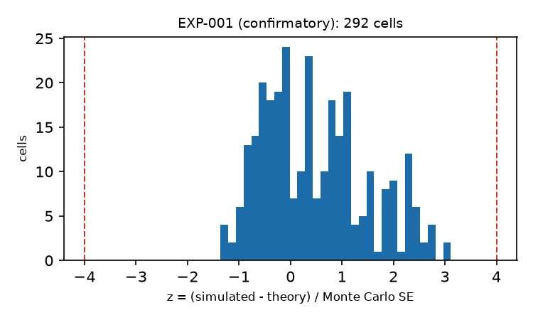

<!-- SPDX-License-Identifier: LicenseRef-PARADOX-NC-Research-1.0 -->
# EXP-001 validation report (confirmatory)

> Confirmatory run under a frozen protocol.

- Experiment id: `EXP-001`; label: **confirmatory**; kind: `validation`
- Result schema: 1.0.0; config SHA-256: `ec431b20bff323bb1c6e8461d721c25909e3522c839f03e0cc212775ec906709`
- Code revision: `d997cf81784aaf136e385e489febaade7e18e55c`; created (UTC): 2026-11-24T23:38:15Z
- Seeds (30): 4081218282, 3682024014, 2560712631, 3921651552, 4191974640, 2901837982, 299243026, 3584341964, 470840663, 3717419112, 3863015920, 3690208844, 1878958287, 3674753195, 4225516169, 4016339100, 387561879, 1274279766, 33776825, 3913718065, 952162785, 2664475064, 4515682, 1003833796, 885547622, 471843871, 3973450909, 3063446374, 3560773735, 1515114762
- Claims boundary: Synthetic reasoners, not LLMs or people. Values hold only within the stated simulation model. Exploratory results are not findings and do not test any preregistered hypothesis.

Every number below is generated by `paradox report` from `results.json` in this folder; none is typed by hand.

## Deterministic checks and overall verdict

| Check | Expected | Got | Pass |
|---|---|---|---|
| golden bahadur_mv(3, 0.55, 0.4) | 0.54505 | 0.5450500000 | True |
| golden bahadur_mv(5, 0.55, 0.4) | 0.5196194 | 0.5196193750 | True |
| golden condorcet(3, 0.55) | 0.57475 | 0.5747500000 | True |
| golden condorcet(5, 0.55) | 0.5931269 | 0.5931268750 | True |

Monte Carlo cells run: 292; excluded (inadmissible): 20; failing the 4.0 SE tolerance: 0; max |z| = 3.116.

## Cells

| Cell | Model | Parameters | n | Simulated | Theory | z | Pass |
|---|---|---|---|---|---|---|---|
| CELL-0001 | independent | lambda=0.0, p=0.45 | 1 | 0.44994 | 0.45000 | -0.09 | True |
| CELL-0002 | independent | lambda=0.0, p=0.45 | 3 | 0.42496 | 0.42525 | -0.46 | True |
| CELL-0003 | independent | lambda=0.0, p=0.45 | 5 | 0.40727 | 0.40687 | 0.63 | True |
| CELL-0004 | independent | lambda=0.0, p=0.45 | 9 | 0.37815 | 0.37858 | -0.68 | True |
| CELL-0005 | independent | lambda=0.0, p=0.45 | 15 | 0.34621 | 0.34650 | -0.46 | True |
| CELL-0006 | independent | lambda=0.0, p=0.45 | 31 | 0.28674 | 0.28682 | -0.14 | True |
| CELL-0007 | common_shock | lambda=0.25, p=0.45 | 1 | 0.45036 | 0.45000 | 0.56 | True |
| CELL-0008 | common_shock | lambda=0.25, p=0.45 | 3 | 0.42933 | 0.42912 | 0.34 | True |
| CELL-0009 | common_shock | lambda=0.25, p=0.45 | 5 | 0.41695 | 0.41618 | 1.20 | True |
| CELL-0010 | common_shock | lambda=0.25, p=0.45 | 9 | 0.40223 | 0.40128 | 1.51 | True |
| CELL-0011 | common_shock | lambda=0.25, p=0.45 | 15 | 0.39268 | 0.39210 | 0.91 | True |
| CELL-0012 | common_shock | lambda=0.25, p=0.45 | 31 | 0.39484 | 0.39420 | 1.02 | True |
| CELL-0013 | common_shock | lambda=0.5, p=0.45 | 1 | 0.45071 | 0.45000 | 1.11 | True |
| CELL-0014 | common_shock | lambda=0.5, p=0.45 | 3 | 0.43817 | 0.43763 | 0.86 | True |
| CELL-0015 | common_shock | lambda=0.5, p=0.45 | 5 | 0.43541 | 0.43418 | 1.93 | True |
| CELL-0016 | common_shock | lambda=0.5, p=0.45 | 9 | 0.43663 | 0.43560 | 1.62 | True |
| CELL-0017 | common_shock | lambda=0.5, p=0.45 | 15 | 0.44190 | 0.44125 | 1.03 | True |
| CELL-0018 | common_shock | lambda=0.5, p=0.45 | 31 | 0.44927 | 0.44850 | 1.20 | True |
| CELL-0019 | common_shock | lambda=0.75, p=0.45 | 1 | 0.45034 | 0.45000 | 0.54 | True |
| CELL-0020 | common_shock | lambda=0.75, p=0.45 | 3 | 0.44644 | 0.44613 | 0.48 | True |
| CELL-0021 | common_shock | lambda=0.75, p=0.45 | 5 | 0.44788 | 0.44715 | 1.14 | True |
| CELL-0022 | common_shock | lambda=0.75, p=0.45 | 9 | 0.44980 | 0.44913 | 1.04 | True |
| CELL-0023 | common_shock | lambda=0.75, p=0.45 | 15 | 0.45058 | 0.44989 | 1.06 | True |
| CELL-0024 | common_shock | lambda=0.75, p=0.45 | 31 | 0.45070 | 0.45000 | 1.09 | True |
| CELL-0025 | perfect_correlation | lambda=1.0, p=0.45 | 1 | 0.45070 | 0.45000 | 1.09 | True |
| CELL-0026 | perfect_correlation | lambda=1.0, p=0.45 | 3 | 0.45070 | 0.45000 | 1.09 | True |
| CELL-0027 | perfect_correlation | lambda=1.0, p=0.45 | 5 | 0.45070 | 0.45000 | 1.09 | True |
| CELL-0028 | perfect_correlation | lambda=1.0, p=0.45 | 9 | 0.45070 | 0.45000 | 1.09 | True |
| CELL-0029 | perfect_correlation | lambda=1.0, p=0.45 | 15 | 0.45070 | 0.45000 | 1.09 | True |
| CELL-0030 | perfect_correlation | lambda=1.0, p=0.45 | 31 | 0.45070 | 0.45000 | 1.09 | True |
| CELL-0031 | independent | lambda=0.0, p=0.5 | 1 | 0.50039 | 0.50000 | 0.60 | True |
| CELL-0032 | independent | lambda=0.0, p=0.5 | 3 | 0.50057 | 0.50000 | 0.88 | True |
| CELL-0033 | independent | lambda=0.0, p=0.5 | 5 | 0.50103 | 0.50000 | 1.60 | True |
| CELL-0034 | independent | lambda=0.0, p=0.5 | 9 | 0.50011 | 0.50000 | 0.17 | True |
| CELL-0035 | independent | lambda=0.0, p=0.5 | 15 | 0.49989 | 0.50000 | -0.17 | True |
| CELL-0036 | independent | lambda=0.0, p=0.5 | 31 | 0.49928 | 0.50000 | -1.12 | True |
| CELL-0037 | common_shock | lambda=0.25, p=0.5 | 1 | 0.50081 | 0.50000 | 1.26 | True |
| CELL-0038 | common_shock | lambda=0.25, p=0.5 | 3 | 0.50110 | 0.50000 | 1.70 | True |
| CELL-0039 | common_shock | lambda=0.25, p=0.5 | 5 | 0.50151 | 0.50000 | 2.34 | True |
| CELL-0040 | common_shock | lambda=0.25, p=0.5 | 9 | 0.50097 | 0.50000 | 1.51 | True |
| CELL-0041 | common_shock | lambda=0.25, p=0.5 | 15 | 0.50068 | 0.50000 | 1.06 | True |
| CELL-0042 | common_shock | lambda=0.25, p=0.5 | 31 | 0.50027 | 0.50000 | 0.42 | True |
| CELL-0043 | common_shock | lambda=0.5, p=0.5 | 1 | 0.50068 | 0.50000 | 1.06 | True |
| CELL-0044 | common_shock | lambda=0.5, p=0.5 | 3 | 0.50075 | 0.50000 | 1.16 | True |
| CELL-0045 | common_shock | lambda=0.5, p=0.5 | 5 | 0.50126 | 0.50000 | 1.94 | True |
| CELL-0046 | common_shock | lambda=0.5, p=0.5 | 9 | 0.50076 | 0.50000 | 1.17 | True |
| CELL-0047 | common_shock | lambda=0.5, p=0.5 | 15 | 0.50060 | 0.50000 | 0.93 | True |
| CELL-0048 | common_shock | lambda=0.5, p=0.5 | 31 | 0.50050 | 0.50000 | 0.78 | True |
| CELL-0049 | common_shock | lambda=0.75, p=0.5 | 1 | 0.50046 | 0.50000 | 0.72 | True |
| CELL-0050 | common_shock | lambda=0.75, p=0.5 | 3 | 0.50026 | 0.50000 | 0.40 | True |
| CELL-0051 | common_shock | lambda=0.75, p=0.5 | 5 | 0.50066 | 0.50000 | 1.02 | True |
| CELL-0052 | common_shock | lambda=0.75, p=0.5 | 9 | 0.50047 | 0.50000 | 0.73 | True |
| CELL-0053 | common_shock | lambda=0.75, p=0.5 | 15 | 0.50055 | 0.50000 | 0.85 | True |
| CELL-0054 | common_shock | lambda=0.75, p=0.5 | 31 | 0.50056 | 0.50000 | 0.86 | True |
| CELL-0055 | perfect_correlation | lambda=1.0, p=0.5 | 1 | 0.50056 | 0.50000 | 0.86 | True |
| CELL-0056 | perfect_correlation | lambda=1.0, p=0.5 | 3 | 0.50056 | 0.50000 | 0.86 | True |
| CELL-0057 | perfect_correlation | lambda=1.0, p=0.5 | 5 | 0.50056 | 0.50000 | 0.86 | True |
| CELL-0058 | perfect_correlation | lambda=1.0, p=0.5 | 9 | 0.50056 | 0.50000 | 0.86 | True |
| CELL-0059 | perfect_correlation | lambda=1.0, p=0.5 | 15 | 0.50056 | 0.50000 | 0.86 | True |
| CELL-0060 | perfect_correlation | lambda=1.0, p=0.5 | 31 | 0.50056 | 0.50000 | 0.86 | True |
| CELL-0061 | independent | lambda=0.0, p=0.55 | 1 | 0.55044 | 0.55000 | 0.68 | True |
| CELL-0062 | independent | lambda=0.0, p=0.55 | 3 | 0.57520 | 0.57475 | 0.70 | True |
| CELL-0063 | independent | lambda=0.0, p=0.55 | 5 | 0.59431 | 0.59313 | 1.86 | True |
| CELL-0064 | independent | lambda=0.0, p=0.55 | 9 | 0.62108 | 0.62142 | -0.54 | True |
| CELL-0065 | independent | lambda=0.0, p=0.55 | 15 | 0.65295 | 0.65350 | -0.90 | True |
| CELL-0066 | independent | lambda=0.0, p=0.55 | 31 | 0.71271 | 0.71318 | -0.80 | True |
| CELL-0067 | common_shock | lambda=0.25, p=0.55 | 1 | 0.55060 | 0.55000 | 0.93 | True |
| CELL-0068 | common_shock | lambda=0.25, p=0.55 | 3 | 0.57231 | 0.57088 | 2.24 | True |
| CELL-0069 | common_shock | lambda=0.25, p=0.55 | 5 | 0.58557 | 0.58382 | 2.75 | True |
| CELL-0070 | common_shock | lambda=0.25, p=0.55 | 9 | 0.59966 | 0.59872 | 1.49 | True |
| CELL-0071 | common_shock | lambda=0.25, p=0.55 | 15 | 0.60810 | 0.60790 | 0.32 | True |
| CELL-0072 | common_shock | lambda=0.25, p=0.55 | 31 | 0.60603 | 0.60580 | 0.37 | True |
| CELL-0073 | common_shock | lambda=0.5, p=0.55 | 1 | 0.55014 | 0.55000 | 0.22 | True |
| CELL-0074 | common_shock | lambda=0.5, p=0.55 | 3 | 0.56292 | 0.56238 | 0.86 | True |
| CELL-0075 | common_shock | lambda=0.5, p=0.55 | 5 | 0.56678 | 0.56582 | 1.50 | True |
| CELL-0076 | common_shock | lambda=0.5, p=0.55 | 9 | 0.56490 | 0.56440 | 0.78 | True |
| CELL-0077 | common_shock | lambda=0.5, p=0.55 | 15 | 0.55907 | 0.55875 | 0.49 | True |
| CELL-0078 | common_shock | lambda=0.5, p=0.55 | 31 | 0.55175 | 0.55150 | 0.40 | True |
| CELL-0079 | common_shock | lambda=0.75, p=0.55 | 1 | 0.54987 | 0.55000 | -0.21 | True |
| CELL-0080 | common_shock | lambda=0.75, p=0.55 | 3 | 0.55387 | 0.55387 | 0.00 | True |
| CELL-0081 | common_shock | lambda=0.75, p=0.55 | 5 | 0.55302 | 0.55285 | 0.26 | True |
| CELL-0082 | common_shock | lambda=0.75, p=0.55 | 9 | 0.55105 | 0.55087 | 0.27 | True |
| CELL-0083 | common_shock | lambda=0.75, p=0.55 | 15 | 0.55036 | 0.55011 | 0.39 | True |
| CELL-0084 | common_shock | lambda=0.75, p=0.55 | 31 | 0.55026 | 0.55000 | 0.40 | True |
| CELL-0085 | perfect_correlation | lambda=1.0, p=0.55 | 1 | 0.55026 | 0.55000 | 0.40 | True |
| CELL-0086 | perfect_correlation | lambda=1.0, p=0.55 | 3 | 0.55026 | 0.55000 | 0.40 | True |
| CELL-0087 | perfect_correlation | lambda=1.0, p=0.55 | 5 | 0.55026 | 0.55000 | 0.40 | True |
| CELL-0088 | perfect_correlation | lambda=1.0, p=0.55 | 9 | 0.55026 | 0.55000 | 0.40 | True |
| CELL-0089 | perfect_correlation | lambda=1.0, p=0.55 | 15 | 0.55026 | 0.55000 | 0.40 | True |
| CELL-0090 | perfect_correlation | lambda=1.0, p=0.55 | 31 | 0.55026 | 0.55000 | 0.40 | True |
| CELL-0091 | independent | lambda=0.0, p=0.6 | 1 | 0.59989 | 0.60000 | -0.17 | True |
| CELL-0092 | independent | lambda=0.0, p=0.6 | 3 | 0.64836 | 0.64800 | 0.59 | True |
| CELL-0093 | independent | lambda=0.0, p=0.6 | 5 | 0.68390 | 0.68256 | 2.22 | True |
| CELL-0094 | independent | lambda=0.0, p=0.6 | 9 | 0.73378 | 0.73343 | 0.61 | True |
| CELL-0095 | independent | lambda=0.0, p=0.6 | 15 | 0.78670 | 0.78690 | -0.37 | True |
| CELL-0096 | independent | lambda=0.0, p=0.6 | 31 | 0.87103 | 0.87162 | -1.36 | True |
| CELL-0097 | common_shock | lambda=0.25, p=0.6 | 1 | 0.60008 | 0.60000 | 0.13 | True |
| CELL-0098 | common_shock | lambda=0.25, p=0.6 | 3 | 0.64175 | 0.64050 | 2.01 | True |
| CELL-0099 | common_shock | lambda=0.25, p=0.6 | 5 | 0.66614 | 0.66490 | 2.04 | True |
| CELL-0100 | common_shock | lambda=0.25, p=0.6 | 9 | 0.69177 | 0.69215 | -0.63 | True |
| CELL-0101 | common_shock | lambda=0.25, p=0.6 | 15 | 0.70879 | 0.70859 | 0.33 | True |
| CELL-0102 | common_shock | lambda=0.25, p=0.6 | 31 | 0.70874 | 0.70900 | -0.45 | True |
| CELL-0103 | common_shock | lambda=0.5, p=0.6 | 1 | 0.59969 | 0.60000 | -0.49 | True |
| CELL-0104 | common_shock | lambda=0.5, p=0.6 | 3 | 0.62382 | 0.62400 | -0.28 | True |
| CELL-0105 | common_shock | lambda=0.5, p=0.6 | 5 | 0.63055 | 0.63048 | 0.11 | True |
| CELL-0106 | common_shock | lambda=0.5, p=0.6 | 9 | 0.62755 | 0.62777 | -0.36 | True |
| CELL-0107 | common_shock | lambda=0.5, p=0.6 | 15 | 0.61720 | 0.61746 | -0.42 | True |
| CELL-0108 | common_shock | lambda=0.5, p=0.6 | 31 | 0.60361 | 0.60376 | -0.24 | True |
| CELL-0109 | common_shock | lambda=0.75, p=0.6 | 1 | 0.59942 | 0.60000 | -0.92 | True |
| CELL-0110 | common_shock | lambda=0.75, p=0.6 | 3 | 0.60695 | 0.60750 | -0.88 | True |
| CELL-0111 | common_shock | lambda=0.75, p=0.6 | 5 | 0.60517 | 0.60551 | -0.54 | True |
| CELL-0112 | common_shock | lambda=0.75, p=0.6 | 9 | 0.60140 | 0.60172 | -0.50 | True |
| CELL-0113 | common_shock | lambda=0.75, p=0.6 | 15 | 0.59995 | 0.60022 | -0.43 | True |
| CELL-0114 | common_shock | lambda=0.75, p=0.6 | 31 | 0.59975 | 0.60000 | -0.40 | True |
| CELL-0115 | perfect_correlation | lambda=1.0, p=0.6 | 1 | 0.59975 | 0.60000 | -0.40 | True |
| CELL-0116 | perfect_correlation | lambda=1.0, p=0.6 | 3 | 0.59975 | 0.60000 | -0.40 | True |
| CELL-0117 | perfect_correlation | lambda=1.0, p=0.6 | 5 | 0.59975 | 0.60000 | -0.40 | True |
| CELL-0118 | perfect_correlation | lambda=1.0, p=0.6 | 9 | 0.59975 | 0.60000 | -0.40 | True |
| CELL-0119 | perfect_correlation | lambda=1.0, p=0.6 | 15 | 0.59975 | 0.60000 | -0.40 | True |
| CELL-0120 | perfect_correlation | lambda=1.0, p=0.6 | 31 | 0.59975 | 0.60000 | -0.40 | True |
| CELL-0121 | independent | lambda=0.0, p=0.8 | 1 | 0.79961 | 0.80000 | -0.75 | True |
| CELL-0122 | independent | lambda=0.0, p=0.8 | 3 | 0.89636 | 0.89600 | 0.92 | True |
| CELL-0123 | independent | lambda=0.0, p=0.8 | 5 | 0.94298 | 0.94208 | 2.97 | True |
| CELL-0124 | independent | lambda=0.0, p=0.8 | 9 | 0.98050 | 0.98042 | 0.45 | True |
| CELL-0125 | independent | lambda=0.0, p=0.8 | 15 | 0.99580 | 0.99576 | 0.49 | True |
| CELL-0126 | independent | lambda=0.0, p=0.8 | 31 | 0.99991 | 0.99991 | -0.56 | True |
| CELL-0127 | common_shock | lambda=0.25, p=0.8 | 1 | 0.80001 | 0.80000 | 0.02 | True |
| CELL-0128 | common_shock | lambda=0.25, p=0.8 | 3 | 0.88137 | 0.88100 | 0.89 | True |
| CELL-0129 | common_shock | lambda=0.25, p=0.8 | 5 | 0.91557 | 0.91522 | 0.96 | True |
| CELL-0130 | common_shock | lambda=0.25, p=0.8 | 9 | 0.94188 | 0.94218 | -1.02 | True |
| CELL-0131 | common_shock | lambda=0.25, p=0.8 | 15 | 0.95671 | 0.95689 | -0.69 | True |
| CELL-0132 | common_shock | lambda=0.25, p=0.8 | 31 | 0.97449 | 0.97432 | 0.81 | True |
| CELL-0133 | common_shock | lambda=0.5, p=0.8 | 1 | 0.79981 | 0.80000 | -0.37 | True |
| CELL-0134 | common_shock | lambda=0.5, p=0.8 | 3 | 0.84787 | 0.84800 | -0.29 | True |
| CELL-0135 | common_shock | lambda=0.5, p=0.8 | 5 | 0.85664 | 0.85664 | 0.00 | True |
| CELL-0136 | common_shock | lambda=0.5, p=0.8 | 9 | 0.85251 | 0.85260 | -0.19 | True |
| CELL-0137 | common_shock | lambda=0.5, p=0.8 | 15 | 0.84230 | 0.84259 | -0.62 | True |
| CELL-0138 | common_shock | lambda=0.5, p=0.8 | 31 | 0.82521 | 0.82568 | -0.95 | True |
| CELL-0139 | common_shock | lambda=0.75, p=0.8 | 1 | 0.79937 | 0.80000 | -1.21 | True |
| CELL-0140 | common_shock | lambda=0.75, p=0.8 | 3 | 0.81476 | 0.81500 | -0.49 | True |
| CELL-0141 | common_shock | lambda=0.75, p=0.8 | 5 | 0.81028 | 0.81066 | -0.75 | True |
| CELL-0142 | common_shock | lambda=0.75, p=0.8 | 9 | 0.80326 | 0.80389 | -1.23 | True |
| CELL-0143 | common_shock | lambda=0.75, p=0.8 | 15 | 0.80037 | 0.80085 | -0.93 | True |
| CELL-0144 | common_shock | lambda=0.75, p=0.8 | 31 | 0.79956 | 0.80002 | -0.89 | True |
| CELL-0145 | perfect_correlation | lambda=1.0, p=0.8 | 1 | 0.79954 | 0.80000 | -0.90 | True |
| CELL-0146 | perfect_correlation | lambda=1.0, p=0.8 | 3 | 0.79954 | 0.80000 | -0.90 | True |
| CELL-0147 | perfect_correlation | lambda=1.0, p=0.8 | 5 | 0.79954 | 0.80000 | -0.90 | True |
| CELL-0148 | perfect_correlation | lambda=1.0, p=0.8 | 9 | 0.79954 | 0.80000 | -0.90 | True |
| CELL-0149 | perfect_correlation | lambda=1.0, p=0.8 | 15 | 0.79954 | 0.80000 | -0.90 | True |
| CELL-0150 | perfect_correlation | lambda=1.0, p=0.8 | 31 | 0.79954 | 0.80000 | -0.90 | True |
| CELL-0151 | mixture | h=0.4, lambda=0.0, p_easy=0.9, p_hard=0.3, scenario=S4 | 1 | 0.65994 | 0.66000 | -0.10 | True |
| CELL-0152 | mixture | h=0.4, lambda=0.0, p_easy=0.9, p_hard=0.3, scenario=S4 | 3 | 0.67031 | 0.66960 | 1.16 | True |
| CELL-0153 | mixture | h=0.4, lambda=0.0, p_easy=0.9, p_hard=0.3, scenario=S4 | 5 | 0.66122 | 0.66010 | 1.84 | True |
| CELL-0154 | mixture | h=0.4, lambda=0.0, p_easy=0.9, p_hard=0.3, scenario=S4 | 9 | 0.64038 | 0.63899 | 2.24 | True |
| CELL-0155 | mixture | h=0.4, lambda=0.0, p_easy=0.9, p_hard=0.3, scenario=S4 | 15 | 0.62064 | 0.61998 | 1.05 | True |
| CELL-0156 | mixture | h=0.4, lambda=0.0, p_easy=0.9, p_hard=0.3, scenario=S4 | 31 | 0.60445 | 0.60382 | 1.00 | True |
| CELL-0157 | mixture | h=0.4, lambda=0.25, p_easy=0.9, p_hard=0.3, scenario=S4 | 1 | 0.66019 | 0.66000 | 0.32 | True |
| CELL-0158 | mixture | h=0.4, lambda=0.25, p_easy=0.9, p_hard=0.3, scenario=S4 | 3 | 0.66855 | 0.66810 | 0.75 | True |
| CELL-0159 | mixture | h=0.4, lambda=0.25, p_easy=0.9, p_hard=0.3, scenario=S4 | 5 | 0.66331 | 0.66259 | 1.18 | True |
| CELL-0160 | mixture | h=0.4, lambda=0.25, p_easy=0.9, p_hard=0.3, scenario=S4 | 9 | 0.65468 | 0.65352 | 1.88 | True |
| CELL-0161 | mixture | h=0.4, lambda=0.25, p_easy=0.9, p_hard=0.3, scenario=S4 | 15 | 0.64974 | 0.64852 | 1.98 | True |
| CELL-0162 | mixture | h=0.4, lambda=0.25, p_easy=0.9, p_hard=0.3, scenario=S4 | 31 | 0.64641 | 0.64556 | 1.37 | True |
| CELL-0163 | mixture | h=0.4, lambda=0.5, p_easy=0.9, p_hard=0.3, scenario=S4 | 1 | 0.66061 | 0.66000 | 1.00 | True |
| CELL-0164 | mixture | h=0.4, lambda=0.5, p_easy=0.9, p_hard=0.3, scenario=S4 | 3 | 0.66571 | 0.66480 | 1.49 | True |
| CELL-0165 | mixture | h=0.4, lambda=0.5, p_easy=0.9, p_hard=0.3, scenario=S4 | 5 | 0.66445 | 0.66302 | 2.35 | True |
| CELL-0166 | mixture | h=0.4, lambda=0.5, p_easy=0.9, p_hard=0.3, scenario=S4 | 9 | 0.66489 | 0.66367 | 2.00 | True |
| CELL-0167 | mixture | h=0.4, lambda=0.5, p_easy=0.9, p_hard=0.3, scenario=S4 | 15 | 0.66850 | 0.66737 | 1.85 | True |
| CELL-0168 | mixture | h=0.4, lambda=0.5, p_easy=0.9, p_hard=0.3, scenario=S4 | 31 | 0.67325 | 0.67213 | 1.86 | True |
| CELL-0169 | mixture | h=0.4, lambda=0.75, p_easy=0.9, p_hard=0.3, scenario=S4 | 1 | 0.66078 | 0.66000 | 1.28 | True |
| CELL-0170 | mixture | h=0.4, lambda=0.75, p_easy=0.9, p_hard=0.3, scenario=S4 | 3 | 0.66266 | 0.66150 | 1.90 | True |
| CELL-0171 | mixture | h=0.4, lambda=0.75, p_easy=0.9, p_hard=0.3, scenario=S4 | 5 | 0.66225 | 0.66085 | 2.30 | True |
| CELL-0172 | mixture | h=0.4, lambda=0.75, p_easy=0.9, p_hard=0.3, scenario=S4 | 9 | 0.66187 | 0.66065 | 1.98 | True |
| CELL-0173 | mixture | h=0.4, lambda=0.75, p_easy=0.9, p_hard=0.3, scenario=S4 | 15 | 0.66151 | 0.66033 | 1.93 | True |
| CELL-0174 | mixture | h=0.4, lambda=0.75, p_easy=0.9, p_hard=0.3, scenario=S4 | 31 | 0.66121 | 0.66002 | 1.94 | True |
| CELL-0175 | mixture | h=0.2, lambda=0.0, p_easy=0.7, p_hard=0.45, scenario=S5 | 1 | 0.65041 | 0.65000 | 0.67 | True |
| CELL-0176 | mixture | h=0.2, lambda=0.0, p_easy=0.7, p_hard=0.45, scenario=S5 | 3 | 0.71249 | 0.71225 | 0.42 | True |
| CELL-0177 | mixture | h=0.2, lambda=0.0, p_easy=0.7, p_hard=0.45, scenario=S5 | 5 | 0.75181 | 0.75091 | 1.61 | True |
| CELL-0178 | mixture | h=0.2, lambda=0.0, p_easy=0.7, p_hard=0.45, scenario=S5 | 9 | 0.79766 | 0.79667 | 1.91 | True |
| CELL-0179 | mixture | h=0.2, lambda=0.0, p_easy=0.7, p_hard=0.45, scenario=S5 | 15 | 0.82936 | 0.82929 | 0.14 | True |
| CELL-0180 | mixture | h=0.2, lambda=0.0, p_easy=0.7, p_hard=0.45, scenario=S5 | 31 | 0.84987 | 0.84973 | 0.31 | True |
| CELL-0181 | mixture | h=0.2, lambda=0.25, p_easy=0.7, p_hard=0.45, scenario=S5 | 1 | 0.65087 | 0.65000 | 1.42 | True |
| CELL-0182 | mixture | h=0.2, lambda=0.25, p_easy=0.7, p_hard=0.45, scenario=S5 | 3 | 0.70385 | 0.70252 | 2.24 | True |
| CELL-0183 | mixture | h=0.2, lambda=0.25, p_easy=0.7, p_hard=0.45, scenario=S5 | 5 | 0.73152 | 0.73027 | 2.18 | True |
| CELL-0184 | mixture | h=0.2, lambda=0.25, p_easy=0.7, p_hard=0.45, scenario=S5 | 9 | 0.75758 | 0.75707 | 0.92 | True |
| CELL-0185 | mixture | h=0.2, lambda=0.25, p_easy=0.7, p_hard=0.45, scenario=S5 | 15 | 0.77260 | 0.77211 | 0.91 | True |
| CELL-0186 | mixture | h=0.2, lambda=0.25, p_easy=0.7, p_hard=0.45, scenario=S5 | 31 | 0.78554 | 0.78517 | 0.71 | True |
| CELL-0187 | mixture | h=0.2, lambda=0.5, p_easy=0.7, p_hard=0.45, scenario=S5 | 1 | 0.65061 | 0.65000 | 0.99 | True |
| CELL-0188 | mixture | h=0.2, lambda=0.5, p_easy=0.7, p_hard=0.45, scenario=S5 | 3 | 0.68121 | 0.68112 | 0.14 | True |
| CELL-0189 | mixture | h=0.2, lambda=0.5, p_easy=0.7, p_hard=0.45, scenario=S5 | 5 | 0.68882 | 0.68837 | 0.75 | True |
| CELL-0190 | mixture | h=0.2, lambda=0.5, p_easy=0.7, p_hard=0.45, scenario=S5 | 9 | 0.68538 | 0.68518 | 0.34 | True |
| CELL-0191 | mixture | h=0.2, lambda=0.5, p_easy=0.7, p_hard=0.45, scenario=S5 | 15 | 0.67532 | 0.67508 | 0.40 | True |
| CELL-0192 | mixture | h=0.2, lambda=0.5, p_easy=0.7, p_hard=0.45, scenario=S5 | 31 | 0.66022 | 0.65987 | 0.58 | True |
| CELL-0193 | mixture | h=0.2, lambda=0.75, p_easy=0.7, p_hard=0.45, scenario=S5 | 1 | 0.65016 | 0.65000 | 0.27 | True |
| CELL-0194 | mixture | h=0.2, lambda=0.75, p_easy=0.7, p_hard=0.45, scenario=S5 | 3 | 0.65985 | 0.65973 | 0.20 | True |
| CELL-0195 | mixture | h=0.2, lambda=0.75, p_easy=0.7, p_hard=0.45, scenario=S5 | 5 | 0.65752 | 0.65705 | 0.77 | True |
| CELL-0196 | mixture | h=0.2, lambda=0.75, p_easy=0.7, p_hard=0.45, scenario=S5 | 9 | 0.65254 | 0.65235 | 0.31 | True |
| CELL-0197 | mixture | h=0.2, lambda=0.75, p_easy=0.7, p_hard=0.45, scenario=S5 | 15 | 0.65061 | 0.65040 | 0.35 | True |
| CELL-0198 | mixture | h=0.2, lambda=0.75, p_easy=0.7, p_hard=0.45, scenario=S5 | 31 | 0.65024 | 0.65000 | 0.38 | True |
| CELL-0199 | mixture | h=0.5, lambda=0.0, p_easy=0.95, p_hard=0.35, scenario=S6 | 1 | 0.65058 | 0.65000 | 0.94 | True |
| CELL-0200 | mixture | h=0.5, lambda=0.0, p_easy=0.95, p_hard=0.35, scenario=S6 | 3 | 0.63811 | 0.63725 | 1.39 | True |
| CELL-0201 | mixture | h=0.5, lambda=0.0, p_easy=0.95, p_hard=0.35, scenario=S6 | 5 | 0.61865 | 0.61701 | 2.61 | True |
| CELL-0202 | mixture | h=0.5, lambda=0.0, p_easy=0.95, p_hard=0.35, scenario=S6 | 9 | 0.58755 | 0.58584 | 2.69 | True |
| CELL-0203 | mixture | h=0.5, lambda=0.0, p_easy=0.95, p_hard=0.35, scenario=S6 | 15 | 0.55763 | 0.55662 | 1.58 | True |
| CELL-0204 | mixture | h=0.5, lambda=0.0, p_easy=0.95, p_hard=0.35, scenario=S6 | 31 | 0.52212 | 0.52119 | 1.44 | True |
| CELL-0205 | mixture | h=0.5, lambda=0.25, p_easy=0.95, p_hard=0.35, scenario=S6 | 1 | 0.65086 | 0.65000 | 1.39 | True |
| CELL-0206 | mixture | h=0.5, lambda=0.25, p_easy=0.95, p_hard=0.35, scenario=S6 | 3 | 0.64018 | 0.63924 | 1.50 | True |
| CELL-0207 | mixture | h=0.5, lambda=0.25, p_easy=0.95, p_hard=0.35, scenario=S6 | 5 | 0.62724 | 0.62576 | 2.38 | True |
| CELL-0208 | mixture | h=0.5, lambda=0.25, p_easy=0.95, p_hard=0.35, scenario=S6 | 9 | 0.61172 | 0.61005 | 2.65 | True |
| CELL-0209 | mixture | h=0.5, lambda=0.25, p_easy=0.95, p_hard=0.35, scenario=S6 | 15 | 0.60268 | 0.60091 | 2.80 | True |
| CELL-0210 | mixture | h=0.5, lambda=0.25, p_easy=0.95, p_hard=0.35, scenario=S6 | 31 | 0.59939 | 0.59785 | 2.44 | True |
| CELL-0211 | mixture | h=0.5, lambda=0.5, p_easy=0.95, p_hard=0.35, scenario=S6 | 1 | 0.65138 | 0.65000 | 2.24 | True |
| CELL-0212 | mixture | h=0.5, lambda=0.5, p_easy=0.95, p_hard=0.35, scenario=S6 | 3 | 0.64517 | 0.64363 | 2.50 | True |
| CELL-0213 | mixture | h=0.5, lambda=0.5, p_easy=0.95, p_hard=0.35, scenario=S6 | 5 | 0.64176 | 0.63983 | 3.12 | True |
| CELL-0214 | mixture | h=0.5, lambda=0.5, p_easy=0.95, p_hard=0.35, scenario=S6 | 9 | 0.64309 | 0.64140 | 2.74 | True |
| CELL-0215 | mixture | h=0.5, lambda=0.5, p_easy=0.95, p_hard=0.35, scenario=S6 | 15 | 0.64909 | 0.64760 | 2.41 | True |
| CELL-0216 | mixture | h=0.5, lambda=0.5, p_easy=0.95, p_hard=0.35, scenario=S6 | 31 | 0.65744 | 0.65603 | 2.30 | True |
| CELL-0217 | mixture | h=0.5, lambda=0.75, p_easy=0.95, p_hard=0.35, scenario=S6 | 1 | 0.65114 | 0.65000 | 1.84 | True |
| CELL-0218 | mixture | h=0.5, lambda=0.75, p_easy=0.95, p_hard=0.35, scenario=S6 | 3 | 0.64950 | 0.64801 | 2.43 | True |
| CELL-0219 | mixture | h=0.5, lambda=0.75, p_easy=0.95, p_hard=0.35, scenario=S6 | 5 | 0.64980 | 0.64836 | 2.33 | True |
| CELL-0220 | mixture | h=0.5, lambda=0.75, p_easy=0.95, p_hard=0.35, scenario=S6 | 9 | 0.65127 | 0.64975 | 2.47 | True |
| CELL-0221 | mixture | h=0.5, lambda=0.75, p_easy=0.95, p_hard=0.35, scenario=S6 | 15 | 0.65155 | 0.65013 | 2.30 | True |
| CELL-0222 | mixture | h=0.5, lambda=0.75, p_easy=0.95, p_hard=0.35, scenario=S6 | 31 | 0.65145 | 0.65002 | 2.32 | True |
| CELL-0223 | bahadur | c=0.0, p=0.45 | 1 | 0.44964 | 0.45000 | -0.56 | True |
| CELL-0224 | bahadur | c=0.0, p=0.45 | 3 | 0.42511 | 0.42525 | -0.21 | True |
| CELL-0225 | bahadur | c=0.0, p=0.45 | 5 | 0.40693 | 0.40687 | 0.09 | True |
| CELL-0226 | bahadur | c=0.0, p=0.45 | 9 | 0.37868 | 0.37858 | 0.16 | True |
| CELL-0227 | bahadur | c=0.0, p=0.45 | 15 | 0.34616 | 0.34650 | -0.55 | True |
| CELL-0228 | bahadur | c=0.0, p=0.45 | 31 | 0.28667 | 0.28682 | -0.26 | True |
| CELL-0229 | bahadur | c=0.1, p=0.45 | 1 | 0.44964 | 0.45000 | -0.56 | True |
| CELL-0230 | bahadur | c=0.1, p=0.45 | 3 | 0.43250 | 0.43268 | -0.27 | True |
| CELL-0231 | bahadur | c=0.1, p=0.45 | 5 | 0.42511 | 0.42525 | -0.21 | True |
| CELL-0232 | bahadur | c=0.1, p=0.45 | 9 | 0.42570 | 0.42586 | -0.25 | True |
| CELL-0233 | bahadur | c=0.1, p=0.45 | 15 | 0.44871 | 0.44900 | -0.45 | True |
| CELL-0234 | bahadur | c=0.1, p=0.45 | 31 | excluded | inadmissible Bahadur cell (negative profile probability) | | |
| CELL-0235 | bahadur | c=0.4, p=0.45 | 1 | 0.44964 | 0.45000 | -0.56 | True |
| CELL-0236 | bahadur | c=0.4, p=0.45 | 3 | 0.45455 | 0.45495 | -0.61 | True |
| CELL-0237 | bahadur | c=0.4, p=0.45 | 5 | 0.48009 | 0.48038 | -0.45 | True |
| CELL-0238 | bahadur | c=0.4, p=0.45 | 9 | excluded | inadmissible Bahadur cell (negative profile probability) | | |
| CELL-0239 | bahadur | c=0.4, p=0.45 | 15 | excluded | inadmissible Bahadur cell (negative profile probability) | | |
| CELL-0240 | bahadur | c=0.4, p=0.45 | 31 | excluded | inadmissible Bahadur cell (negative profile probability) | | |
| CELL-0241 | bahadur | c=0.0, p=0.5 | 1 | 0.49989 | 0.50000 | -0.17 | True |
| CELL-0242 | bahadur | c=0.0, p=0.5 | 3 | 0.49989 | 0.50000 | -0.17 | True |
| CELL-0243 | bahadur | c=0.0, p=0.5 | 5 | 0.49989 | 0.50000 | -0.17 | True |
| CELL-0244 | bahadur | c=0.0, p=0.5 | 9 | 0.49989 | 0.50000 | -0.17 | True |
| CELL-0245 | bahadur | c=0.0, p=0.5 | 15 | 0.49989 | 0.50000 | -0.17 | True |
| CELL-0246 | bahadur | c=0.0, p=0.5 | 31 | 0.49989 | 0.50000 | -0.17 | True |
| CELL-0247 | bahadur | c=0.1, p=0.5 | 1 | 0.49989 | 0.50000 | -0.17 | True |
| CELL-0248 | bahadur | c=0.1, p=0.5 | 3 | 0.49989 | 0.50000 | -0.17 | True |
| CELL-0249 | bahadur | c=0.1, p=0.5 | 5 | 0.49989 | 0.50000 | -0.17 | True |
| CELL-0250 | bahadur | c=0.1, p=0.5 | 9 | 0.49989 | 0.50000 | -0.17 | True |
| CELL-0251 | bahadur | c=0.1, p=0.5 | 15 | 0.49989 | 0.50000 | -0.17 | True |
| CELL-0252 | bahadur | c=0.1, p=0.5 | 31 | excluded | inadmissible Bahadur cell (negative profile probability) | | |
| CELL-0253 | bahadur | c=0.4, p=0.5 | 1 | 0.49989 | 0.50000 | -0.17 | True |
| CELL-0254 | bahadur | c=0.4, p=0.5 | 3 | 0.49989 | 0.50000 | -0.17 | True |
| CELL-0255 | bahadur | c=0.4, p=0.5 | 5 | 0.49989 | 0.50000 | -0.17 | True |
| CELL-0256 | bahadur | c=0.4, p=0.5 | 9 | excluded | inadmissible Bahadur cell (negative profile probability) | | |
| CELL-0257 | bahadur | c=0.4, p=0.5 | 15 | excluded | inadmissible Bahadur cell (negative profile probability) | | |
| CELL-0258 | bahadur | c=0.4, p=0.5 | 31 | excluded | inadmissible Bahadur cell (negative profile probability) | | |
| CELL-0259 | bahadur | c=0.0, p=0.55 | 1 | 0.54998 | 0.55000 | -0.02 | True |
| CELL-0260 | bahadur | c=0.0, p=0.55 | 3 | 0.57440 | 0.57475 | -0.55 | True |
| CELL-0261 | bahadur | c=0.0, p=0.55 | 5 | 0.59293 | 0.59313 | -0.31 | True |
| CELL-0262 | bahadur | c=0.0, p=0.55 | 9 | 0.62104 | 0.62142 | -0.61 | True |
| CELL-0263 | bahadur | c=0.0, p=0.55 | 15 | 0.65315 | 0.65350 | -0.57 | True |
| CELL-0264 | bahadur | c=0.0, p=0.55 | 31 | 0.71283 | 0.71318 | -0.59 | True |
| CELL-0265 | bahadur | c=0.1, p=0.55 | 1 | 0.54998 | 0.55000 | -0.02 | True |
| CELL-0266 | bahadur | c=0.1, p=0.55 | 3 | 0.56703 | 0.56733 | -0.46 | True |
| CELL-0267 | bahadur | c=0.1, p=0.55 | 5 | 0.57440 | 0.57475 | -0.55 | True |
| CELL-0268 | bahadur | c=0.1, p=0.55 | 9 | 0.57380 | 0.57414 | -0.53 | True |
| CELL-0269 | bahadur | c=0.1, p=0.55 | 15 | 0.55096 | 0.55100 | -0.06 | True |
| CELL-0270 | bahadur | c=0.1, p=0.55 | 31 | excluded | inadmissible Bahadur cell (negative profile probability) | | |
| CELL-0271 | bahadur | c=0.4, p=0.55 | 1 | 0.54998 | 0.55000 | -0.02 | True |
| CELL-0272 | bahadur | c=0.4, p=0.55 | 3 | 0.54496 | 0.54505 | -0.14 | True |
| CELL-0273 | bahadur | c=0.4, p=0.55 | 5 | 0.51975 | 0.51962 | 0.20 | True |
| CELL-0274 | bahadur | c=0.4, p=0.55 | 9 | excluded | inadmissible Bahadur cell (negative profile probability) | | |
| CELL-0275 | bahadur | c=0.4, p=0.55 | 15 | excluded | inadmissible Bahadur cell (negative profile probability) | | |
| CELL-0276 | bahadur | c=0.4, p=0.55 | 31 | excluded | inadmissible Bahadur cell (negative profile probability) | | |
| CELL-0277 | bahadur | c=0.0, p=0.6 | 1 | 0.59988 | 0.60000 | -0.19 | True |
| CELL-0278 | bahadur | c=0.0, p=0.6 | 3 | 0.64763 | 0.64800 | -0.61 | True |
| CELL-0279 | bahadur | c=0.0, p=0.6 | 5 | 0.68213 | 0.68256 | -0.72 | True |
| CELL-0280 | bahadur | c=0.0, p=0.6 | 9 | 0.73284 | 0.73343 | -1.03 | True |
| CELL-0281 | bahadur | c=0.0, p=0.6 | 15 | 0.78635 | 0.78690 | -1.04 | True |
| CELL-0282 | bahadur | c=0.0, p=0.6 | 31 | 0.87146 | 0.87162 | -0.37 | True |
| CELL-0283 | bahadur | c=0.1, p=0.6 | 1 | 0.59988 | 0.60000 | -0.19 | True |
| CELL-0284 | bahadur | c=0.1, p=0.6 | 3 | 0.63306 | 0.63360 | -0.87 | True |
| CELL-0285 | bahadur | c=0.1, p=0.6 | 5 | 0.64763 | 0.64800 | -0.61 | True |
| CELL-0286 | bahadur | c=0.1, p=0.6 | 9 | 0.64953 | 0.64982 | -0.49 | True |
| CELL-0287 | bahadur | c=0.1, p=0.6 | 15 | 0.62120 | 0.62162 | -0.67 | True |
| CELL-0288 | bahadur | c=0.1, p=0.6 | 31 | excluded | inadmissible Bahadur cell (negative profile probability) | | |
| CELL-0289 | bahadur | c=0.4, p=0.6 | 1 | 0.59988 | 0.60000 | -0.19 | True |
| CELL-0290 | bahadur | c=0.4, p=0.6 | 3 | 0.59021 | 0.59040 | -0.30 | True |
| CELL-0291 | bahadur | c=0.4, p=0.6 | 5 | 0.54423 | 0.54432 | -0.13 | True |
| CELL-0292 | bahadur | c=0.4, p=0.6 | 9 | excluded | inadmissible Bahadur cell (negative profile probability) | | |
| CELL-0293 | bahadur | c=0.4, p=0.6 | 15 | excluded | inadmissible Bahadur cell (negative profile probability) | | |
| CELL-0294 | bahadur | c=0.4, p=0.6 | 31 | excluded | inadmissible Bahadur cell (negative profile probability) | | |
| CELL-0295 | bahadur | c=0.0, p=0.8 | 1 | 0.79966 | 0.80000 | -0.65 | True |
| CELL-0296 | bahadur | c=0.0, p=0.8 | 3 | 0.89591 | 0.89600 | -0.23 | True |
| CELL-0297 | bahadur | c=0.0, p=0.8 | 5 | 0.94184 | 0.94208 | -0.81 | True |
| CELL-0298 | bahadur | c=0.0, p=0.8 | 9 | 0.98022 | 0.98042 | -1.13 | True |
| CELL-0299 | bahadur | c=0.0, p=0.8 | 15 | 0.99577 | 0.99576 | 0.06 | True |
| CELL-0300 | bahadur | c=0.0, p=0.8 | 31 | 0.99992 | 0.99991 | 0.81 | True |
| CELL-0301 | bahadur | c=0.1, p=0.8 | 1 | 0.79966 | 0.80000 | -0.65 | True |
| CELL-0302 | bahadur | c=0.1, p=0.8 | 3 | 0.86692 | 0.86720 | -0.65 | True |
| CELL-0303 | bahadur | c=0.1, p=0.8 | 5 | 0.89591 | 0.89600 | -0.23 | True |
| CELL-0304 | bahadur | c=0.1, p=0.8 | 9 | 0.93069 | 0.93087 | -0.55 | True |
| CELL-0305 | bahadur | c=0.1, p=0.8 | 15 | 0.96674 | 0.96674 | -0.02 | True |
| CELL-0306 | bahadur | c=0.1, p=0.8 | 31 | excluded | inadmissible Bahadur cell (negative profile probability) | | |
| CELL-0307 | bahadur | c=0.4, p=0.8 | 1 | 0.79966 | 0.80000 | -0.65 | True |
| CELL-0308 | bahadur | c=0.4, p=0.8 | 3 | 0.78032 | 0.78080 | -0.90 | True |
| CELL-0309 | bahadur | c=0.4, p=0.8 | 5 | 0.75703 | 0.75776 | -1.32 | True |
| CELL-0310 | bahadur | c=0.4, p=0.8 | 9 | excluded | inadmissible Bahadur cell (negative profile probability) | | |
| CELL-0311 | bahadur | c=0.4, p=0.8 | 15 | excluded | inadmissible Bahadur cell (negative profile probability) | | |
| CELL-0312 | bahadur | c=0.4, p=0.8 | 31 | excluded | inadmissible Bahadur cell (negative profile probability) | | |

*Figure 1. Standardised deviation z per validation cell. Cells share seeds across n, so they are not independent.*
