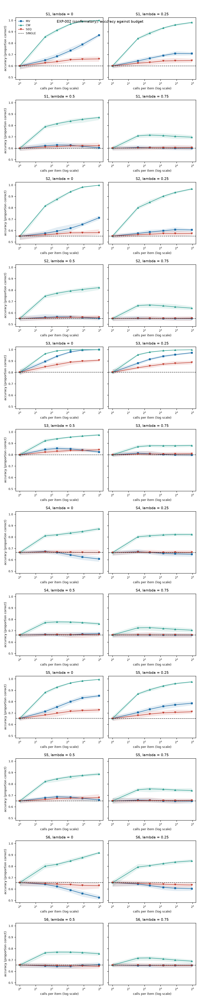

<!-- SPDX-License-Identifier: LicenseRef-PARADOX-NC-Research-1.0 -->
# EXP-002 aggregation report (confirmatory)

> Confirmatory run under a frozen protocol.

- Experiment id: `EXP-002`; label: **confirmatory**; kind: `aggregation`
- Result schema: 1.0.0; config SHA-256: `a69b5eb8cedca9e14027b68fde479fbfaf2d1b25ddb6ead6c5cf66360f89ae2b`
- Code revision: `d997cf81784aaf136e385e489febaade7e18e55c`; created (UTC): 2026-11-24T23:38:54Z
- Seeds (30): 4081218282, 3682024014, 2560712631, 3921651552, 4191974640, 2901837982, 299243026, 3584341964, 470840663, 3717419112, 3863015920, 3690208844, 1878958287, 3674753195, 4225516169, 4016339100, 387561879, 1274279766, 33776825, 3913718065, 952162785, 2664475064, 4515682, 1003833796, 885547622, 471843871, 3973450909, 3063446374, 3560773735, 1515114762
- Claims boundary: Synthetic reasoners, not LLMs or people. Values hold only within the stated simulation model. Exploratory results are not findings and do not test any preregistered hypothesis.

Every number below is generated by `paradox report` from `results.json` in this folder; none is typed by hand.

## Run records

720 runs (2000 items each); 0 excluded by invariant checks.

## Accuracy and paired difference from SINGLE

Delta is the mean per-item paired difference in correctness against SINGLE (reasoner 1, one call) of the same run. SD is the between-seed standard deviation of the per-run Delta; the interval is the seed-level t 95% interval. `theory` is the closed-form MV accuracy (odd budgets only).

| Scenario | lambda | Rule | Calls | Accuracy | theory | Delta | SD(Delta) | t95 low | t95 high | seeds |
|---|---|---|---|---|---|---|---|---|---|---|
| S1 | 0 | SINGLE | 1 | 0.5997 | 0.6000 | 0.0000 | 0.0000 | 0.0000 | 0.0000 | 30 |
| S1 | 0 | MV | 1 | 0.5997 | 0.6000 | 0.0000 | 0.0000 | 0.0000 | 0.0000 | 30 |
| S1 | 0 | MV | 3 | 0.6506 | 0.6480 | 0.0509 | 0.0104 | 0.0470 | 0.0548 | 30 |
| S1 | 0 | MV | 5 | 0.6843 | 0.6826 | 0.0846 | 0.0132 | 0.0796 | 0.0895 | 30 |
| S1 | 0 | MV | 9 | 0.7348 | 0.7334 | 0.1351 | 0.0137 | 0.1300 | 0.1403 | 30 |
| S1 | 0 | MV | 15 | 0.7882 | 0.7869 | 0.1885 | 0.0145 | 0.1831 | 0.1940 | 30 |
| S1 | 0 | MV | 31 | 0.8704 | 0.8716 | 0.2708 | 0.0112 | 0.2666 | 0.2749 | 30 |
| S1 | 0 | CW | 1 | 0.5997 |  | 0.0000 | 0.0000 | 0.0000 | 0.0000 | 30 |
| S1 | 0 | CW | 3 | 0.8560 |  | 0.2563 | 0.0105 | 0.2524 | 0.2602 | 30 |
| S1 | 0 | CW | 5 | 0.9138 |  | 0.3141 | 0.0110 | 0.3100 | 0.3182 | 30 |
| S1 | 0 | CW | 9 | 0.9687 |  | 0.3690 | 0.0111 | 0.3649 | 0.3732 | 30 |
| S1 | 0 | CW | 15 | 0.9925 |  | 0.3929 | 0.0101 | 0.3891 | 0.3967 | 30 |
| S1 | 0 | CW | 31 | 0.9998 |  | 0.4001 | 0.0100 | 0.3964 | 0.4038 | 30 |
| S1 | 0 | SEQ | 1 | 0.5997 |  | 0.0000 | 0.0000 | 0.0000 | 0.0000 | 30 |
| S1 | 0 | SEQ | 3 | 0.6267 |  | 0.0270 | 0.0112 | 0.0228 | 0.0312 | 30 |
| S1 | 0 | SEQ | 5 | 0.6374 |  | 0.0377 | 0.0122 | 0.0332 | 0.0423 | 30 |
| S1 | 0 | SEQ | 9 | 0.6542 |  | 0.0546 | 0.0146 | 0.0491 | 0.0600 | 30 |
| S1 | 0 | SEQ | 15 | 0.6595 |  | 0.0598 | 0.0125 | 0.0552 | 0.0645 | 30 |
| S1 | 0 | SEQ | 31 | 0.6621 |  | 0.0624 | 0.0151 | 0.0567 | 0.0680 | 30 |
| S1 | 0.25 | SINGLE | 1 | 0.6006 | 0.6000 | 0.0000 | 0.0000 | 0.0000 | 0.0000 | 30 |
| S1 | 0.25 | MV | 1 | 0.6006 | 0.6000 | 0.0000 | 0.0000 | 0.0000 | 0.0000 | 30 |
| S1 | 0.25 | MV | 3 | 0.6445 | 0.6405 | 0.0439 | 0.0089 | 0.0405 | 0.0472 | 30 |
| S1 | 0.25 | MV | 5 | 0.6673 | 0.6649 | 0.0667 | 0.0111 | 0.0625 | 0.0708 | 30 |
| S1 | 0.25 | MV | 9 | 0.6920 | 0.6921 | 0.0914 | 0.0111 | 0.0873 | 0.0955 | 30 |
| S1 | 0.25 | MV | 15 | 0.7096 | 0.7086 | 0.1090 | 0.0109 | 0.1049 | 0.1130 | 30 |
| S1 | 0.25 | MV | 31 | 0.7087 | 0.7090 | 0.1081 | 0.0115 | 0.1038 | 0.1124 | 30 |
| S1 | 0.25 | CW | 1 | 0.6006 |  | 0.0000 | 0.0000 | 0.0000 | 0.0000 | 30 |
| S1 | 0.25 | CW | 3 | 0.8409 |  | 0.2403 | 0.0103 | 0.2364 | 0.2441 | 30 |
| S1 | 0.25 | CW | 5 | 0.8880 |  | 0.2874 | 0.0114 | 0.2832 | 0.2917 | 30 |
| S1 | 0.25 | CW | 9 | 0.9342 |  | 0.3336 | 0.0112 | 0.3294 | 0.3378 | 30 |
| S1 | 0.25 | CW | 15 | 0.9607 |  | 0.3601 | 0.0101 | 0.3563 | 0.3638 | 30 |
| S1 | 0.25 | CW | 31 | 0.9825 |  | 0.3819 | 0.0111 | 0.3777 | 0.3860 | 30 |
| S1 | 0.25 | SEQ | 1 | 0.6006 |  | 0.0000 | 0.0000 | 0.0000 | 0.0000 | 30 |
| S1 | 0.25 | SEQ | 3 | 0.6244 |  | 0.0238 | 0.0099 | 0.0200 | 0.0275 | 30 |
| S1 | 0.25 | SEQ | 5 | 0.6317 |  | 0.0311 | 0.0128 | 0.0263 | 0.0358 | 30 |
| S1 | 0.25 | SEQ | 9 | 0.6439 |  | 0.0433 | 0.0147 | 0.0378 | 0.0488 | 30 |
| S1 | 0.25 | SEQ | 15 | 0.6460 |  | 0.0454 | 0.0119 | 0.0410 | 0.0499 | 30 |
| S1 | 0.25 | SEQ | 31 | 0.6474 |  | 0.0468 | 0.0109 | 0.0428 | 0.0509 | 30 |
| S1 | 0.5 | SINGLE | 1 | 0.5997 | 0.6000 | 0.0000 | 0.0000 | 0.0000 | 0.0000 | 30 |
| S1 | 0.5 | MV | 1 | 0.5997 | 0.6000 | 0.0000 | 0.0000 | 0.0000 | 0.0000 | 30 |
| S1 | 0.5 | MV | 3 | 0.6220 | 0.6240 | 0.0223 | 0.0091 | 0.0189 | 0.0257 | 30 |
| S1 | 0.5 | MV | 5 | 0.6288 | 0.6305 | 0.0291 | 0.0085 | 0.0259 | 0.0323 | 30 |
| S1 | 0.5 | MV | 9 | 0.6266 | 0.6278 | 0.0269 | 0.0089 | 0.0236 | 0.0302 | 30 |
| S1 | 0.5 | MV | 15 | 0.6173 | 0.6175 | 0.0176 | 0.0093 | 0.0141 | 0.0211 | 30 |
| S1 | 0.5 | MV | 31 | 0.6040 | 0.6038 | 0.0043 | 0.0083 | 0.0012 | 0.0074 | 30 |
| S1 | 0.5 | CW | 1 | 0.5997 |  | 0.0000 | 0.0000 | 0.0000 | 0.0000 | 30 |
| S1 | 0.5 | CW | 3 | 0.7893 |  | 0.1896 | 0.0085 | 0.1865 | 0.1928 | 30 |
| S1 | 0.5 | CW | 5 | 0.8165 |  | 0.2168 | 0.0098 | 0.2131 | 0.2205 | 30 |
| S1 | 0.5 | CW | 9 | 0.8387 |  | 0.2390 | 0.0100 | 0.2353 | 0.2427 | 30 |
| S1 | 0.5 | CW | 15 | 0.8543 |  | 0.2545 | 0.0110 | 0.2504 | 0.2587 | 30 |
| S1 | 0.5 | CW | 31 | 0.8705 |  | 0.2708 | 0.0104 | 0.2669 | 0.2747 | 30 |
| S1 | 0.5 | SEQ | 1 | 0.5997 |  | 0.0000 | 0.0000 | 0.0000 | 0.0000 | 30 |
| S1 | 0.5 | SEQ | 3 | 0.6107 |  | 0.0110 | 0.0091 | 0.0076 | 0.0143 | 30 |
| S1 | 0.5 | SEQ | 5 | 0.6156 |  | 0.0159 | 0.0104 | 0.0120 | 0.0198 | 30 |
| S1 | 0.5 | SEQ | 9 | 0.6208 |  | 0.0211 | 0.0096 | 0.0175 | 0.0246 | 30 |
| S1 | 0.5 | SEQ | 15 | 0.6213 |  | 0.0215 | 0.0099 | 0.0178 | 0.0252 | 30 |
| S1 | 0.5 | SEQ | 31 | 0.6220 |  | 0.0223 | 0.0112 | 0.0181 | 0.0265 | 30 |
| S1 | 0.75 | SINGLE | 1 | 0.6006 | 0.6000 | 0.0000 | 0.0000 | 0.0000 | 0.0000 | 30 |
| S1 | 0.75 | MV | 1 | 0.6006 | 0.6000 | 0.0000 | 0.0000 | 0.0000 | 0.0000 | 30 |
| S1 | 0.75 | MV | 3 | 0.6068 | 0.6075 | 0.0062 | 0.0067 | 0.0037 | 0.0087 | 30 |
| S1 | 0.75 | MV | 5 | 0.6051 | 0.6055 | 0.0045 | 0.0073 | 0.0017 | 0.0072 | 30 |
| S1 | 0.75 | MV | 9 | 0.6018 | 0.6017 | 0.0012 | 0.0077 | -0.0016 | 0.0041 | 30 |
| S1 | 0.75 | MV | 15 | 0.6005 | 0.6002 | -0.0001 | 0.0076 | -0.0030 | 0.0027 | 30 |
| S1 | 0.75 | MV | 31 | 0.6001 | 0.6000 | -0.0005 | 0.0075 | -0.0033 | 0.0024 | 30 |
| S1 | 0.75 | CW | 1 | 0.6006 |  | 0.0000 | 0.0000 | 0.0000 | 0.0000 | 30 |
| S1 | 0.75 | CW | 3 | 0.7093 |  | 0.1087 | 0.0060 | 0.1065 | 0.1110 | 30 |
| S1 | 0.75 | CW | 5 | 0.7160 |  | 0.1154 | 0.0095 | 0.1118 | 0.1190 | 30 |
| S1 | 0.75 | CW | 9 | 0.7115 |  | 0.1109 | 0.0079 | 0.1079 | 0.1139 | 30 |
| S1 | 0.75 | CW | 15 | 0.7044 |  | 0.1038 | 0.0087 | 0.1006 | 0.1071 | 30 |
| S1 | 0.75 | CW | 31 | 0.6974 |  | 0.0969 | 0.0083 | 0.0937 | 0.1000 | 30 |
| S1 | 0.75 | SEQ | 1 | 0.6006 |  | 0.0000 | 0.0000 | 0.0000 | 0.0000 | 30 |
| S1 | 0.75 | SEQ | 3 | 0.6031 |  | 0.0026 | 0.0085 | -0.0006 | 0.0057 | 30 |
| S1 | 0.75 | SEQ | 5 | 0.6043 |  | 0.0037 | 0.0083 | 0.0006 | 0.0068 | 30 |
| S1 | 0.75 | SEQ | 9 | 0.6042 |  | 0.0036 | 0.0081 | 0.0006 | 0.0066 | 30 |
| S1 | 0.75 | SEQ | 15 | 0.6042 |  | 0.0036 | 0.0077 | 0.0007 | 0.0064 | 30 |
| S1 | 0.75 | SEQ | 31 | 0.6058 |  | 0.0052 | 0.0076 | 0.0024 | 0.0081 | 30 |
| S2 | 0 | SINGLE | 1 | 0.5509 | 0.5500 | 0.0000 | 0.0000 | 0.0000 | 0.0000 | 30 |
| S2 | 0 | MV | 1 | 0.5509 | 0.5500 | 0.0000 | 0.0000 | 0.0000 | 0.0000 | 30 |
| S2 | 0 | MV | 3 | 0.5760 | 0.5748 | 0.0251 | 0.0116 | 0.0208 | 0.0295 | 30 |
| S2 | 0 | MV | 5 | 0.5949 | 0.5931 | 0.0440 | 0.0151 | 0.0384 | 0.0497 | 30 |
| S2 | 0 | MV | 9 | 0.6207 | 0.6214 | 0.0698 | 0.0143 | 0.0645 | 0.0752 | 30 |
| S2 | 0 | MV | 15 | 0.6539 | 0.6535 | 0.1031 | 0.0135 | 0.0980 | 0.1081 | 30 |
| S2 | 0 | MV | 31 | 0.7129 | 0.7132 | 0.1620 | 0.0139 | 0.1568 | 0.1672 | 30 |
| S2 | 0 | CW | 1 | 0.5509 |  | 0.0000 | 0.0000 | 0.0000 | 0.0000 | 30 |
| S2 | 0 | CW | 3 | 0.8163 |  | 0.2654 | 0.0108 | 0.2614 | 0.2695 | 30 |
| S2 | 0 | CW | 5 | 0.8755 |  | 0.3246 | 0.0118 | 0.3202 | 0.3290 | 30 |
| S2 | 0 | CW | 9 | 0.9422 |  | 0.3913 | 0.0112 | 0.3871 | 0.3954 | 30 |
| S2 | 0 | CW | 15 | 0.9819 |  | 0.4310 | 0.0106 | 0.4271 | 0.4350 | 30 |
| S2 | 0 | CW | 31 | 0.9987 |  | 0.4478 | 0.0101 | 0.4440 | 0.4516 | 30 |
| S2 | 0 | SEQ | 1 | 0.5509 |  | 0.0000 | 0.0000 | 0.0000 | 0.0000 | 30 |
| S2 | 0 | SEQ | 3 | 0.5638 |  | 0.0129 | 0.0116 | 0.0086 | 0.0172 | 30 |
| S2 | 0 | SEQ | 5 | 0.5701 |  | 0.0193 | 0.0124 | 0.0146 | 0.0239 | 30 |
| S2 | 0 | SEQ | 9 | 0.5804 |  | 0.0295 | 0.0133 | 0.0246 | 0.0345 | 30 |
| S2 | 0 | SEQ | 15 | 0.5811 |  | 0.0302 | 0.0122 | 0.0256 | 0.0348 | 30 |
| S2 | 0 | SEQ | 31 | 0.5820 |  | 0.0311 | 0.0162 | 0.0251 | 0.0372 | 30 |
| S2 | 0.25 | SINGLE | 1 | 0.5520 | 0.5500 | 0.0000 | 0.0000 | 0.0000 | 0.0000 | 30 |
| S2 | 0.25 | MV | 1 | 0.5520 | 0.5500 | 0.0000 | 0.0000 | 0.0000 | 0.0000 | 30 |
| S2 | 0.25 | MV | 3 | 0.5755 | 0.5709 | 0.0235 | 0.0090 | 0.0202 | 0.0269 | 30 |
| S2 | 0.25 | MV | 5 | 0.5873 | 0.5838 | 0.0353 | 0.0137 | 0.0302 | 0.0404 | 30 |
| S2 | 0.25 | MV | 9 | 0.5990 | 0.5987 | 0.0470 | 0.0129 | 0.0421 | 0.0518 | 30 |
| S2 | 0.25 | MV | 15 | 0.6086 | 0.6079 | 0.0565 | 0.0129 | 0.0517 | 0.0614 | 30 |
| S2 | 0.25 | MV | 31 | 0.6060 | 0.6058 | 0.0540 | 0.0120 | 0.0495 | 0.0584 | 30 |
| S2 | 0.25 | CW | 1 | 0.5520 |  | 0.0000 | 0.0000 | 0.0000 | 0.0000 | 30 |
| S2 | 0.25 | CW | 3 | 0.8010 |  | 0.2490 | 0.0126 | 0.2443 | 0.2536 | 30 |
| S2 | 0.25 | CW | 5 | 0.8483 |  | 0.2963 | 0.0142 | 0.2910 | 0.3016 | 30 |
| S2 | 0.25 | CW | 9 | 0.9022 |  | 0.3502 | 0.0120 | 0.3457 | 0.3547 | 30 |
| S2 | 0.25 | CW | 15 | 0.9345 |  | 0.3825 | 0.0105 | 0.3786 | 0.3865 | 30 |
| S2 | 0.25 | CW | 31 | 0.9663 |  | 0.4143 | 0.0114 | 0.4100 | 0.4186 | 30 |
| S2 | 0.25 | SEQ | 1 | 0.5520 |  | 0.0000 | 0.0000 | 0.0000 | 0.0000 | 30 |
| S2 | 0.25 | SEQ | 3 | 0.5644 |  | 0.0124 | 0.0098 | 0.0088 | 0.0161 | 30 |
| S2 | 0.25 | SEQ | 5 | 0.5675 |  | 0.0155 | 0.0138 | 0.0103 | 0.0206 | 30 |
| S2 | 0.25 | SEQ | 9 | 0.5741 |  | 0.0221 | 0.0156 | 0.0163 | 0.0280 | 30 |
| S2 | 0.25 | SEQ | 15 | 0.5735 |  | 0.0215 | 0.0124 | 0.0169 | 0.0262 | 30 |
| S2 | 0.25 | SEQ | 31 | 0.5746 |  | 0.0226 | 0.0122 | 0.0180 | 0.0271 | 30 |
| S2 | 0.5 | SINGLE | 1 | 0.5504 | 0.5500 | 0.0000 | 0.0000 | 0.0000 | 0.0000 | 30 |
| S2 | 0.5 | MV | 1 | 0.5504 | 0.5500 | 0.0000 | 0.0000 | 0.0000 | 0.0000 | 30 |
| S2 | 0.5 | MV | 3 | 0.5613 | 0.5624 | 0.0108 | 0.0098 | 0.0072 | 0.0145 | 30 |
| S2 | 0.5 | MV | 5 | 0.5652 | 0.5658 | 0.0148 | 0.0097 | 0.0112 | 0.0184 | 30 |
| S2 | 0.5 | MV | 9 | 0.5647 | 0.5644 | 0.0142 | 0.0096 | 0.0107 | 0.0178 | 30 |
| S2 | 0.5 | MV | 15 | 0.5595 | 0.5588 | 0.0091 | 0.0104 | 0.0052 | 0.0129 | 30 |
| S2 | 0.5 | MV | 31 | 0.5520 | 0.5515 | 0.0015 | 0.0098 | -0.0021 | 0.0052 | 30 |
| S2 | 0.5 | CW | 1 | 0.5504 |  | 0.0000 | 0.0000 | 0.0000 | 0.0000 | 30 |
| S2 | 0.5 | CW | 3 | 0.7476 |  | 0.1971 | 0.0096 | 0.1935 | 0.2007 | 30 |
| S2 | 0.5 | CW | 5 | 0.7728 |  | 0.2224 | 0.0125 | 0.2177 | 0.2271 | 30 |
| S2 | 0.5 | CW | 9 | 0.7933 |  | 0.2428 | 0.0110 | 0.2387 | 0.2469 | 30 |
| S2 | 0.5 | CW | 15 | 0.8060 |  | 0.2556 | 0.0108 | 0.2516 | 0.2596 | 30 |
| S2 | 0.5 | CW | 31 | 0.8219 |  | 0.2715 | 0.0113 | 0.2672 | 0.2757 | 30 |
| S2 | 0.5 | SEQ | 1 | 0.5504 |  | 0.0000 | 0.0000 | 0.0000 | 0.0000 | 30 |
| S2 | 0.5 | SEQ | 3 | 0.5557 |  | 0.0053 | 0.0092 | 0.0019 | 0.0087 | 30 |
| S2 | 0.5 | SEQ | 5 | 0.5586 |  | 0.0082 | 0.0117 | 0.0038 | 0.0126 | 30 |
| S2 | 0.5 | SEQ | 9 | 0.5616 |  | 0.0111 | 0.0111 | 0.0070 | 0.0153 | 30 |
| S2 | 0.5 | SEQ | 15 | 0.5617 |  | 0.0112 | 0.0108 | 0.0072 | 0.0152 | 30 |
| S2 | 0.5 | SEQ | 31 | 0.5616 |  | 0.0112 | 0.0097 | 0.0075 | 0.0148 | 30 |
| S2 | 0.75 | SINGLE | 1 | 0.5506 | 0.5500 | 0.0000 | 0.0000 | 0.0000 | 0.0000 | 30 |
| S2 | 0.75 | MV | 1 | 0.5506 | 0.5500 | 0.0000 | 0.0000 | 0.0000 | 0.0000 | 30 |
| S2 | 0.75 | MV | 3 | 0.5539 | 0.5539 | 0.0032 | 0.0067 | 0.0007 | 0.0057 | 30 |
| S2 | 0.75 | MV | 5 | 0.5525 | 0.5528 | 0.0019 | 0.0073 | -0.0008 | 0.0046 | 30 |
| S2 | 0.75 | MV | 9 | 0.5510 | 0.5509 | 0.0003 | 0.0074 | -0.0024 | 0.0031 | 30 |
| S2 | 0.75 | MV | 15 | 0.5503 | 0.5501 | -0.0003 | 0.0077 | -0.0032 | 0.0025 | 30 |
| S2 | 0.75 | MV | 31 | 0.5502 | 0.5500 | -0.0004 | 0.0077 | -0.0033 | 0.0025 | 30 |
| S2 | 0.75 | CW | 1 | 0.5506 |  | 0.0000 | 0.0000 | 0.0000 | 0.0000 | 30 |
| S2 | 0.75 | CW | 3 | 0.6644 |  | 0.1137 | 0.0058 | 0.1116 | 0.1159 | 30 |
| S2 | 0.75 | CW | 5 | 0.6700 |  | 0.1194 | 0.0093 | 0.1159 | 0.1229 | 30 |
| S2 | 0.75 | CW | 9 | 0.6621 |  | 0.1115 | 0.0092 | 0.1081 | 0.1149 | 30 |
| S2 | 0.75 | CW | 15 | 0.6529 |  | 0.1022 | 0.0097 | 0.0986 | 0.1058 | 30 |
| S2 | 0.75 | CW | 31 | 0.6419 |  | 0.0912 | 0.0086 | 0.0880 | 0.0945 | 30 |
| S2 | 0.75 | SEQ | 1 | 0.5506 |  | 0.0000 | 0.0000 | 0.0000 | 0.0000 | 30 |
| S2 | 0.75 | SEQ | 3 | 0.5521 |  | 0.0015 | 0.0083 | -0.0016 | 0.0046 | 30 |
| S2 | 0.75 | SEQ | 5 | 0.5526 |  | 0.0020 | 0.0092 | -0.0015 | 0.0054 | 30 |
| S2 | 0.75 | SEQ | 9 | 0.5519 |  | 0.0013 | 0.0080 | -0.0017 | 0.0043 | 30 |
| S2 | 0.75 | SEQ | 15 | 0.5519 |  | 0.0013 | 0.0073 | -0.0014 | 0.0040 | 30 |
| S2 | 0.75 | SEQ | 31 | 0.5537 |  | 0.0031 | 0.0074 | 0.0003 | 0.0059 | 30 |
| S3 | 0 | SINGLE | 1 | 0.8012 | 0.8000 | 0.0000 | 0.0000 | 0.0000 | 0.0000 | 30 |
| S3 | 0 | MV | 1 | 0.8012 | 0.8000 | 0.0000 | 0.0000 | 0.0000 | 0.0000 | 30 |
| S3 | 0 | MV | 3 | 0.8960 | 0.8960 | 0.0948 | 0.0083 | 0.0917 | 0.0979 | 30 |
| S3 | 0 | MV | 5 | 0.9423 | 0.9421 | 0.1411 | 0.0081 | 0.1381 | 0.1442 | 30 |
| S3 | 0 | MV | 9 | 0.9807 | 0.9804 | 0.1796 | 0.0103 | 0.1758 | 0.1834 | 30 |
| S3 | 0 | MV | 15 | 0.9959 | 0.9958 | 0.1947 | 0.0093 | 0.1913 | 0.1982 | 30 |
| S3 | 0 | MV | 31 | 0.9999 | 0.9999 | 0.1988 | 0.0092 | 0.1953 | 0.2022 | 30 |
| S3 | 0 | CW | 1 | 0.8012 |  | 0.0000 | 0.0000 | 0.0000 | 0.0000 | 30 |
| S3 | 0 | CW | 3 | 0.9643 |  | 0.1632 | 0.0081 | 0.1602 | 0.1662 | 30 |
| S3 | 0 | CW | 5 | 0.9906 |  | 0.1895 | 0.0093 | 0.1860 | 0.1930 | 30 |
| S3 | 0 | CW | 9 | 0.9992 |  | 0.1981 | 0.0092 | 0.1947 | 0.2015 | 30 |
| S3 | 0 | CW | 15 | 1.0000 |  | 0.1988 | 0.0092 | 0.1954 | 0.2023 | 30 |
| S3 | 0 | CW | 31 | 1.0000 |  | 0.1988 | 0.0092 | 0.1954 | 0.2023 | 30 |
| S3 | 0 | SEQ | 1 | 0.8012 |  | 0.0000 | 0.0000 | 0.0000 | 0.0000 | 30 |
| S3 | 0 | SEQ | 3 | 0.8492 |  | 0.0480 | 0.0101 | 0.0443 | 0.0518 | 30 |
| S3 | 0 | SEQ | 5 | 0.8690 |  | 0.0679 | 0.0109 | 0.0638 | 0.0720 | 30 |
| S3 | 0 | SEQ | 9 | 0.8899 |  | 0.0888 | 0.0121 | 0.0843 | 0.0933 | 30 |
| S3 | 0 | SEQ | 15 | 0.8988 |  | 0.0976 | 0.0122 | 0.0931 | 0.1022 | 30 |
| S3 | 0 | SEQ | 31 | 0.9071 |  | 0.1059 | 0.0098 | 0.1023 | 0.1096 | 30 |
| S3 | 0.25 | SINGLE | 1 | 0.8013 | 0.8000 | 0.0000 | 0.0000 | 0.0000 | 0.0000 | 30 |
| S3 | 0.25 | MV | 1 | 0.8013 | 0.8000 | 0.0000 | 0.0000 | 0.0000 | 0.0000 | 30 |
| S3 | 0.25 | MV | 3 | 0.8812 | 0.8810 | 0.0799 | 0.0072 | 0.0772 | 0.0826 | 30 |
| S3 | 0.25 | MV | 5 | 0.9154 | 0.9152 | 0.1141 | 0.0077 | 0.1112 | 0.1170 | 30 |
| S3 | 0.25 | MV | 9 | 0.9422 | 0.9422 | 0.1409 | 0.0097 | 0.1373 | 0.1445 | 30 |
| S3 | 0.25 | MV | 15 | 0.9565 | 0.9569 | 0.1552 | 0.0096 | 0.1516 | 0.1588 | 30 |
| S3 | 0.25 | MV | 31 | 0.9733 | 0.9743 | 0.1720 | 0.0105 | 0.1681 | 0.1760 | 30 |
| S3 | 0.25 | CW | 1 | 0.8013 |  | 0.0000 | 0.0000 | 0.0000 | 0.0000 | 30 |
| S3 | 0.25 | CW | 3 | 0.9549 |  | 0.1536 | 0.0084 | 0.1505 | 0.1567 | 30 |
| S3 | 0.25 | CW | 5 | 0.9790 |  | 0.1777 | 0.0090 | 0.1744 | 0.1811 | 30 |
| S3 | 0.25 | CW | 9 | 0.9915 |  | 0.1902 | 0.0091 | 0.1868 | 0.1936 | 30 |
| S3 | 0.25 | CW | 15 | 0.9968 |  | 0.1955 | 0.0093 | 0.1920 | 0.1990 | 30 |
| S3 | 0.25 | CW | 31 | 0.9993 |  | 0.1981 | 0.0091 | 0.1947 | 0.2014 | 30 |
| S3 | 0.25 | SEQ | 1 | 0.8013 |  | 0.0000 | 0.0000 | 0.0000 | 0.0000 | 30 |
| S3 | 0.25 | SEQ | 3 | 0.8413 |  | 0.0400 | 0.0085 | 0.0368 | 0.0432 | 30 |
| S3 | 0.25 | SEQ | 5 | 0.8570 |  | 0.0557 | 0.0102 | 0.0519 | 0.0596 | 30 |
| S3 | 0.25 | SEQ | 9 | 0.8724 |  | 0.0711 | 0.0111 | 0.0670 | 0.0753 | 30 |
| S3 | 0.25 | SEQ | 15 | 0.8804 |  | 0.0791 | 0.0118 | 0.0747 | 0.0836 | 30 |
| S3 | 0.25 | SEQ | 31 | 0.8881 |  | 0.0868 | 0.0105 | 0.0829 | 0.0907 | 30 |
| S3 | 0.5 | SINGLE | 1 | 0.8001 | 0.8000 | 0.0000 | 0.0000 | 0.0000 | 0.0000 | 30 |
| S3 | 0.5 | MV | 1 | 0.8001 | 0.8000 | 0.0000 | 0.0000 | 0.0000 | 0.0000 | 30 |
| S3 | 0.5 | MV | 3 | 0.8465 | 0.8480 | 0.0464 | 0.0078 | 0.0435 | 0.0493 | 30 |
| S3 | 0.5 | MV | 5 | 0.8558 | 0.8566 | 0.0557 | 0.0093 | 0.0522 | 0.0591 | 30 |
| S3 | 0.5 | MV | 9 | 0.8515 | 0.8526 | 0.0513 | 0.0106 | 0.0473 | 0.0553 | 30 |
| S3 | 0.5 | MV | 15 | 0.8411 | 0.8426 | 0.0410 | 0.0095 | 0.0374 | 0.0445 | 30 |
| S3 | 0.5 | MV | 31 | 0.8241 | 0.8257 | 0.0239 | 0.0088 | 0.0206 | 0.0272 | 30 |
| S3 | 0.5 | CW | 1 | 0.8001 |  | 0.0000 | 0.0000 | 0.0000 | 0.0000 | 30 |
| S3 | 0.5 | CW | 3 | 0.9236 |  | 0.1235 | 0.0075 | 0.1207 | 0.1263 | 30 |
| S3 | 0.5 | CW | 5 | 0.9412 |  | 0.1411 | 0.0070 | 0.1384 | 0.1437 | 30 |
| S3 | 0.5 | CW | 9 | 0.9554 |  | 0.1553 | 0.0087 | 0.1520 | 0.1586 | 30 |
| S3 | 0.5 | CW | 15 | 0.9646 |  | 0.1644 | 0.0079 | 0.1615 | 0.1674 | 30 |
| S3 | 0.5 | CW | 31 | 0.9739 |  | 0.1737 | 0.0093 | 0.1703 | 0.1772 | 30 |
| S3 | 0.5 | SEQ | 1 | 0.8001 |  | 0.0000 | 0.0000 | 0.0000 | 0.0000 | 30 |
| S3 | 0.5 | SEQ | 3 | 0.8224 |  | 0.0222 | 0.0084 | 0.0191 | 0.0254 | 30 |
| S3 | 0.5 | SEQ | 5 | 0.8301 |  | 0.0299 | 0.0094 | 0.0264 | 0.0334 | 30 |
| S3 | 0.5 | SEQ | 9 | 0.8365 |  | 0.0364 | 0.0096 | 0.0328 | 0.0399 | 30 |
| S3 | 0.5 | SEQ | 15 | 0.8382 |  | 0.0380 | 0.0109 | 0.0340 | 0.0421 | 30 |
| S3 | 0.5 | SEQ | 31 | 0.8441 |  | 0.0440 | 0.0097 | 0.0404 | 0.0476 | 30 |
| S3 | 0.75 | SINGLE | 1 | 0.7996 | 0.8000 | 0.0000 | 0.0000 | 0.0000 | 0.0000 | 30 |
| S3 | 0.75 | MV | 1 | 0.7996 | 0.8000 | 0.0000 | 0.0000 | 0.0000 | 0.0000 | 30 |
| S3 | 0.75 | MV | 3 | 0.8136 | 0.8150 | 0.0140 | 0.0060 | 0.0118 | 0.0162 | 30 |
| S3 | 0.75 | MV | 5 | 0.8093 | 0.8107 | 0.0097 | 0.0071 | 0.0070 | 0.0123 | 30 |
| S3 | 0.75 | MV | 9 | 0.8021 | 0.8039 | 0.0025 | 0.0074 | -0.0003 | 0.0053 | 30 |
| S3 | 0.75 | MV | 15 | 0.7993 | 0.8008 | -0.0003 | 0.0072 | -0.0030 | 0.0023 | 30 |
| S3 | 0.75 | MV | 31 | 0.7984 | 0.8000 | -0.0012 | 0.0070 | -0.0038 | 0.0014 | 30 |
| S3 | 0.75 | CW | 1 | 0.7996 |  | 0.0000 | 0.0000 | 0.0000 | 0.0000 | 30 |
| S3 | 0.75 | CW | 3 | 0.8713 |  | 0.0717 | 0.0062 | 0.0694 | 0.0740 | 30 |
| S3 | 0.75 | CW | 5 | 0.8792 |  | 0.0796 | 0.0076 | 0.0767 | 0.0824 | 30 |
| S3 | 0.75 | CW | 9 | 0.8796 |  | 0.0800 | 0.0076 | 0.0772 | 0.0828 | 30 |
| S3 | 0.75 | CW | 15 | 0.8797 |  | 0.0801 | 0.0079 | 0.0772 | 0.0831 | 30 |
| S3 | 0.75 | CW | 31 | 0.8815 |  | 0.0819 | 0.0079 | 0.0790 | 0.0848 | 30 |
| S3 | 0.75 | SEQ | 1 | 0.7996 |  | 0.0000 | 0.0000 | 0.0000 | 0.0000 | 30 |
| S3 | 0.75 | SEQ | 3 | 0.8061 |  | 0.0065 | 0.0058 | 0.0043 | 0.0086 | 30 |
| S3 | 0.75 | SEQ | 5 | 0.8069 |  | 0.0073 | 0.0075 | 0.0045 | 0.0101 | 30 |
| S3 | 0.75 | SEQ | 9 | 0.8062 |  | 0.0066 | 0.0073 | 0.0039 | 0.0093 | 30 |
| S3 | 0.75 | SEQ | 15 | 0.8069 |  | 0.0072 | 0.0073 | 0.0045 | 0.0100 | 30 |
| S3 | 0.75 | SEQ | 31 | 0.8086 |  | 0.0090 | 0.0078 | 0.0061 | 0.0119 | 30 |
| S4 | 0 | SINGLE | 1 | 0.6645 | 0.6600 | 0.0000 | 0.0000 | 0.0000 | 0.0000 | 30 |
| S4 | 0 | MV | 1 | 0.6645 | 0.6600 | 0.0000 | 0.0000 | 0.0000 | 0.0000 | 30 |
| S4 | 0 | MV | 3 | 0.6739 | 0.6696 | 0.0094 | 0.0084 | 0.0063 | 0.0126 | 30 |
| S4 | 0 | MV | 5 | 0.6651 | 0.6601 | 0.0006 | 0.0073 | -0.0021 | 0.0033 | 30 |
| S4 | 0 | MV | 9 | 0.6432 | 0.6390 | -0.0213 | 0.0089 | -0.0246 | -0.0180 | 30 |
| S4 | 0 | MV | 15 | 0.6242 | 0.6200 | -0.0403 | 0.0083 | -0.0434 | -0.0372 | 30 |
| S4 | 0 | MV | 31 | 0.6076 | 0.6038 | -0.0570 | 0.0088 | -0.0602 | -0.0537 | 30 |
| S4 | 0 | CW | 1 | 0.6645 |  | 0.0000 | 0.0000 | 0.0000 | 0.0000 | 30 |
| S4 | 0 | CW | 3 | 0.8113 |  | 0.1468 | 0.0061 | 0.1445 | 0.1491 | 30 |
| S4 | 0 | CW | 5 | 0.8204 |  | 0.1559 | 0.0078 | 0.1529 | 0.1588 | 30 |
| S4 | 0 | CW | 9 | 0.8354 |  | 0.1708 | 0.0092 | 0.1674 | 0.1743 | 30 |
| S4 | 0 | CW | 15 | 0.8491 |  | 0.1845 | 0.0087 | 0.1813 | 0.1878 | 30 |
| S4 | 0 | CW | 31 | 0.8726 |  | 0.2080 | 0.0085 | 0.2048 | 0.2112 | 30 |
| S4 | 0 | SEQ | 1 | 0.6645 |  | 0.0000 | 0.0000 | 0.0000 | 0.0000 | 30 |
| S4 | 0 | SEQ | 3 | 0.6703 |  | 0.0058 | 0.0077 | 0.0029 | 0.0087 | 30 |
| S4 | 0 | SEQ | 5 | 0.6686 |  | 0.0040 | 0.0102 | 0.0003 | 0.0078 | 30 |
| S4 | 0 | SEQ | 9 | 0.6673 |  | 0.0028 | 0.0094 | -0.0007 | 0.0063 | 30 |
| S4 | 0 | SEQ | 15 | 0.6650 |  | 0.0005 | 0.0100 | -0.0032 | 0.0042 | 30 |
| S4 | 0 | SEQ | 31 | 0.6648 |  | 0.0003 | 0.0097 | -0.0034 | 0.0039 | 30 |
| S4 | 0.25 | SINGLE | 1 | 0.6641 | 0.6600 | 0.0000 | 0.0000 | 0.0000 | 0.0000 | 30 |
| S4 | 0.25 | MV | 1 | 0.6641 | 0.6600 | 0.0000 | 0.0000 | 0.0000 | 0.0000 | 30 |
| S4 | 0.25 | MV | 3 | 0.6715 | 0.6681 | 0.0074 | 0.0081 | 0.0043 | 0.0104 | 30 |
| S4 | 0.25 | MV | 5 | 0.6660 | 0.6626 | 0.0019 | 0.0063 | -0.0005 | 0.0042 | 30 |
| S4 | 0.25 | MV | 9 | 0.6567 | 0.6535 | -0.0074 | 0.0087 | -0.0107 | -0.0042 | 30 |
| S4 | 0.25 | MV | 15 | 0.6534 | 0.6485 | -0.0107 | 0.0094 | -0.0142 | -0.0072 | 30 |
| S4 | 0.25 | MV | 31 | 0.6491 | 0.6456 | -0.0150 | 0.0092 | -0.0185 | -0.0116 | 30 |
| S4 | 0.25 | CW | 1 | 0.6641 |  | 0.0000 | 0.0000 | 0.0000 | 0.0000 | 30 |
| S4 | 0.25 | CW | 3 | 0.8025 |  | 0.1384 | 0.0081 | 0.1354 | 0.1414 | 30 |
| S4 | 0.25 | CW | 5 | 0.8115 |  | 0.1474 | 0.0087 | 0.1442 | 0.1506 | 30 |
| S4 | 0.25 | CW | 9 | 0.8190 |  | 0.1549 | 0.0101 | 0.1512 | 0.1587 | 30 |
| S4 | 0.25 | CW | 15 | 0.8225 |  | 0.1584 | 0.0090 | 0.1550 | 0.1617 | 30 |
| S4 | 0.25 | CW | 31 | 0.8231 |  | 0.1590 | 0.0082 | 0.1559 | 0.1620 | 30 |
| S4 | 0.25 | SEQ | 1 | 0.6641 |  | 0.0000 | 0.0000 | 0.0000 | 0.0000 | 30 |
| S4 | 0.25 | SEQ | 3 | 0.6680 |  | 0.0039 | 0.0072 | 0.0012 | 0.0066 | 30 |
| S4 | 0.25 | SEQ | 5 | 0.6672 |  | 0.0031 | 0.0082 | 0.0000 | 0.0061 | 30 |
| S4 | 0.25 | SEQ | 9 | 0.6659 |  | 0.0018 | 0.0080 | -0.0012 | 0.0049 | 30 |
| S4 | 0.25 | SEQ | 15 | 0.6666 |  | 0.0025 | 0.0099 | -0.0011 | 0.0062 | 30 |
| S4 | 0.25 | SEQ | 31 | 0.6664 |  | 0.0023 | 0.0085 | -0.0009 | 0.0055 | 30 |
| S4 | 0.5 | SINGLE | 1 | 0.6628 | 0.6600 | 0.0000 | 0.0000 | 0.0000 | 0.0000 | 30 |
| S4 | 0.5 | MV | 1 | 0.6628 | 0.6600 | 0.0000 | 0.0000 | 0.0000 | 0.0000 | 30 |
| S4 | 0.5 | MV | 3 | 0.6672 | 0.6648 | 0.0045 | 0.0063 | 0.0021 | 0.0068 | 30 |
| S4 | 0.5 | MV | 5 | 0.6668 | 0.6630 | 0.0041 | 0.0066 | 0.0016 | 0.0065 | 30 |
| S4 | 0.5 | MV | 9 | 0.6658 | 0.6637 | 0.0031 | 0.0067 | 0.0006 | 0.0056 | 30 |
| S4 | 0.5 | MV | 15 | 0.6708 | 0.6674 | 0.0081 | 0.0067 | 0.0056 | 0.0106 | 30 |
| S4 | 0.5 | MV | 31 | 0.6746 | 0.6721 | 0.0119 | 0.0059 | 0.0097 | 0.0141 | 30 |
| S4 | 0.5 | CW | 1 | 0.6628 |  | 0.0000 | 0.0000 | 0.0000 | 0.0000 | 30 |
| S4 | 0.5 | CW | 3 | 0.7723 |  | 0.1095 | 0.0074 | 0.1067 | 0.1123 | 30 |
| S4 | 0.5 | CW | 5 | 0.7782 |  | 0.1154 | 0.0079 | 0.1125 | 0.1184 | 30 |
| S4 | 0.5 | CW | 9 | 0.7770 |  | 0.1142 | 0.0084 | 0.1111 | 0.1173 | 30 |
| S4 | 0.5 | CW | 15 | 0.7720 |  | 0.1092 | 0.0077 | 0.1064 | 0.1121 | 30 |
| S4 | 0.5 | CW | 31 | 0.7611 |  | 0.0984 | 0.0068 | 0.0958 | 0.1009 | 30 |
| S4 | 0.5 | SEQ | 1 | 0.6628 |  | 0.0000 | 0.0000 | 0.0000 | 0.0000 | 30 |
| S4 | 0.5 | SEQ | 3 | 0.6647 |  | 0.0020 | 0.0066 | -0.0005 | 0.0045 | 30 |
| S4 | 0.5 | SEQ | 5 | 0.6659 |  | 0.0032 | 0.0078 | 0.0003 | 0.0061 | 30 |
| S4 | 0.5 | SEQ | 9 | 0.6651 |  | 0.0023 | 0.0086 | -0.0009 | 0.0055 | 30 |
| S4 | 0.5 | SEQ | 15 | 0.6661 |  | 0.0033 | 0.0099 | -0.0004 | 0.0070 | 30 |
| S4 | 0.5 | SEQ | 31 | 0.6654 |  | 0.0026 | 0.0059 | 0.0004 | 0.0048 | 30 |
| S4 | 0.75 | SINGLE | 1 | 0.6635 | 0.6600 | 0.0000 | 0.0000 | 0.0000 | 0.0000 | 30 |
| S4 | 0.75 | MV | 1 | 0.6635 | 0.6600 | 0.0000 | 0.0000 | 0.0000 | 0.0000 | 30 |
| S4 | 0.75 | MV | 3 | 0.6641 | 0.6615 | 0.0006 | 0.0046 | -0.0012 | 0.0023 | 30 |
| S4 | 0.75 | MV | 5 | 0.6636 | 0.6608 | 0.0001 | 0.0049 | -0.0018 | 0.0019 | 30 |
| S4 | 0.75 | MV | 9 | 0.6631 | 0.6607 | -0.0005 | 0.0043 | -0.0021 | 0.0011 | 30 |
| S4 | 0.75 | MV | 15 | 0.6628 | 0.6603 | -0.0008 | 0.0042 | -0.0024 | 0.0008 | 30 |
| S4 | 0.75 | MV | 31 | 0.6624 | 0.6600 | -0.0011 | 0.0042 | -0.0027 | 0.0004 | 30 |
| S4 | 0.75 | CW | 1 | 0.6635 |  | 0.0000 | 0.0000 | 0.0000 | 0.0000 | 30 |
| S4 | 0.75 | CW | 3 | 0.7259 |  | 0.0624 | 0.0055 | 0.0603 | 0.0645 | 30 |
| S4 | 0.75 | CW | 5 | 0.7278 |  | 0.0642 | 0.0062 | 0.0619 | 0.0665 | 30 |
| S4 | 0.75 | CW | 9 | 0.7202 |  | 0.0566 | 0.0062 | 0.0543 | 0.0589 | 30 |
| S4 | 0.75 | CW | 15 | 0.7132 |  | 0.0496 | 0.0047 | 0.0479 | 0.0514 | 30 |
| S4 | 0.75 | CW | 31 | 0.7051 |  | 0.0415 | 0.0049 | 0.0397 | 0.0434 | 30 |
| S4 | 0.75 | SEQ | 1 | 0.6635 |  | 0.0000 | 0.0000 | 0.0000 | 0.0000 | 30 |
| S4 | 0.75 | SEQ | 3 | 0.6643 |  | 0.0008 | 0.0049 | -0.0011 | 0.0026 | 30 |
| S4 | 0.75 | SEQ | 5 | 0.6643 |  | 0.0008 | 0.0055 | -0.0013 | 0.0028 | 30 |
| S4 | 0.75 | SEQ | 9 | 0.6631 |  | -0.0004 | 0.0056 | -0.0025 | 0.0017 | 30 |
| S4 | 0.75 | SEQ | 15 | 0.6637 |  | 0.0002 | 0.0049 | -0.0017 | 0.0020 | 30 |
| S4 | 0.75 | SEQ | 31 | 0.6634 |  | -0.0001 | 0.0050 | -0.0020 | 0.0017 | 30 |
| S5 | 0 | SINGLE | 1 | 0.6534 | 0.6500 | 0.0000 | 0.0000 | 0.0000 | 0.0000 | 30 |
| S5 | 0 | MV | 1 | 0.6534 | 0.6500 | 0.0000 | 0.0000 | 0.0000 | 0.0000 | 30 |
| S5 | 0 | MV | 3 | 0.7142 | 0.7123 | 0.0608 | 0.0104 | 0.0569 | 0.0647 | 30 |
| S5 | 0 | MV | 5 | 0.7536 | 0.7509 | 0.1002 | 0.0128 | 0.0954 | 0.1050 | 30 |
| S5 | 0 | MV | 9 | 0.8007 | 0.7967 | 0.1473 | 0.0141 | 0.1421 | 0.1526 | 30 |
| S5 | 0 | MV | 15 | 0.8331 | 0.8293 | 0.1797 | 0.0138 | 0.1745 | 0.1849 | 30 |
| S5 | 0 | MV | 31 | 0.8518 | 0.8497 | 0.1984 | 0.0123 | 0.1938 | 0.2030 | 30 |
| S5 | 0 | CW | 1 | 0.6534 |  | 0.0000 | 0.0000 | 0.0000 | 0.0000 | 30 |
| S5 | 0 | CW | 3 | 0.8813 |  | 0.2279 | 0.0101 | 0.2241 | 0.2317 | 30 |
| S5 | 0 | CW | 5 | 0.9275 |  | 0.2741 | 0.0105 | 0.2702 | 0.2781 | 30 |
| S5 | 0 | CW | 9 | 0.9652 |  | 0.3118 | 0.0103 | 0.3080 | 0.3157 | 30 |
| S5 | 0 | CW | 15 | 0.9829 |  | 0.3295 | 0.0099 | 0.3258 | 0.3332 | 30 |
| S5 | 0 | CW | 31 | 0.9956 |  | 0.3422 | 0.0091 | 0.3388 | 0.3456 | 30 |
| S5 | 0 | SEQ | 1 | 0.6534 |  | 0.0000 | 0.0000 | 0.0000 | 0.0000 | 30 |
| S5 | 0 | SEQ | 3 | 0.6828 |  | 0.0294 | 0.0115 | 0.0251 | 0.0337 | 30 |
| S5 | 0 | SEQ | 5 | 0.6987 |  | 0.0454 | 0.0144 | 0.0400 | 0.0507 | 30 |
| S5 | 0 | SEQ | 9 | 0.7157 |  | 0.0623 | 0.0148 | 0.0568 | 0.0678 | 30 |
| S5 | 0 | SEQ | 15 | 0.7219 |  | 0.0685 | 0.0138 | 0.0634 | 0.0737 | 30 |
| S5 | 0 | SEQ | 31 | 0.7276 |  | 0.0742 | 0.0149 | 0.0687 | 0.0798 | 30 |
| S5 | 0.25 | SINGLE | 1 | 0.6530 | 0.6500 | 0.0000 | 0.0000 | 0.0000 | 0.0000 | 30 |
| S5 | 0.25 | MV | 1 | 0.6530 | 0.6500 | 0.0000 | 0.0000 | 0.0000 | 0.0000 | 30 |
| S5 | 0.25 | MV | 3 | 0.7055 | 0.7025 | 0.0525 | 0.0105 | 0.0485 | 0.0564 | 30 |
| S5 | 0.25 | MV | 5 | 0.7332 | 0.7303 | 0.0802 | 0.0121 | 0.0757 | 0.0848 | 30 |
| S5 | 0.25 | MV | 9 | 0.7592 | 0.7571 | 0.1062 | 0.0138 | 0.1011 | 0.1114 | 30 |
| S5 | 0.25 | MV | 15 | 0.7730 | 0.7721 | 0.1200 | 0.0130 | 0.1151 | 0.1248 | 30 |
| S5 | 0.25 | MV | 31 | 0.7863 | 0.7852 | 0.1333 | 0.0126 | 0.1286 | 0.1380 | 30 |
| S5 | 0.25 | CW | 1 | 0.6530 |  | 0.0000 | 0.0000 | 0.0000 | 0.0000 | 30 |
| S5 | 0.25 | CW | 3 | 0.8681 |  | 0.2151 | 0.0117 | 0.2107 | 0.2194 | 30 |
| S5 | 0.25 | CW | 5 | 0.9054 |  | 0.2524 | 0.0112 | 0.2482 | 0.2566 | 30 |
| S5 | 0.25 | CW | 9 | 0.9390 |  | 0.2860 | 0.0110 | 0.2819 | 0.2901 | 30 |
| S5 | 0.25 | CW | 15 | 0.9590 |  | 0.3060 | 0.0119 | 0.3016 | 0.3105 | 30 |
| S5 | 0.25 | CW | 31 | 0.9748 |  | 0.3218 | 0.0113 | 0.3176 | 0.3260 | 30 |
| S5 | 0.25 | SEQ | 1 | 0.6530 |  | 0.0000 | 0.0000 | 0.0000 | 0.0000 | 30 |
| S5 | 0.25 | SEQ | 3 | 0.6793 |  | 0.0263 | 0.0112 | 0.0221 | 0.0304 | 30 |
| S5 | 0.25 | SEQ | 5 | 0.6916 |  | 0.0386 | 0.0134 | 0.0336 | 0.0436 | 30 |
| S5 | 0.25 | SEQ | 9 | 0.7026 |  | 0.0496 | 0.0138 | 0.0444 | 0.0547 | 30 |
| S5 | 0.25 | SEQ | 15 | 0.7062 |  | 0.0531 | 0.0146 | 0.0477 | 0.0586 | 30 |
| S5 | 0.25 | SEQ | 31 | 0.7116 |  | 0.0586 | 0.0144 | 0.0532 | 0.0640 | 30 |
| S5 | 0.5 | SINGLE | 1 | 0.6512 | 0.6500 | 0.0000 | 0.0000 | 0.0000 | 0.0000 | 30 |
| S5 | 0.5 | MV | 1 | 0.6512 | 0.6500 | 0.0000 | 0.0000 | 0.0000 | 0.0000 | 30 |
| S5 | 0.5 | MV | 3 | 0.6791 | 0.6811 | 0.0279 | 0.0088 | 0.0246 | 0.0312 | 30 |
| S5 | 0.5 | MV | 5 | 0.6876 | 0.6884 | 0.0364 | 0.0088 | 0.0331 | 0.0397 | 30 |
| S5 | 0.5 | MV | 9 | 0.6842 | 0.6852 | 0.0330 | 0.0090 | 0.0296 | 0.0363 | 30 |
| S5 | 0.5 | MV | 15 | 0.6750 | 0.6751 | 0.0238 | 0.0100 | 0.0200 | 0.0275 | 30 |
| S5 | 0.5 | MV | 31 | 0.6600 | 0.6599 | 0.0088 | 0.0094 | 0.0053 | 0.0123 | 30 |
| S5 | 0.5 | CW | 1 | 0.6512 |  | 0.0000 | 0.0000 | 0.0000 | 0.0000 | 30 |
| S5 | 0.5 | CW | 3 | 0.8216 |  | 0.1704 | 0.0081 | 0.1674 | 0.1734 | 30 |
| S5 | 0.5 | CW | 5 | 0.8458 |  | 0.1946 | 0.0089 | 0.1912 | 0.1979 | 30 |
| S5 | 0.5 | CW | 9 | 0.8644 |  | 0.2132 | 0.0092 | 0.2098 | 0.2166 | 30 |
| S5 | 0.5 | CW | 15 | 0.8751 |  | 0.2239 | 0.0088 | 0.2206 | 0.2272 | 30 |
| S5 | 0.5 | CW | 31 | 0.8873 |  | 0.2361 | 0.0106 | 0.2321 | 0.2400 | 30 |
| S5 | 0.5 | SEQ | 1 | 0.6512 |  | 0.0000 | 0.0000 | 0.0000 | 0.0000 | 30 |
| S5 | 0.5 | SEQ | 3 | 0.6640 |  | 0.0128 | 0.0084 | 0.0097 | 0.0160 | 30 |
| S5 | 0.5 | SEQ | 5 | 0.6720 |  | 0.0208 | 0.0095 | 0.0172 | 0.0243 | 30 |
| S5 | 0.5 | SEQ | 9 | 0.6753 |  | 0.0241 | 0.0084 | 0.0209 | 0.0272 | 30 |
| S5 | 0.5 | SEQ | 15 | 0.6763 |  | 0.0251 | 0.0092 | 0.0217 | 0.0286 | 30 |
| S5 | 0.5 | SEQ | 31 | 0.6801 |  | 0.0289 | 0.0096 | 0.0253 | 0.0325 | 30 |
| S5 | 0.75 | SINGLE | 1 | 0.6516 | 0.6500 | 0.0000 | 0.0000 | 0.0000 | 0.0000 | 30 |
| S5 | 0.75 | MV | 1 | 0.6516 | 0.6500 | 0.0000 | 0.0000 | 0.0000 | 0.0000 | 30 |
| S5 | 0.75 | MV | 3 | 0.6593 | 0.6597 | 0.0077 | 0.0074 | 0.0049 | 0.0104 | 30 |
| S5 | 0.75 | MV | 5 | 0.6575 | 0.6570 | 0.0059 | 0.0084 | 0.0028 | 0.0090 | 30 |
| S5 | 0.75 | MV | 9 | 0.6519 | 0.6524 | 0.0003 | 0.0082 | -0.0027 | 0.0034 | 30 |
| S5 | 0.75 | MV | 15 | 0.6502 | 0.6504 | -0.0014 | 0.0083 | -0.0045 | 0.0017 | 30 |
| S5 | 0.75 | MV | 31 | 0.6498 | 0.6500 | -0.0018 | 0.0083 | -0.0049 | 0.0013 | 30 |
| S5 | 0.75 | CW | 1 | 0.6516 |  | 0.0000 | 0.0000 | 0.0000 | 0.0000 | 30 |
| S5 | 0.75 | CW | 3 | 0.7496 |  | 0.0980 | 0.0072 | 0.0953 | 0.1007 | 30 |
| S5 | 0.75 | CW | 5 | 0.7577 |  | 0.1062 | 0.0089 | 0.1028 | 0.1095 | 30 |
| S5 | 0.75 | CW | 9 | 0.7536 |  | 0.1020 | 0.0075 | 0.0992 | 0.1048 | 30 |
| S5 | 0.75 | CW | 15 | 0.7478 |  | 0.0962 | 0.0079 | 0.0933 | 0.0991 | 30 |
| S5 | 0.75 | CW | 31 | 0.7430 |  | 0.0914 | 0.0083 | 0.0883 | 0.0945 | 30 |
| S5 | 0.75 | SEQ | 1 | 0.6516 |  | 0.0000 | 0.0000 | 0.0000 | 0.0000 | 30 |
| S5 | 0.75 | SEQ | 3 | 0.6546 |  | 0.0030 | 0.0080 | 0.0000 | 0.0060 | 30 |
| S5 | 0.75 | SEQ | 5 | 0.6564 |  | 0.0048 | 0.0081 | 0.0018 | 0.0079 | 30 |
| S5 | 0.75 | SEQ | 9 | 0.6550 |  | 0.0034 | 0.0086 | 0.0002 | 0.0066 | 30 |
| S5 | 0.75 | SEQ | 15 | 0.6548 |  | 0.0032 | 0.0076 | 0.0003 | 0.0060 | 30 |
| S5 | 0.75 | SEQ | 31 | 0.6565 |  | 0.0049 | 0.0083 | 0.0018 | 0.0080 | 30 |
| S6 | 0 | SINGLE | 1 | 0.6570 | 0.6500 | 0.0000 | 0.0000 | 0.0000 | 0.0000 | 30 |
| S6 | 0 | MV | 1 | 0.6570 | 0.6500 | 0.0000 | 0.0000 | 0.0000 | 0.0000 | 30 |
| S6 | 0 | MV | 3 | 0.6417 | 0.6372 | -0.0153 | 0.0079 | -0.0182 | -0.0123 | 30 |
| S6 | 0 | MV | 5 | 0.6229 | 0.6170 | -0.0340 | 0.0089 | -0.0374 | -0.0307 | 30 |
| S6 | 0 | MV | 9 | 0.5912 | 0.5858 | -0.0658 | 0.0098 | -0.0695 | -0.0621 | 30 |
| S6 | 0 | MV | 15 | 0.5615 | 0.5566 | -0.0955 | 0.0107 | -0.0995 | -0.0915 | 30 |
| S6 | 0 | MV | 31 | 0.5257 | 0.5212 | -0.1313 | 0.0100 | -0.1350 | -0.1276 | 30 |
| S6 | 0 | CW | 1 | 0.6570 |  | 0.0000 | 0.0000 | 0.0000 | 0.0000 | 30 |
| S6 | 0 | CW | 3 | 0.8016 |  | 0.1447 | 0.0080 | 0.1417 | 0.1476 | 30 |
| S6 | 0 | CW | 5 | 0.8177 |  | 0.1608 | 0.0090 | 0.1574 | 0.1641 | 30 |
| S6 | 0 | CW | 9 | 0.8480 |  | 0.1910 | 0.0089 | 0.1877 | 0.1943 | 30 |
| S6 | 0 | CW | 15 | 0.8767 |  | 0.2197 | 0.0096 | 0.2161 | 0.2233 | 30 |
| S6 | 0 | CW | 31 | 0.9198 |  | 0.2628 | 0.0107 | 0.2588 | 0.2668 | 30 |
| S6 | 0 | SEQ | 1 | 0.6570 |  | 0.0000 | 0.0000 | 0.0000 | 0.0000 | 30 |
| S6 | 0 | SEQ | 3 | 0.6483 |  | -0.0087 | 0.0075 | -0.0115 | -0.0059 | 30 |
| S6 | 0 | SEQ | 5 | 0.6438 |  | -0.0132 | 0.0105 | -0.0171 | -0.0092 | 30 |
| S6 | 0 | SEQ | 9 | 0.6387 |  | -0.0182 | 0.0105 | -0.0222 | -0.0143 | 30 |
| S6 | 0 | SEQ | 15 | 0.6323 |  | -0.0247 | 0.0119 | -0.0291 | -0.0202 | 30 |
| S6 | 0 | SEQ | 31 | 0.6304 |  | -0.0266 | 0.0134 | -0.0316 | -0.0216 | 30 |
| S6 | 0.25 | SINGLE | 1 | 0.6564 | 0.6500 | 0.0000 | 0.0000 | 0.0000 | 0.0000 | 30 |
| S6 | 0.25 | MV | 1 | 0.6564 | 0.6500 | 0.0000 | 0.0000 | 0.0000 | 0.0000 | 30 |
| S6 | 0.25 | MV | 3 | 0.6446 | 0.6392 | -0.0118 | 0.0087 | -0.0150 | -0.0085 | 30 |
| S6 | 0.25 | MV | 5 | 0.6309 | 0.6258 | -0.0255 | 0.0083 | -0.0286 | -0.0224 | 30 |
| S6 | 0.25 | MV | 9 | 0.6153 | 0.6100 | -0.0411 | 0.0115 | -0.0454 | -0.0369 | 30 |
| S6 | 0.25 | MV | 15 | 0.6077 | 0.6009 | -0.0487 | 0.0118 | -0.0531 | -0.0443 | 30 |
| S6 | 0.25 | MV | 31 | 0.6037 | 0.5978 | -0.0527 | 0.0118 | -0.0571 | -0.0483 | 30 |
| S6 | 0.25 | CW | 1 | 0.6564 |  | 0.0000 | 0.0000 | 0.0000 | 0.0000 | 30 |
| S6 | 0.25 | CW | 3 | 0.7942 |  | 0.1378 | 0.0093 | 0.1343 | 0.1412 | 30 |
| S6 | 0.25 | CW | 5 | 0.8067 |  | 0.1503 | 0.0102 | 0.1465 | 0.1540 | 30 |
| S6 | 0.25 | CW | 9 | 0.8243 |  | 0.1679 | 0.0111 | 0.1637 | 0.1720 | 30 |
| S6 | 0.25 | CW | 15 | 0.8374 |  | 0.1810 | 0.0108 | 0.1770 | 0.1850 | 30 |
| S6 | 0.25 | CW | 31 | 0.8482 |  | 0.1918 | 0.0114 | 0.1875 | 0.1960 | 30 |
| S6 | 0.25 | SEQ | 1 | 0.6564 |  | 0.0000 | 0.0000 | 0.0000 | 0.0000 | 30 |
| S6 | 0.25 | SEQ | 3 | 0.6501 |  | -0.0064 | 0.0078 | -0.0093 | -0.0034 | 30 |
| S6 | 0.25 | SEQ | 5 | 0.6457 |  | -0.0107 | 0.0104 | -0.0146 | -0.0068 | 30 |
| S6 | 0.25 | SEQ | 9 | 0.6426 |  | -0.0139 | 0.0112 | -0.0180 | -0.0097 | 30 |
| S6 | 0.25 | SEQ | 15 | 0.6386 |  | -0.0178 | 0.0119 | -0.0222 | -0.0134 | 30 |
| S6 | 0.25 | SEQ | 31 | 0.6362 |  | -0.0203 | 0.0117 | -0.0246 | -0.0159 | 30 |
| S6 | 0.5 | SINGLE | 1 | 0.6556 | 0.6500 | 0.0000 | 0.0000 | 0.0000 | 0.0000 | 30 |
| S6 | 0.5 | MV | 1 | 0.6556 | 0.6500 | 0.0000 | 0.0000 | 0.0000 | 0.0000 | 30 |
| S6 | 0.5 | MV | 3 | 0.6482 | 0.6436 | -0.0074 | 0.0073 | -0.0102 | -0.0047 | 30 |
| S6 | 0.5 | MV | 5 | 0.6446 | 0.6398 | -0.0111 | 0.0076 | -0.0139 | -0.0082 | 30 |
| S6 | 0.5 | MV | 9 | 0.6454 | 0.6414 | -0.0103 | 0.0081 | -0.0133 | -0.0072 | 30 |
| S6 | 0.5 | MV | 15 | 0.6529 | 0.6476 | -0.0028 | 0.0082 | -0.0059 | 0.0003 | 30 |
| S6 | 0.5 | MV | 31 | 0.6596 | 0.6560 | 0.0040 | 0.0076 | 0.0011 | 0.0068 | 30 |
| S6 | 0.5 | CW | 1 | 0.6556 |  | 0.0000 | 0.0000 | 0.0000 | 0.0000 | 30 |
| S6 | 0.5 | CW | 3 | 0.7639 |  | 0.1082 | 0.0073 | 0.1055 | 0.1110 | 30 |
| S6 | 0.5 | CW | 5 | 0.7699 |  | 0.1142 | 0.0095 | 0.1107 | 0.1178 | 30 |
| S6 | 0.5 | CW | 9 | 0.7695 |  | 0.1139 | 0.0089 | 0.1106 | 0.1172 | 30 |
| S6 | 0.5 | CW | 15 | 0.7656 |  | 0.1099 | 0.0085 | 0.1067 | 0.1131 | 30 |
| S6 | 0.5 | CW | 31 | 0.7553 |  | 0.0997 | 0.0079 | 0.0967 | 0.1026 | 30 |
| S6 | 0.5 | SEQ | 1 | 0.6556 |  | 0.0000 | 0.0000 | 0.0000 | 0.0000 | 30 |
| S6 | 0.5 | SEQ | 3 | 0.6518 |  | -0.0038 | 0.0074 | -0.0066 | -0.0011 | 30 |
| S6 | 0.5 | SEQ | 5 | 0.6513 |  | -0.0043 | 0.0097 | -0.0079 | -0.0007 | 30 |
| S6 | 0.5 | SEQ | 9 | 0.6488 |  | -0.0068 | 0.0092 | -0.0103 | -0.0034 | 30 |
| S6 | 0.5 | SEQ | 15 | 0.6484 |  | -0.0072 | 0.0109 | -0.0113 | -0.0032 | 30 |
| S6 | 0.5 | SEQ | 31 | 0.6455 |  | -0.0102 | 0.0087 | -0.0134 | -0.0069 | 30 |
| S6 | 0.75 | SINGLE | 1 | 0.6554 | 0.6500 | 0.0000 | 0.0000 | 0.0000 | 0.0000 | 30 |
| S6 | 0.75 | MV | 1 | 0.6554 | 0.6500 | 0.0000 | 0.0000 | 0.0000 | 0.0000 | 30 |
| S6 | 0.75 | MV | 3 | 0.6518 | 0.6480 | -0.0036 | 0.0049 | -0.0054 | -0.0018 | 30 |
| S6 | 0.75 | MV | 5 | 0.6518 | 0.6484 | -0.0036 | 0.0053 | -0.0056 | -0.0016 | 30 |
| S6 | 0.75 | MV | 9 | 0.6530 | 0.6497 | -0.0024 | 0.0050 | -0.0042 | -0.0005 | 30 |
| S6 | 0.75 | MV | 15 | 0.6533 | 0.6501 | -0.0021 | 0.0050 | -0.0039 | -0.0002 | 30 |
| S6 | 0.75 | MV | 31 | 0.6533 | 0.6500 | -0.0021 | 0.0052 | -0.0040 | -0.0002 | 30 |
| S6 | 0.75 | CW | 1 | 0.6554 |  | 0.0000 | 0.0000 | 0.0000 | 0.0000 | 30 |
| S6 | 0.75 | CW | 3 | 0.7172 |  | 0.0618 | 0.0052 | 0.0598 | 0.0638 | 30 |
| S6 | 0.75 | CW | 5 | 0.7185 |  | 0.0632 | 0.0071 | 0.0605 | 0.0658 | 30 |
| S6 | 0.75 | CW | 9 | 0.7097 |  | 0.0544 | 0.0063 | 0.0520 | 0.0567 | 30 |
| S6 | 0.75 | CW | 15 | 0.7002 |  | 0.0449 | 0.0050 | 0.0430 | 0.0467 | 30 |
| S6 | 0.75 | CW | 31 | 0.6904 |  | 0.0350 | 0.0054 | 0.0330 | 0.0370 | 30 |
| S6 | 0.75 | SEQ | 1 | 0.6554 |  | 0.0000 | 0.0000 | 0.0000 | 0.0000 | 30 |
| S6 | 0.75 | SEQ | 3 | 0.6540 |  | -0.0014 | 0.0053 | -0.0034 | 0.0006 | 30 |
| S6 | 0.75 | SEQ | 5 | 0.6536 |  | -0.0018 | 0.0054 | -0.0038 | 0.0003 | 30 |
| S6 | 0.75 | SEQ | 9 | 0.6521 |  | -0.0033 | 0.0053 | -0.0052 | -0.0013 | 30 |
| S6 | 0.75 | SEQ | 15 | 0.6523 |  | -0.0031 | 0.0057 | -0.0052 | -0.0009 | 30 |
| S6 | 0.75 | SEQ | 31 | 0.6521 |  | -0.0033 | 0.0059 | -0.0055 | -0.0011 | 30 |

## Secondary metrics (means over seeds)

| Scenario | lambda | Rule | Calls | Brier | ECE | Non-unanimous share |
|---|---|---|---|---|---|---|
| S1 | 0 | SINGLE | 1 | 0.1919 | 0.2072 | 0.0000 |
| S1 | 0 | MV | 1 | 0.4003 | 0.4003 | 0.0000 |
| S1 | 0 | MV | 3 | 0.2387 | 0.1095 | 0.7198 |
| S1 | 0 | MV | 5 | 0.2070 | 0.0252 | 0.9116 |
| S1 | 0 | MV | 9 | 0.1863 | 0.0776 | 0.9896 |
| S1 | 0 | MV | 15 | 0.1760 | 0.1559 | 0.9996 |
| S1 | 0 | MV | 31 | 0.1682 | 0.2588 | 1.0000 |
| S1 | 0 | CW | 1 | 0.4003 | 0.4003 | 0.0000 |
| S1 | 0 | CW | 3 | 0.1319 | 0.1278 | 0.7198 |
| S1 | 0 | CW | 5 | 0.0836 | 0.1044 | 0.9116 |
| S1 | 0 | CW | 9 | 0.0584 | 0.1656 | 0.9896 |
| S1 | 0 | CW | 15 | 0.0479 | 0.1876 | 0.9996 |
| S1 | 0 | CW | 31 | 0.0409 | 0.1908 | 1.0000 |
| S1 | 0 | SEQ | 1 | 0.4003 | 0.4003 | 0.0000 |
| S1 | 0 | SEQ | 3 | 0.3005 | 0.2325 | 0.4225 |
| S1 | 0 | SEQ | 5 | 0.2669 | 0.1880 | 0.6606 |
| S1 | 0 | SEQ | 9 | 0.2382 | 0.1462 | 0.8778 |
| S1 | 0 | SEQ | 15 | 0.2226 | 0.1276 | 0.9719 |
| S1 | 0 | SEQ | 31 | 0.2081 | 0.1291 | 0.9991 |
| S1 | 0.25 | SINGLE | 1 | 0.1918 | 0.2055 | 0.0000 |
| S1 | 0.25 | MV | 1 | 0.3994 | 0.3994 | 0.0000 |
| S1 | 0.25 | MV | 3 | 0.2478 | 0.1301 | 0.6764 |
| S1 | 0.25 | MV | 5 | 0.2186 | 0.0571 | 0.8701 |
| S1 | 0.25 | MV | 9 | 0.1997 | 0.0196 | 0.9744 |
| S1 | 0.25 | MV | 15 | 0.1901 | 0.0459 | 0.9975 |
| S1 | 0.25 | MV | 31 | 0.1830 | 0.1013 | 1.0000 |
| S1 | 0.25 | CW | 1 | 0.3994 | 0.3994 | 0.0000 |
| S1 | 0.25 | CW | 3 | 0.1466 | 0.1400 | 0.6764 |
| S1 | 0.25 | CW | 5 | 0.0983 | 0.0870 | 0.8701 |
| S1 | 0.25 | CW | 9 | 0.0719 | 0.1284 | 0.9744 |
| S1 | 0.25 | CW | 15 | 0.0605 | 0.1578 | 0.9975 |
| S1 | 0.25 | CW | 31 | 0.0527 | 0.1800 | 1.0000 |
| S1 | 0.25 | SEQ | 1 | 0.3994 | 0.3994 | 0.0000 |
| S1 | 0.25 | SEQ | 3 | 0.3066 | 0.2436 | 0.3961 |
| S1 | 0.25 | SEQ | 5 | 0.2757 | 0.2057 | 0.6219 |
| S1 | 0.25 | SEQ | 9 | 0.2510 | 0.1723 | 0.8388 |
| S1 | 0.25 | SEQ | 15 | 0.2380 | 0.1584 | 0.9483 |
| S1 | 0.25 | SEQ | 31 | 0.2268 | 0.1488 | 0.9967 |
| S1 | 0.5 | SINGLE | 1 | 0.1924 | 0.2063 | 0.0000 |
| S1 | 0.5 | MV | 1 | 0.4003 | 0.4003 | 0.0000 |
| S1 | 0.5 | MV | 3 | 0.2806 | 0.1983 | 0.5391 |
| S1 | 0.5 | MV | 5 | 0.2562 | 0.1586 | 0.7330 |
| S1 | 0.5 | MV | 9 | 0.2404 | 0.1425 | 0.9035 |
| S1 | 0.5 | MV | 15 | 0.2324 | 0.1457 | 0.9773 |
| S1 | 0.5 | MV | 31 | 0.2265 | 0.1695 | 0.9993 |
| S1 | 0.5 | CW | 1 | 0.4003 | 0.4003 | 0.0000 |
| S1 | 0.5 | CW | 3 | 0.1970 | 0.1856 | 0.5391 |
| S1 | 0.5 | CW | 5 | 0.1483 | 0.0890 | 0.7330 |
| S1 | 0.5 | CW | 9 | 0.1158 | 0.0275 | 0.9035 |
| S1 | 0.5 | CW | 15 | 0.1008 | 0.0467 | 0.9773 |
| S1 | 0.5 | CW | 31 | 0.0903 | 0.0687 | 0.9993 |
| S1 | 0.5 | SEQ | 1 | 0.4003 | 0.4003 | 0.0000 |
| S1 | 0.5 | SEQ | 3 | 0.3293 | 0.2835 | 0.3176 |
| S1 | 0.5 | SEQ | 5 | 0.3053 | 0.2573 | 0.5026 |
| S1 | 0.5 | SEQ | 9 | 0.2875 | 0.2389 | 0.7119 |
| S1 | 0.5 | SEQ | 15 | 0.2792 | 0.2331 | 0.8607 |
| S1 | 0.5 | SEQ | 31 | 0.2736 | 0.2283 | 0.9772 |
| S1 | 0.75 | SINGLE | 1 | 0.1921 | 0.2061 | 0.0000 |
| S1 | 0.75 | MV | 1 | 0.3994 | 0.3994 | 0.0000 |
| S1 | 0.75 | MV | 3 | 0.3308 | 0.2890 | 0.3128 |
| S1 | 0.75 | MV | 5 | 0.3162 | 0.2792 | 0.4673 |
| S1 | 0.75 | MV | 9 | 0.3070 | 0.2789 | 0.6752 |
| S1 | 0.75 | MV | 15 | 0.3025 | 0.2800 | 0.8430 |
| S1 | 0.75 | MV | 31 | 0.2988 | 0.2800 | 0.9743 |
| S1 | 0.75 | CW | 1 | 0.3994 | 0.3994 | 0.0000 |
| S1 | 0.75 | CW | 3 | 0.2808 | 0.2708 | 0.3128 |
| S1 | 0.75 | CW | 5 | 0.2426 | 0.1921 | 0.4673 |
| S1 | 0.75 | CW | 9 | 0.2085 | 0.1642 | 0.6752 |
| S1 | 0.75 | CW | 15 | 0.1889 | 0.1571 | 0.8430 |
| S1 | 0.75 | CW | 31 | 0.1729 | 0.1554 | 0.9743 |
| S1 | 0.75 | SEQ | 1 | 0.3994 | 0.3994 | 0.0000 |
| S1 | 0.75 | SEQ | 3 | 0.3595 | 0.3356 | 0.1838 |
| S1 | 0.75 | SEQ | 5 | 0.3473 | 0.3250 | 0.2990 |
| S1 | 0.75 | SEQ | 9 | 0.3397 | 0.3207 | 0.4583 |
| S1 | 0.75 | SEQ | 15 | 0.3362 | 0.3202 | 0.6227 |
| S1 | 0.75 | SEQ | 31 | 0.3340 | 0.3196 | 0.8499 |
| S2 | 0 | SINGLE | 1 | 0.2117 | 0.2318 | 0.0000 |
| S2 | 0 | MV | 1 | 0.4491 | 0.4491 | 0.0000 |
| S2 | 0 | MV | 3 | 0.2830 | 0.1758 | 0.7447 |
| S2 | 0 | MV | 5 | 0.2509 | 0.0965 | 0.9308 |
| S2 | 0 | MV | 9 | 0.2299 | 0.0255 | 0.9942 |
| S2 | 0 | MV | 15 | 0.2188 | 0.0438 | 0.9999 |
| S2 | 0 | MV | 31 | 0.2109 | 0.1303 | 1.0000 |
| S2 | 0 | CW | 1 | 0.4491 | 0.4491 | 0.0000 |
| S2 | 0 | CW | 3 | 0.1659 | 0.1535 | 0.7447 |
| S2 | 0 | CW | 5 | 0.1096 | 0.1027 | 0.9308 |
| S2 | 0 | CW | 9 | 0.0785 | 0.1692 | 0.9942 |
| S2 | 0 | CW | 15 | 0.0648 | 0.2101 | 0.9999 |
| S2 | 0 | CW | 31 | 0.0560 | 0.2235 | 1.0000 |
| S2 | 0 | SEQ | 1 | 0.4491 | 0.4491 | 0.0000 |
| S2 | 0 | SEQ | 3 | 0.3490 | 0.2904 | 0.4374 |
| S2 | 0 | SEQ | 5 | 0.3169 | 0.2493 | 0.6791 |
| S2 | 0 | SEQ | 9 | 0.2902 | 0.2126 | 0.8949 |
| S2 | 0 | SEQ | 15 | 0.2762 | 0.1968 | 0.9799 |
| S2 | 0 | SEQ | 31 | 0.2634 | 0.1834 | 0.9997 |
| S2 | 0.25 | SINGLE | 1 | 0.2114 | 0.2305 | 0.0000 |
| S2 | 0.25 | MV | 1 | 0.4480 | 0.4480 | 0.0000 |
| S2 | 0.25 | MV | 3 | 0.2923 | 0.1911 | 0.7002 |
| S2 | 0.25 | MV | 5 | 0.2627 | 0.1263 | 0.8909 |
| S2 | 0.25 | MV | 9 | 0.2435 | 0.0749 | 0.9820 |
| S2 | 0.25 | MV | 15 | 0.2335 | 0.0451 | 0.9986 |
| S2 | 0.25 | MV | 31 | 0.2261 | 0.0519 | 1.0000 |
| S2 | 0.25 | CW | 1 | 0.4480 | 0.4480 | 0.0000 |
| S2 | 0.25 | CW | 3 | 0.1821 | 0.1694 | 0.7002 |
| S2 | 0.25 | CW | 5 | 0.1266 | 0.0959 | 0.8909 |
| S2 | 0.25 | CW | 9 | 0.0943 | 0.1232 | 0.9820 |
| S2 | 0.25 | CW | 15 | 0.0800 | 0.1620 | 0.9986 |
| S2 | 0.25 | CW | 31 | 0.0703 | 0.1968 | 1.0000 |
| S2 | 0.25 | SEQ | 1 | 0.4480 | 0.4480 | 0.0000 |
| S2 | 0.25 | SEQ | 3 | 0.3546 | 0.2985 | 0.4112 |
| S2 | 0.25 | SEQ | 5 | 0.3252 | 0.2641 | 0.6411 |
| S2 | 0.25 | SEQ | 9 | 0.3025 | 0.2347 | 0.8572 |
| S2 | 0.25 | SEQ | 15 | 0.2905 | 0.2230 | 0.9601 |
| S2 | 0.25 | SEQ | 31 | 0.2803 | 0.2128 | 0.9985 |
| S2 | 0.5 | SINGLE | 1 | 0.2123 | 0.2316 | 0.0000 |
| S2 | 0.5 | MV | 1 | 0.4496 | 0.4496 | 0.0000 |
| S2 | 0.5 | MV | 3 | 0.3261 | 0.2530 | 0.5572 |
| S2 | 0.5 | MV | 5 | 0.3013 | 0.2148 | 0.7539 |
| S2 | 0.5 | MV | 9 | 0.2852 | 0.1959 | 0.9201 |
| S2 | 0.5 | MV | 15 | 0.2769 | 0.1952 | 0.9843 |
| S2 | 0.5 | MV | 31 | 0.2708 | 0.2002 | 0.9997 |
| S2 | 0.5 | CW | 1 | 0.4496 | 0.4496 | 0.0000 |
| S2 | 0.5 | CW | 3 | 0.2366 | 0.2220 | 0.5572 |
| S2 | 0.5 | CW | 5 | 0.1828 | 0.1104 | 0.7539 |
| S2 | 0.5 | CW | 9 | 0.1453 | 0.0350 | 0.9201 |
| S2 | 0.5 | CW | 15 | 0.1271 | 0.0364 | 0.9843 |
| S2 | 0.5 | CW | 31 | 0.1144 | 0.0545 | 0.9997 |
| S2 | 0.5 | SEQ | 1 | 0.4496 | 0.4496 | 0.0000 |
| S2 | 0.5 | SEQ | 3 | 0.3771 | 0.3347 | 0.3286 |
| S2 | 0.5 | SEQ | 5 | 0.3535 | 0.3099 | 0.5190 |
| S2 | 0.5 | SEQ | 9 | 0.3369 | 0.2931 | 0.7318 |
| S2 | 0.5 | SEQ | 15 | 0.3289 | 0.2873 | 0.8781 |
| S2 | 0.5 | SEQ | 31 | 0.3236 | 0.2833 | 0.9835 |
| S2 | 0.75 | SINGLE | 1 | 0.2123 | 0.2326 | 0.0000 |
| S2 | 0.75 | MV | 1 | 0.4494 | 0.4494 | 0.0000 |
| S2 | 0.75 | MV | 3 | 0.3779 | 0.3380 | 0.3245 |
| S2 | 0.75 | MV | 5 | 0.3631 | 0.3273 | 0.4836 |
| S2 | 0.75 | MV | 9 | 0.3537 | 0.3255 | 0.6947 |
| S2 | 0.75 | MV | 15 | 0.3491 | 0.3262 | 0.8605 |
| S2 | 0.75 | MV | 31 | 0.3453 | 0.3258 | 0.9814 |
| S2 | 0.75 | CW | 1 | 0.4494 | 0.4494 | 0.0000 |
| S2 | 0.75 | CW | 3 | 0.3251 | 0.3142 | 0.3245 |
| S2 | 0.75 | CW | 5 | 0.2845 | 0.2301 | 0.4836 |
| S2 | 0.75 | CW | 9 | 0.2476 | 0.2051 | 0.6947 |
| S2 | 0.75 | CW | 15 | 0.2257 | 0.1986 | 0.8605 |
| S2 | 0.75 | CW | 31 | 0.2074 | 0.1951 | 0.9814 |
| S2 | 0.75 | SEQ | 1 | 0.4494 | 0.4494 | 0.0000 |
| S2 | 0.75 | SEQ | 3 | 0.4077 | 0.3843 | 0.1908 |
| S2 | 0.75 | SEQ | 5 | 0.3954 | 0.3740 | 0.3097 |
| S2 | 0.75 | SEQ | 9 | 0.3882 | 0.3703 | 0.4735 |
| S2 | 0.75 | SEQ | 15 | 0.3848 | 0.3695 | 0.6403 |
| S2 | 0.75 | SEQ | 31 | 0.3825 | 0.3684 | 0.8671 |
| S3 | 0 | SINGLE | 1 | 0.1111 | 0.1217 | 0.0000 |
| S3 | 0 | MV | 1 | 0.1988 | 0.1988 | 0.0000 |
| S3 | 0 | MV | 3 | 0.0933 | 0.0717 | 0.4789 |
| S3 | 0 | MV | 5 | 0.0717 | 0.1283 | 0.6707 |
| S3 | 0 | MV | 9 | 0.0577 | 0.1780 | 0.8669 |
| S3 | 0 | MV | 15 | 0.0506 | 0.1955 | 0.9650 |
| S3 | 0 | MV | 31 | 0.0453 | 0.2001 | 0.9990 |
| S3 | 0 | CW | 1 | 0.1988 | 0.1988 | 0.0000 |
| S3 | 0 | CW | 3 | 0.0383 | 0.0557 | 0.4789 |
| S3 | 0 | CW | 5 | 0.0215 | 0.0807 | 0.6707 |
| S3 | 0 | CW | 9 | 0.0135 | 0.0850 | 0.8669 |
| S3 | 0 | CW | 15 | 0.0104 | 0.0830 | 0.9650 |
| S3 | 0 | CW | 31 | 0.0081 | 0.0810 | 0.9990 |
| S3 | 0 | SEQ | 1 | 0.1988 | 0.1988 | 0.0000 |
| S3 | 0 | SEQ | 3 | 0.1294 | 0.0865 | 0.2818 |
| S3 | 0 | SEQ | 5 | 0.1031 | 0.0358 | 0.4503 |
| S3 | 0 | SEQ | 9 | 0.0795 | 0.0452 | 0.6540 |
| S3 | 0 | SEQ | 15 | 0.0664 | 0.0876 | 0.8199 |
| S3 | 0 | SEQ | 31 | 0.0543 | 0.1264 | 0.9668 |
| S3 | 0.25 | SINGLE | 1 | 0.1110 | 0.1217 | 0.0000 |
| S3 | 0.25 | MV | 1 | 0.1987 | 0.1987 | 0.0000 |
| S3 | 0.25 | MV | 3 | 0.0999 | 0.0620 | 0.4514 |
| S3 | 0.25 | MV | 5 | 0.0798 | 0.0938 | 0.6273 |
| S3 | 0.25 | MV | 9 | 0.0669 | 0.1305 | 0.8142 |
| S3 | 0.25 | MV | 15 | 0.0603 | 0.1506 | 0.9308 |
| S3 | 0.25 | MV | 31 | 0.0553 | 0.1715 | 0.9948 |
| S3 | 0.25 | CW | 1 | 0.1987 | 0.1987 | 0.0000 |
| S3 | 0.25 | CW | 3 | 0.0457 | 0.0563 | 0.4514 |
| S3 | 0.25 | CW | 5 | 0.0273 | 0.0691 | 0.6273 |
| S3 | 0.25 | CW | 9 | 0.0186 | 0.0799 | 0.8142 |
| S3 | 0.25 | CW | 15 | 0.0149 | 0.0835 | 0.9308 |
| S3 | 0.25 | CW | 31 | 0.0123 | 0.0842 | 0.9948 |
| S3 | 0.25 | SEQ | 1 | 0.1987 | 0.1987 | 0.0000 |
| S3 | 0.25 | SEQ | 3 | 0.1354 | 0.0887 | 0.2645 |
| S3 | 0.25 | SEQ | 5 | 0.1114 | 0.0415 | 0.4219 |
| S3 | 0.25 | SEQ | 9 | 0.0907 | 0.0386 | 0.6110 |
| S3 | 0.25 | SEQ | 15 | 0.0786 | 0.0633 | 0.7689 |
| S3 | 0.25 | SEQ | 31 | 0.0678 | 0.1019 | 0.9348 |
| S3 | 0.5 | SINGLE | 1 | 0.1116 | 0.1217 | 0.0000 |
| S3 | 0.5 | MV | 1 | 0.1998 | 0.1998 | 0.0000 |
| S3 | 0.5 | MV | 3 | 0.1207 | 0.0552 | 0.3625 |
| S3 | 0.5 | MV | 5 | 0.1044 | 0.0330 | 0.5119 |
| S3 | 0.5 | MV | 9 | 0.0939 | 0.0590 | 0.6888 |
| S3 | 0.5 | MV | 15 | 0.0886 | 0.1096 | 0.8358 |
| S3 | 0.5 | MV | 31 | 0.0846 | 0.1608 | 0.9699 |
| S3 | 0.5 | CW | 1 | 0.1998 | 0.1998 | 0.0000 |
| S3 | 0.5 | CW | 3 | 0.0729 | 0.0751 | 0.3625 |
| S3 | 0.5 | CW | 5 | 0.0501 | 0.0344 | 0.5119 |
| S3 | 0.5 | CW | 9 | 0.0370 | 0.0464 | 0.6888 |
| S3 | 0.5 | CW | 15 | 0.0314 | 0.0567 | 0.8358 |
| S3 | 0.5 | CW | 31 | 0.0276 | 0.0669 | 0.9699 |
| S3 | 0.5 | SEQ | 1 | 0.1998 | 0.1998 | 0.0000 |
| S3 | 0.5 | SEQ | 3 | 0.1512 | 0.1072 | 0.2135 |
| S3 | 0.5 | SEQ | 5 | 0.1332 | 0.0861 | 0.3402 |
| S3 | 0.5 | SEQ | 9 | 0.1192 | 0.0724 | 0.5003 |
| S3 | 0.5 | SEQ | 15 | 0.1126 | 0.0682 | 0.6473 |
| S3 | 0.5 | SEQ | 31 | 0.1058 | 0.0935 | 0.8472 |
| S3 | 0.75 | SINGLE | 1 | 0.1117 | 0.1220 | 0.0000 |
| S3 | 0.75 | MV | 1 | 0.2004 | 0.2004 | 0.0000 |
| S3 | 0.75 | MV | 3 | 0.1550 | 0.1164 | 0.2101 |
| S3 | 0.75 | MV | 5 | 0.1449 | 0.1135 | 0.3159 |
| S3 | 0.75 | MV | 9 | 0.1389 | 0.1180 | 0.4715 |
| S3 | 0.75 | MV | 15 | 0.1358 | 0.1204 | 0.6254 |
| S3 | 0.75 | MV | 31 | 0.1334 | 0.1455 | 0.8395 |
| S3 | 0.75 | CW | 1 | 0.2004 | 0.2004 | 0.0000 |
| S3 | 0.75 | CW | 3 | 0.1241 | 0.1214 | 0.2101 |
| S3 | 0.75 | CW | 5 | 0.1017 | 0.0709 | 0.3159 |
| S3 | 0.75 | CW | 9 | 0.0835 | 0.0487 | 0.4715 |
| S3 | 0.75 | CW | 15 | 0.0739 | 0.0441 | 0.6254 |
| S3 | 0.75 | CW | 31 | 0.0667 | 0.0586 | 0.8395 |
| S3 | 0.75 | SEQ | 1 | 0.2004 | 0.2004 | 0.0000 |
| S3 | 0.75 | SEQ | 3 | 0.1732 | 0.1526 | 0.1241 |
| S3 | 0.75 | SEQ | 5 | 0.1647 | 0.1458 | 0.2003 |
| S3 | 0.75 | SEQ | 9 | 0.1595 | 0.1439 | 0.3103 |
| S3 | 0.75 | SEQ | 15 | 0.1568 | 0.1429 | 0.4328 |
| S3 | 0.75 | SEQ | 31 | 0.1547 | 0.1431 | 0.6420 |
| S4 | 0 | SINGLE | 1 | 0.1653 | 0.1748 | 0.0000 |
| S4 | 0 | MV | 1 | 0.3355 | 0.3355 | 0.0000 |
| S4 | 0 | MV | 3 | 0.2445 | 0.1872 | 0.4164 |
| S4 | 0 | MV | 5 | 0.2262 | 0.1739 | 0.5785 |
| S4 | 0 | MV | 9 | 0.2148 | 0.1838 | 0.7515 |
| S4 | 0 | MV | 15 | 0.2091 | 0.2012 | 0.8750 |
| S4 | 0 | MV | 31 | 0.2047 | 0.2570 | 0.9772 |
| S4 | 0 | CW | 1 | 0.3355 | 0.3355 | 0.0000 |
| S4 | 0 | CW | 3 | 0.1785 | 0.1705 | 0.4164 |
| S4 | 0 | CW | 5 | 0.1384 | 0.0776 | 0.5785 |
| S4 | 0 | CW | 9 | 0.1115 | 0.0193 | 0.7515 |
| S4 | 0 | CW | 15 | 0.0980 | 0.0280 | 0.8750 |
| S4 | 0 | CW | 31 | 0.0882 | 0.0551 | 0.9772 |
| S4 | 0 | SEQ | 1 | 0.3355 | 0.3355 | 0.0000 |
| S4 | 0 | SEQ | 3 | 0.2800 | 0.2479 | 0.2454 |
| S4 | 0 | SEQ | 5 | 0.2649 | 0.2351 | 0.3882 |
| S4 | 0 | SEQ | 9 | 0.2540 | 0.2268 | 0.5621 |
| S4 | 0 | SEQ | 15 | 0.2504 | 0.2273 | 0.7077 |
| S4 | 0 | SEQ | 31 | 0.2484 | 0.2335 | 0.8814 |
| S4 | 0.25 | SINGLE | 1 | 0.1658 | 0.1742 | 0.0000 |
| S4 | 0.25 | MV | 1 | 0.3359 | 0.3359 | 0.0000 |
| S4 | 0.25 | MV | 3 | 0.2502 | 0.1979 | 0.3919 |
| S4 | 0.25 | MV | 5 | 0.2335 | 0.1829 | 0.5409 |
| S4 | 0.25 | MV | 9 | 0.2228 | 0.1801 | 0.7021 |
| S4 | 0.25 | MV | 15 | 0.2172 | 0.1781 | 0.8265 |
| S4 | 0.25 | MV | 31 | 0.2131 | 0.1966 | 0.9519 |
| S4 | 0.25 | CW | 1 | 0.3359 | 0.3359 | 0.0000 |
| S4 | 0.25 | CW | 3 | 0.1875 | 0.1797 | 0.3919 |
| S4 | 0.25 | CW | 5 | 0.1499 | 0.0920 | 0.5409 |
| S4 | 0.25 | CW | 9 | 0.1245 | 0.0400 | 0.7021 |
| S4 | 0.25 | CW | 15 | 0.1112 | 0.0333 | 0.8265 |
| S4 | 0.25 | CW | 31 | 0.1011 | 0.0449 | 0.9519 |
| S4 | 0.25 | SEQ | 1 | 0.3359 | 0.3359 | 0.0000 |
| S4 | 0.25 | SEQ | 3 | 0.2847 | 0.2551 | 0.2308 |
| S4 | 0.25 | SEQ | 5 | 0.2702 | 0.2421 | 0.3642 |
| S4 | 0.25 | SEQ | 9 | 0.2605 | 0.2348 | 0.5251 |
| S4 | 0.25 | SEQ | 15 | 0.2558 | 0.2319 | 0.6596 |
| S4 | 0.25 | SEQ | 31 | 0.2531 | 0.2299 | 0.8358 |
| S4 | 0.5 | SINGLE | 1 | 0.1666 | 0.1752 | 0.0000 |
| S4 | 0.5 | MV | 1 | 0.3373 | 0.3372 | 0.0000 |
| S4 | 0.5 | MV | 3 | 0.2688 | 0.2291 | 0.3109 |
| S4 | 0.5 | MV | 5 | 0.2550 | 0.2145 | 0.4387 |
| S4 | 0.5 | MV | 9 | 0.2463 | 0.2066 | 0.5889 |
| S4 | 0.5 | MV | 15 | 0.2416 | 0.2001 | 0.7222 |
| S4 | 0.5 | MV | 31 | 0.2381 | 0.2091 | 0.8866 |
| S4 | 0.5 | CW | 1 | 0.3373 | 0.3372 | 0.0000 |
| S4 | 0.5 | CW | 3 | 0.2188 | 0.2105 | 0.3109 |
| S4 | 0.5 | CW | 5 | 0.1861 | 0.1370 | 0.4387 |
| S4 | 0.5 | CW | 9 | 0.1613 | 0.1070 | 0.5889 |
| S4 | 0.5 | CW | 15 | 0.1470 | 0.1013 | 0.7222 |
| S4 | 0.5 | CW | 31 | 0.1354 | 0.1055 | 0.8866 |
| S4 | 0.5 | SEQ | 1 | 0.3373 | 0.3372 | 0.0000 |
| S4 | 0.5 | SEQ | 3 | 0.2972 | 0.2743 | 0.1831 |
| S4 | 0.5 | SEQ | 5 | 0.2851 | 0.2624 | 0.2911 |
| S4 | 0.5 | SEQ | 9 | 0.2773 | 0.2570 | 0.4260 |
| S4 | 0.5 | SEQ | 15 | 0.2729 | 0.2541 | 0.5499 |
| S4 | 0.5 | SEQ | 31 | 0.2709 | 0.2537 | 0.7341 |
| S4 | 0.75 | SINGLE | 1 | 0.1667 | 0.1745 | 0.0000 |
| S4 | 0.75 | MV | 1 | 0.3364 | 0.3364 | 0.0000 |
| S4 | 0.75 | MV | 3 | 0.2976 | 0.2756 | 0.1810 |
| S4 | 0.75 | MV | 5 | 0.2892 | 0.2701 | 0.2712 |
| S4 | 0.75 | MV | 9 | 0.2841 | 0.2689 | 0.4050 |
| S4 | 0.75 | MV | 15 | 0.2815 | 0.2687 | 0.5339 |
| S4 | 0.75 | MV | 31 | 0.2795 | 0.2686 | 0.7286 |
| S4 | 0.75 | CW | 1 | 0.3364 | 0.3364 | 0.0000 |
| S4 | 0.75 | CW | 3 | 0.2683 | 0.2624 | 0.1810 |
| S4 | 0.75 | CW | 5 | 0.2454 | 0.2144 | 0.2712 |
| S4 | 0.75 | CW | 9 | 0.2236 | 0.2046 | 0.4050 |
| S4 | 0.75 | CW | 15 | 0.2099 | 0.2027 | 0.5339 |
| S4 | 0.75 | CW | 31 | 0.1974 | 0.2028 | 0.7286 |
| S4 | 0.75 | SEQ | 1 | 0.3364 | 0.3364 | 0.0000 |
| S4 | 0.75 | SEQ | 3 | 0.3136 | 0.3004 | 0.1059 |
| S4 | 0.75 | SEQ | 5 | 0.3069 | 0.2950 | 0.1714 |
| S4 | 0.75 | SEQ | 9 | 0.3033 | 0.2940 | 0.2675 |
| S4 | 0.75 | SEQ | 15 | 0.3013 | 0.2932 | 0.3701 |
| S4 | 0.75 | SEQ | 31 | 0.3008 | 0.2940 | 0.5486 |
| S5 | 0 | SINGLE | 1 | 0.1704 | 0.1794 | 0.0000 |
| S5 | 0 | MV | 1 | 0.3466 | 0.3466 | 0.0000 |
| S5 | 0 | MV | 3 | 0.2032 | 0.0682 | 0.6528 |
| S5 | 0 | MV | 5 | 0.1743 | 0.0413 | 0.8493 |
| S5 | 0 | MV | 9 | 0.1555 | 0.1001 | 0.9670 |
| S5 | 0 | MV | 15 | 0.1460 | 0.1461 | 0.9962 |
| S5 | 0 | MV | 31 | 0.1390 | 0.1750 | 1.0000 |
| S5 | 0 | CW | 1 | 0.3466 | 0.3466 | 0.0000 |
| S5 | 0 | CW | 3 | 0.1109 | 0.1124 | 0.6528 |
| S5 | 0 | CW | 5 | 0.0714 | 0.0900 | 0.8493 |
| S5 | 0 | CW | 9 | 0.0505 | 0.1320 | 0.9670 |
| S5 | 0 | CW | 15 | 0.0418 | 0.1493 | 0.9962 |
| S5 | 0 | CW | 31 | 0.0357 | 0.1603 | 1.0000 |
| S5 | 0 | SEQ | 1 | 0.3466 | 0.3466 | 0.0000 |
| S5 | 0 | SEQ | 3 | 0.2583 | 0.1890 | 0.3846 |
| S5 | 0 | SEQ | 5 | 0.2263 | 0.1446 | 0.6034 |
| S5 | 0 | SEQ | 9 | 0.1998 | 0.1078 | 0.8203 |
| S5 | 0 | SEQ | 15 | 0.1846 | 0.0913 | 0.9390 |
| S5 | 0 | SEQ | 31 | 0.1706 | 0.1071 | 0.9953 |
| S5 | 0.25 | SINGLE | 1 | 0.1707 | 0.1785 | 0.0000 |
| S5 | 0.25 | MV | 1 | 0.3470 | 0.3470 | 0.0000 |
| S5 | 0.25 | MV | 3 | 0.2116 | 0.0898 | 0.6142 |
| S5 | 0.25 | MV | 5 | 0.1851 | 0.0327 | 0.8063 |
| S5 | 0.25 | MV | 9 | 0.1680 | 0.0404 | 0.9399 |
| S5 | 0.25 | MV | 15 | 0.1592 | 0.0648 | 0.9875 |
| S5 | 0.25 | MV | 31 | 0.1525 | 0.0879 | 0.9998 |
| S5 | 0.25 | CW | 1 | 0.3470 | 0.3470 | 0.0000 |
| S5 | 0.25 | CW | 3 | 0.1234 | 0.1220 | 0.6142 |
| S5 | 0.25 | CW | 5 | 0.0841 | 0.0756 | 0.8063 |
| S5 | 0.25 | CW | 9 | 0.0621 | 0.1042 | 0.9399 |
| S5 | 0.25 | CW | 15 | 0.0523 | 0.1271 | 0.9875 |
| S5 | 0.25 | CW | 31 | 0.0456 | 0.1437 | 0.9998 |
| S5 | 0.25 | SEQ | 1 | 0.3470 | 0.3470 | 0.0000 |
| S5 | 0.25 | SEQ | 3 | 0.2645 | 0.2006 | 0.3602 |
| S5 | 0.25 | SEQ | 5 | 0.2347 | 0.1625 | 0.5673 |
| S5 | 0.25 | SEQ | 9 | 0.2123 | 0.1334 | 0.7795 |
| S5 | 0.25 | SEQ | 15 | 0.1995 | 0.1208 | 0.9077 |
| S5 | 0.25 | SEQ | 31 | 0.1875 | 0.1116 | 0.9877 |
| S5 | 0.5 | SINGLE | 1 | 0.1716 | 0.1792 | 0.0000 |
| S5 | 0.5 | MV | 1 | 0.3488 | 0.3488 | 0.0000 |
| S5 | 0.5 | MV | 3 | 0.2415 | 0.1574 | 0.4904 |
| S5 | 0.5 | MV | 5 | 0.2188 | 0.1208 | 0.6741 |
| S5 | 0.5 | MV | 9 | 0.2048 | 0.1084 | 0.8497 |
| S5 | 0.5 | MV | 15 | 0.1978 | 0.1119 | 0.9477 |
| S5 | 0.5 | MV | 31 | 0.1922 | 0.1507 | 0.9963 |
| S5 | 0.5 | CW | 1 | 0.3488 | 0.3488 | 0.0000 |
| S5 | 0.5 | CW | 3 | 0.1678 | 0.1604 | 0.4904 |
| S5 | 0.5 | CW | 5 | 0.1261 | 0.0786 | 0.6741 |
| S5 | 0.5 | CW | 9 | 0.0989 | 0.0259 | 0.8497 |
| S5 | 0.5 | CW | 15 | 0.0867 | 0.0400 | 0.9477 |
| S5 | 0.5 | CW | 31 | 0.0777 | 0.0572 | 0.9963 |
| S5 | 0.5 | SEQ | 1 | 0.3488 | 0.3488 | 0.0000 |
| S5 | 0.5 | SEQ | 3 | 0.2855 | 0.2395 | 0.2895 |
| S5 | 0.5 | SEQ | 5 | 0.2618 | 0.2128 | 0.4587 |
| S5 | 0.5 | SEQ | 9 | 0.2462 | 0.1978 | 0.6562 |
| S5 | 0.5 | SEQ | 15 | 0.2389 | 0.1932 | 0.8070 |
| S5 | 0.5 | SEQ | 31 | 0.2317 | 0.1859 | 0.9516 |
| S5 | 0.75 | SINGLE | 1 | 0.1716 | 0.1794 | 0.0000 |
| S5 | 0.75 | MV | 1 | 0.3484 | 0.3484 | 0.0000 |
| S5 | 0.75 | MV | 3 | 0.2870 | 0.2459 | 0.2846 |
| S5 | 0.75 | MV | 5 | 0.2733 | 0.2372 | 0.4248 |
| S5 | 0.75 | MV | 9 | 0.2653 | 0.2396 | 0.6193 |
| S5 | 0.75 | MV | 15 | 0.2616 | 0.2413 | 0.7860 |
| S5 | 0.75 | MV | 31 | 0.2582 | 0.2415 | 0.9474 |
| S5 | 0.75 | CW | 1 | 0.3484 | 0.3484 | 0.0000 |
| S5 | 0.75 | CW | 3 | 0.2423 | 0.2345 | 0.2846 |
| S5 | 0.75 | CW | 5 | 0.2084 | 0.1619 | 0.4248 |
| S5 | 0.75 | CW | 9 | 0.1789 | 0.1367 | 0.6193 |
| S5 | 0.75 | CW | 15 | 0.1626 | 0.1305 | 0.7860 |
| S5 | 0.75 | CW | 31 | 0.1488 | 0.1279 | 0.9474 |
| S5 | 0.75 | SEQ | 1 | 0.3484 | 0.3484 | 0.0000 |
| S5 | 0.75 | SEQ | 3 | 0.3130 | 0.2897 | 0.1671 |
| S5 | 0.75 | SEQ | 5 | 0.3010 | 0.2790 | 0.2714 |
| S5 | 0.75 | SEQ | 9 | 0.2949 | 0.2768 | 0.4171 |
| S5 | 0.75 | SEQ | 15 | 0.2922 | 0.2769 | 0.5709 |
| S5 | 0.75 | SEQ | 31 | 0.2898 | 0.2761 | 0.7985 |
| S6 | 0 | SINGLE | 1 | 0.1687 | 0.1776 | 0.0000 |
| S6 | 0 | MV | 1 | 0.3430 | 0.3430 | 0.0000 |
| S6 | 0 | MV | 3 | 0.2546 | 0.2207 | 0.4129 |
| S6 | 0 | MV | 5 | 0.2362 | 0.2129 | 0.5498 |
| S6 | 0 | MV | 9 | 0.2245 | 0.2261 | 0.6729 |
| S6 | 0 | MV | 15 | 0.2187 | 0.2594 | 0.7681 |
| S6 | 0 | MV | 31 | 0.2145 | 0.3173 | 0.9004 |
| S6 | 0 | CW | 1 | 0.3430 | 0.3430 | 0.0000 |
| S6 | 0 | CW | 3 | 0.1834 | 0.1680 | 0.4129 |
| S6 | 0 | CW | 5 | 0.1383 | 0.0699 | 0.5498 |
| S6 | 0 | CW | 9 | 0.1084 | 0.0270 | 0.6729 |
| S6 | 0 | CW | 15 | 0.0940 | 0.0601 | 0.7681 |
| S6 | 0 | CW | 31 | 0.0841 | 0.1155 | 0.9004 |
| S6 | 0 | SEQ | 1 | 0.3430 | 0.3430 | 0.0000 |
| S6 | 0 | SEQ | 3 | 0.2920 | 0.2703 | 0.2445 |
| S6 | 0 | SEQ | 5 | 0.2776 | 0.2587 | 0.3831 |
| S6 | 0 | SEQ | 9 | 0.2682 | 0.2531 | 0.5343 |
| S6 | 0 | SEQ | 15 | 0.2663 | 0.2553 | 0.6419 |
| S6 | 0 | SEQ | 31 | 0.2651 | 0.2712 | 0.7747 |
| S6 | 0.25 | SINGLE | 1 | 0.1691 | 0.1769 | 0.0000 |
| S6 | 0.25 | MV | 1 | 0.3436 | 0.3436 | 0.0000 |
| S6 | 0.25 | MV | 3 | 0.2596 | 0.2260 | 0.3881 |
| S6 | 0.25 | MV | 5 | 0.2428 | 0.2156 | 0.5198 |
| S6 | 0.25 | MV | 9 | 0.2323 | 0.2152 | 0.6383 |
| S6 | 0.25 | MV | 15 | 0.2266 | 0.2146 | 0.7283 |
| S6 | 0.25 | MV | 31 | 0.2226 | 0.2318 | 0.8555 |
| S6 | 0.25 | CW | 1 | 0.3436 | 0.3436 | 0.0000 |
| S6 | 0.25 | CW | 3 | 0.1928 | 0.1799 | 0.3881 |
| S6 | 0.25 | CW | 5 | 0.1506 | 0.0842 | 0.5198 |
| S6 | 0.25 | CW | 9 | 0.1224 | 0.0280 | 0.6383 |
| S6 | 0.25 | CW | 15 | 0.1079 | 0.0147 | 0.7283 |
| S6 | 0.25 | CW | 31 | 0.0976 | 0.0333 | 0.8555 |
| S6 | 0.25 | SEQ | 1 | 0.3436 | 0.3436 | 0.0000 |
| S6 | 0.25 | SEQ | 3 | 0.2951 | 0.2737 | 0.2288 |
| S6 | 0.25 | SEQ | 5 | 0.2816 | 0.2629 | 0.3601 |
| S6 | 0.25 | SEQ | 9 | 0.2729 | 0.2566 | 0.5032 |
| S6 | 0.25 | SEQ | 15 | 0.2704 | 0.2562 | 0.6075 |
| S6 | 0.25 | SEQ | 31 | 0.2687 | 0.2571 | 0.7354 |
| S6 | 0.5 | SINGLE | 1 | 0.1697 | 0.1773 | 0.0000 |
| S6 | 0.5 | MV | 1 | 0.3444 | 0.3444 | 0.0000 |
| S6 | 0.5 | MV | 3 | 0.2778 | 0.2490 | 0.3082 |
| S6 | 0.5 | MV | 5 | 0.2641 | 0.2357 | 0.4295 |
| S6 | 0.5 | MV | 9 | 0.2556 | 0.2265 | 0.5568 |
| S6 | 0.5 | MV | 15 | 0.2509 | 0.2220 | 0.6540 |
| S6 | 0.5 | MV | 31 | 0.2477 | 0.2497 | 0.7804 |
| S6 | 0.5 | CW | 1 | 0.3444 | 0.3444 | 0.0000 |
| S6 | 0.5 | CW | 3 | 0.2256 | 0.2148 | 0.3082 |
| S6 | 0.5 | CW | 5 | 0.1894 | 0.1346 | 0.4295 |
| S6 | 0.5 | CW | 9 | 0.1618 | 0.1043 | 0.5568 |
| S6 | 0.5 | CW | 15 | 0.1463 | 0.0962 | 0.6540 |
| S6 | 0.5 | CW | 31 | 0.1344 | 0.0982 | 0.7804 |
| S6 | 0.5 | SEQ | 1 | 0.3444 | 0.3444 | 0.0000 |
| S6 | 0.5 | SEQ | 3 | 0.3062 | 0.2878 | 0.1811 |
| S6 | 0.5 | SEQ | 5 | 0.2948 | 0.2770 | 0.2888 |
| S6 | 0.5 | SEQ | 9 | 0.2881 | 0.2728 | 0.4164 |
| S6 | 0.5 | SEQ | 15 | 0.2847 | 0.2708 | 0.5223 |
| S6 | 0.5 | SEQ | 31 | 0.2839 | 0.2724 | 0.6594 |
| S6 | 0.75 | SINGLE | 1 | 0.1699 | 0.1783 | 0.0000 |
| S6 | 0.75 | MV | 1 | 0.3446 | 0.3446 | 0.0000 |
| S6 | 0.75 | MV | 3 | 0.3065 | 0.2881 | 0.1805 |
| S6 | 0.75 | MV | 5 | 0.2981 | 0.2820 | 0.2693 |
| S6 | 0.75 | MV | 9 | 0.2933 | 0.2800 | 0.3969 |
| S6 | 0.75 | MV | 15 | 0.2909 | 0.2793 | 0.5095 |
| S6 | 0.75 | MV | 31 | 0.2889 | 0.2783 | 0.6579 |
| S6 | 0.75 | CW | 1 | 0.3446 | 0.3446 | 0.0000 |
| S6 | 0.75 | CW | 3 | 0.2764 | 0.2693 | 0.1805 |
| S6 | 0.75 | CW | 5 | 0.2523 | 0.2208 | 0.2693 |
| S6 | 0.75 | CW | 9 | 0.2291 | 0.2114 | 0.3969 |
| S6 | 0.75 | CW | 15 | 0.2144 | 0.2111 | 0.5095 |
| S6 | 0.75 | CW | 31 | 0.2008 | 0.2120 | 0.6579 |
| S6 | 0.75 | SEQ | 1 | 0.3446 | 0.3446 | 0.0000 |
| S6 | 0.75 | SEQ | 3 | 0.3225 | 0.3107 | 0.1059 |
| S6 | 0.75 | SEQ | 5 | 0.3162 | 0.3059 | 0.1708 |
| S6 | 0.75 | SEQ | 9 | 0.3132 | 0.3052 | 0.2648 |
| S6 | 0.75 | SEQ | 15 | 0.3114 | 0.3046 | 0.3624 |
| S6 | 0.75 | SEQ | 31 | 0.3109 | 0.3050 | 0.5193 |

## Between-seed spread

Across 432 non-baseline cells, SD(Delta) ranges from 0.0000 to 0.0162 (median 0.0087).

## Figure

*Figure 1. Accuracy (proportion of items correct) against calls per item (log2 axis). Mean over 30 seeds of 2000 items; bands show the seed range, not a confidence interval.*
