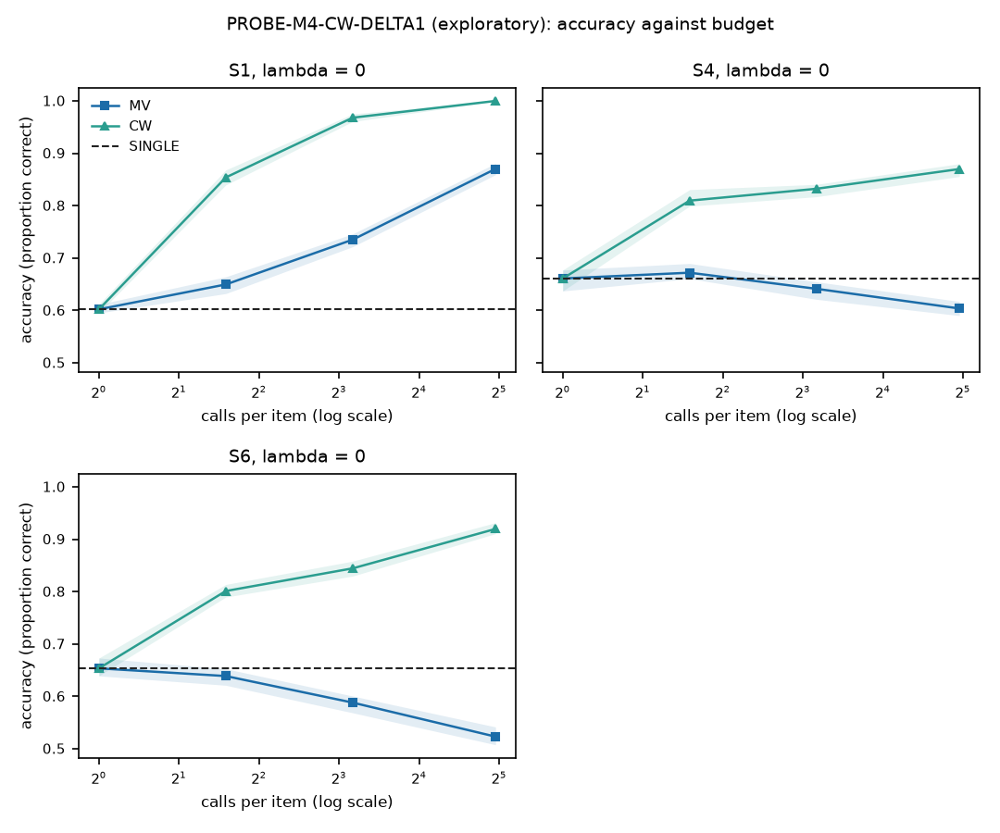

<!-- SPDX-License-Identifier: LicenseRef-PARADOX-NC-Research-1.0 -->
# PROBE-M4-CW-DELTA1 aggregation report (exploratory)

> **EXPLORATORY. Not a finding.** This report comes from an exploratory run made before the owner froze the protocol. It does not test any preregistered hypothesis and must not be cited as a result.

- Experiment id: `PROBE-M4-CW-DELTA1`; label: **exploratory**; kind: `aggregation`
- Result schema: 1.0.0; config SHA-256: `3f54bb3380718af6ec203c2bc5dd7d4f4fbc6875e8786797504abf6288be83b0`
- Code revision: `2f689edcace9e9b3418b38724af2f4fef811c1f0`; created (UTC): 2026-11-25T01:22:01Z
- Seeds (10): 3757552657, 673228719, 3241444873, 3685993406, 1216546553, 2078861726, 2471122328, 23012616, 3031610183, 2976135721
- Claims boundary: Synthetic reasoners, not LLMs or people. Values hold only within the stated simulation model. Exploratory results are not findings and do not test any preregistered hypothesis.

Every number below is generated by `paradox report` from `results.json` in this folder; none is typed by hand.

## Run records

30 runs (2000 items each); 0 excluded by invariant checks.

## Accuracy and paired difference from SINGLE

Delta is the mean per-item paired difference in correctness against SINGLE (reasoner 1, one call) of the same run. SD is the between-seed standard deviation of the per-run Delta; the interval is the seed-level t 95% interval. `theory` is the closed-form MV accuracy (odd budgets only).

| Scenario | lambda | Rule | Calls | Accuracy | theory | Delta | SD(Delta) | t95 low | t95 high | seeds |
|---|---|---|---|---|---|---|---|---|---|---|
| S1 | 0 | SINGLE | 1 | 0.6019 | 0.6000 | 0.0000 | 0.0000 | 0.0000 | 0.0000 | 10 |
| S1 | 0 | MV | 1 | 0.6019 | 0.6000 | 0.0000 | 0.0000 | 0.0000 | 0.0000 | 10 |
| S1 | 0 | MV | 3 | 0.6494 | 0.6480 | 0.0474 | 0.0106 | 0.0398 | 0.0551 | 10 |
| S1 | 0 | MV | 9 | 0.7349 | 0.7334 | 0.1330 | 0.0090 | 0.1266 | 0.1394 | 10 |
| S1 | 0 | MV | 31 | 0.8700 | 0.8716 | 0.2681 | 0.0089 | 0.2617 | 0.2744 | 10 |
| S1 | 0 | CW | 1 | 0.6019 |  | 0.0000 | 0.0000 | 0.0000 | 0.0000 | 10 |
| S1 | 0 | CW | 3 | 0.8538 |  | 0.2518 | 0.0113 | 0.2437 | 0.2599 | 10 |
| S1 | 0 | CW | 9 | 0.9678 |  | 0.3659 | 0.0078 | 0.3603 | 0.3714 | 10 |
| S1 | 0 | CW | 31 | 0.9998 |  | 0.3979 | 0.0059 | 0.3936 | 0.4021 | 10 |
| S4 | 0 | SINGLE | 1 | 0.6608 | 0.6600 | 0.0000 | 0.0000 | 0.0000 | 0.0000 | 10 |
| S4 | 0 | MV | 1 | 0.6608 | 0.6600 | 0.0000 | 0.0000 | 0.0000 | 0.0000 | 10 |
| S4 | 0 | MV | 3 | 0.6718 | 0.6696 | 0.0111 | 0.0083 | 0.0051 | 0.0170 | 10 |
| S4 | 0 | MV | 9 | 0.6411 | 0.6390 | -0.0197 | 0.0078 | -0.0253 | -0.0141 | 10 |
| S4 | 0 | MV | 31 | 0.6036 | 0.6038 | -0.0573 | 0.0085 | -0.0633 | -0.0512 | 10 |
| S4 | 0 | CW | 1 | 0.6608 |  | 0.0000 | 0.0000 | 0.0000 | 0.0000 | 10 |
| S4 | 0 | CW | 3 | 0.8095 |  | 0.1487 | 0.0102 | 0.1413 | 0.1560 | 10 |
| S4 | 0 | CW | 9 | 0.8321 |  | 0.1713 | 0.0103 | 0.1639 | 0.1787 | 10 |
| S4 | 0 | CW | 31 | 0.8698 |  | 0.2090 | 0.0125 | 0.2000 | 0.2179 | 10 |
| S6 | 0 | SINGLE | 1 | 0.6533 | 0.6500 | 0.0000 | 0.0000 | 0.0000 | 0.0000 | 10 |
| S6 | 0 | MV | 1 | 0.6533 | 0.6500 | 0.0000 | 0.0000 | 0.0000 | 0.0000 | 10 |
| S6 | 0 | MV | 3 | 0.6386 | 0.6372 | -0.0147 | 0.0072 | -0.0198 | -0.0096 | 10 |
| S6 | 0 | MV | 9 | 0.5879 | 0.5858 | -0.0654 | 0.0058 | -0.0696 | -0.0612 | 10 |
| S6 | 0 | MV | 31 | 0.5230 | 0.5212 | -0.1304 | 0.0082 | -0.1362 | -0.1245 | 10 |
| S6 | 0 | CW | 1 | 0.6533 |  | 0.0000 | 0.0000 | 0.0000 | 0.0000 | 10 |
| S6 | 0 | CW | 3 | 0.8010 |  | 0.1477 | 0.0083 | 0.1417 | 0.1536 | 10 |
| S6 | 0 | CW | 9 | 0.8443 |  | 0.1909 | 0.0094 | 0.1842 | 0.1976 | 10 |
| S6 | 0 | CW | 31 | 0.9195 |  | 0.2661 | 0.0120 | 0.2576 | 0.2747 | 10 |

## Secondary metrics (means over seeds)

| Scenario | lambda | Rule | Calls | Brier | ECE | Non-unanimous share |
|---|---|---|---|---|---|---|
| S1 | 0 | SINGLE | 1 | 0.1907 | 0.2103 | 0.0000 |
| S1 | 0 | MV | 1 | 0.3981 | 0.3981 | 0.0000 |
| S1 | 0 | MV | 3 | 0.2394 | 0.1122 | 0.7151 |
| S1 | 0 | MV | 9 | 0.1864 | 0.0762 | 0.9890 |
| S1 | 0 | MV | 31 | 0.1678 | 0.2581 | 1.0000 |
| S1 | 0 | CW | 1 | 0.3981 | 0.3981 | 0.0000 |
| S1 | 0 | CW | 3 | 0.1333 | 0.1281 | 0.7151 |
| S1 | 0 | CW | 9 | 0.0585 | 0.1637 | 0.9890 |
| S1 | 0 | CW | 31 | 0.0408 | 0.1905 | 1.0000 |
| S4 | 0 | SINGLE | 1 | 0.1667 | 0.1777 | 0.0000 |
| S4 | 0 | MV | 1 | 0.3392 | 0.3392 | 0.0000 |
| S4 | 0 | MV | 3 | 0.2469 | 0.1902 | 0.4139 |
| S4 | 0 | MV | 9 | 0.2166 | 0.1866 | 0.7517 |
| S4 | 0 | MV | 31 | 0.2060 | 0.2617 | 0.9785 |
| S4 | 0 | CW | 1 | 0.3392 | 0.3392 | 0.0000 |
| S4 | 0 | CW | 3 | 0.1802 | 0.1741 | 0.4139 |
| S4 | 0 | CW | 9 | 0.1118 | 0.0184 | 0.7517 |
| S4 | 0 | CW | 31 | 0.0883 | 0.0532 | 0.9785 |
| S6 | 0 | SINGLE | 1 | 0.1699 | 0.1812 | 0.0000 |
| S6 | 0 | MV | 1 | 0.3466 | 0.3467 | 0.0000 |
| S6 | 0 | MV | 3 | 0.2567 | 0.2252 | 0.4086 |
| S6 | 0 | MV | 9 | 0.2270 | 0.2302 | 0.6725 |
| S6 | 0 | MV | 31 | 0.2162 | 0.3188 | 0.8953 |
| S6 | 0 | CW | 1 | 0.3466 | 0.3467 | 0.0000 |
| S6 | 0 | CW | 3 | 0.1846 | 0.1717 | 0.4086 |
| S6 | 0 | CW | 9 | 0.1094 | 0.0250 | 0.6725 |
| S6 | 0 | CW | 31 | 0.0845 | 0.1163 | 0.8953 |

## Between-seed spread

Across 24 non-baseline cells, SD(Delta) ranges from 0.0000 to 0.0125 (median 0.0083).

## Figure

*Figure 1. Accuracy (proportion of items correct) against calls per item (log2 axis). Mean over 10 seeds of 2000 items; bands show the seed range, not a confidence interval.*
