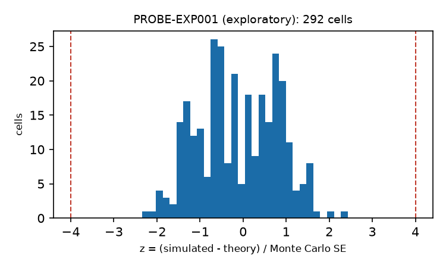

<!-- SPDX-License-Identifier: LicenseRef-PARADOX-NC-Research-1.0 -->
# PROBE-EXP001 validation report (exploratory)

> **EXPLORATORY. Not a finding.** This report comes from an exploratory run made before the owner froze the protocol. It does not test any preregistered hypothesis and must not be cited as a result.

- Experiment id: `PROBE-EXP001`; label: **exploratory**; kind: `validation`
- Result schema: 1.0.0; config SHA-256: `0ca8c9a392000395b7efc227a3abf5ef5d06a978140d04b1ab463c7d36e385db`
- Code revision: `9bfb9d3eaef0fb7676a6b2c1950c121b27e08135`; created (UTC): 2026-11-24T16:07:27Z
- Seeds (10): 3757552657, 673228719, 3241444873, 3685993406, 1216546553, 2078861726, 2471122328, 23012616, 3031610183, 2976135721
- Claims boundary: Synthetic reasoners, not LLMs or people. Values hold only within the stated simulation model. Exploratory results are not findings and do not test any preregistered hypothesis.

Every number below is generated by `paradox report` from `results.json` in this folder; none is typed by hand.

## Deterministic checks and overall verdict

| Check | Expected | Got | Pass |
|---|---|---|---|
| golden bahadur_mv(3, 0.55, 0.4) | 0.54505 | 0.5450500000 | True |
| golden bahadur_mv(5, 0.55, 0.4) | 0.5196194 | 0.5196193750 | True |
| golden condorcet(3, 0.55) | 0.57475 | 0.5747500000 | True |
| golden condorcet(5, 0.55) | 0.5931269 | 0.5931268750 | True |

Monte Carlo cells run: 292; excluded (inadmissible): 20; failing the 4.0 SE tolerance: 0; max |z| = 2.427.

## Cells

| Cell | Model | Parameters | n | Simulated | Theory | z | Pass |
|---|---|---|---|---|---|---|---|
| CELL-0001 | independent | lambda=0.0, p=0.45 | 1 | 0.45088 | 0.45000 | 0.79 | True |
| CELL-0002 | independent | lambda=0.0, p=0.45 | 3 | 0.42577 | 0.42525 | 0.47 | True |
| CELL-0003 | independent | lambda=0.0, p=0.45 | 5 | 0.40617 | 0.40687 | -0.64 | True |
| CELL-0004 | independent | lambda=0.0, p=0.45 | 9 | 0.37981 | 0.37858 | 1.13 | True |
| CELL-0005 | independent | lambda=0.0, p=0.45 | 15 | 0.34706 | 0.34650 | 0.53 | True |
| CELL-0006 | independent | lambda=0.0, p=0.45 | 31 | 0.28748 | 0.28682 | 0.66 | True |
| CELL-0007 | common_shock | lambda=0.25, p=0.45 | 1 | 0.45115 | 0.45000 | 1.03 | True |
| CELL-0008 | common_shock | lambda=0.25, p=0.45 | 3 | 0.42929 | 0.42912 | 0.16 | True |
| CELL-0009 | common_shock | lambda=0.25, p=0.45 | 5 | 0.41680 | 0.41618 | 0.56 | True |
| CELL-0010 | common_shock | lambda=0.25, p=0.45 | 9 | 0.40210 | 0.40128 | 0.75 | True |
| CELL-0011 | common_shock | lambda=0.25, p=0.45 | 15 | 0.39310 | 0.39210 | 0.92 | True |
| CELL-0012 | common_shock | lambda=0.25, p=0.45 | 31 | 0.39392 | 0.39420 | -0.26 | True |
| CELL-0013 | common_shock | lambda=0.5, p=0.45 | 1 | 0.45010 | 0.45000 | 0.09 | True |
| CELL-0014 | common_shock | lambda=0.5, p=0.45 | 3 | 0.43678 | 0.43763 | -0.77 | True |
| CELL-0015 | common_shock | lambda=0.5, p=0.45 | 5 | 0.43193 | 0.43418 | -2.03 | True |
| CELL-0016 | common_shock | lambda=0.5, p=0.45 | 9 | 0.43408 | 0.43560 | -1.37 | True |
| CELL-0017 | common_shock | lambda=0.5, p=0.45 | 15 | 0.44005 | 0.44125 | -1.08 | True |
| CELL-0018 | common_shock | lambda=0.5, p=0.45 | 31 | 0.44736 | 0.44850 | -1.03 | True |
| CELL-0019 | common_shock | lambda=0.75, p=0.45 | 1 | 0.45072 | 0.45000 | 0.65 | True |
| CELL-0020 | common_shock | lambda=0.75, p=0.45 | 3 | 0.44472 | 0.44613 | -1.27 | True |
| CELL-0021 | common_shock | lambda=0.75, p=0.45 | 5 | 0.44567 | 0.44715 | -1.33 | True |
| CELL-0022 | common_shock | lambda=0.75, p=0.45 | 9 | 0.44794 | 0.44913 | -1.07 | True |
| CELL-0023 | common_shock | lambda=0.75, p=0.45 | 15 | 0.44878 | 0.44989 | -1.00 | True |
| CELL-0024 | common_shock | lambda=0.75, p=0.45 | 31 | 0.44884 | 0.45000 | -1.04 | True |
| CELL-0025 | perfect_correlation | lambda=1.0, p=0.45 | 1 | 0.44884 | 0.45000 | -1.04 | True |
| CELL-0026 | perfect_correlation | lambda=1.0, p=0.45 | 3 | 0.44884 | 0.45000 | -1.04 | True |
| CELL-0027 | perfect_correlation | lambda=1.0, p=0.45 | 5 | 0.44884 | 0.45000 | -1.04 | True |
| CELL-0028 | perfect_correlation | lambda=1.0, p=0.45 | 9 | 0.44884 | 0.45000 | -1.04 | True |
| CELL-0029 | perfect_correlation | lambda=1.0, p=0.45 | 15 | 0.44884 | 0.45000 | -1.04 | True |
| CELL-0030 | perfect_correlation | lambda=1.0, p=0.45 | 31 | 0.44884 | 0.45000 | -1.04 | True |
| CELL-0031 | independent | lambda=0.0, p=0.5 | 1 | 0.50097 | 0.50000 | 0.87 | True |
| CELL-0032 | independent | lambda=0.0, p=0.5 | 3 | 0.50179 | 0.50000 | 1.60 | True |
| CELL-0033 | independent | lambda=0.0, p=0.5 | 5 | 0.49987 | 0.50000 | -0.12 | True |
| CELL-0034 | independent | lambda=0.0, p=0.5 | 9 | 0.50077 | 0.50000 | 0.68 | True |
| CELL-0035 | independent | lambda=0.0, p=0.5 | 15 | 0.50063 | 0.50000 | 0.56 | True |
| CELL-0036 | independent | lambda=0.0, p=0.5 | 31 | 0.50135 | 0.50000 | 1.20 | True |
| CELL-0037 | common_shock | lambda=0.25, p=0.5 | 1 | 0.50177 | 0.50000 | 1.58 | True |
| CELL-0038 | common_shock | lambda=0.25, p=0.5 | 3 | 0.50179 | 0.50000 | 1.61 | True |
| CELL-0039 | common_shock | lambda=0.25, p=0.5 | 5 | 0.50063 | 0.50000 | 0.56 | True |
| CELL-0040 | common_shock | lambda=0.25, p=0.5 | 9 | 0.50096 | 0.50000 | 0.85 | True |
| CELL-0041 | common_shock | lambda=0.25, p=0.5 | 15 | 0.50051 | 0.50000 | 0.46 | True |
| CELL-0042 | common_shock | lambda=0.25, p=0.5 | 31 | 0.49949 | 0.50000 | -0.46 | True |
| CELL-0043 | common_shock | lambda=0.5, p=0.5 | 1 | 0.50060 | 0.50000 | 0.54 | True |
| CELL-0044 | common_shock | lambda=0.5, p=0.5 | 3 | 0.50002 | 0.50000 | 0.02 | True |
| CELL-0045 | common_shock | lambda=0.5, p=0.5 | 5 | 0.49791 | 0.50000 | -1.87 | True |
| CELL-0046 | common_shock | lambda=0.5, p=0.5 | 9 | 0.49862 | 0.50000 | -1.23 | True |
| CELL-0047 | common_shock | lambda=0.5, p=0.5 | 15 | 0.49880 | 0.50000 | -1.07 | True |
| CELL-0048 | common_shock | lambda=0.5, p=0.5 | 31 | 0.49844 | 0.50000 | -1.40 | True |
| CELL-0049 | common_shock | lambda=0.75, p=0.5 | 1 | 0.50076 | 0.50000 | 0.68 | True |
| CELL-0050 | common_shock | lambda=0.75, p=0.5 | 3 | 0.49843 | 0.50000 | -1.40 | True |
| CELL-0051 | common_shock | lambda=0.75, p=0.5 | 5 | 0.49831 | 0.50000 | -1.51 | True |
| CELL-0052 | common_shock | lambda=0.75, p=0.5 | 9 | 0.49855 | 0.50000 | -1.30 | True |
| CELL-0053 | common_shock | lambda=0.75, p=0.5 | 15 | 0.49854 | 0.50000 | -1.31 | True |
| CELL-0054 | common_shock | lambda=0.75, p=0.5 | 31 | 0.49851 | 0.50000 | -1.33 | True |
| CELL-0055 | perfect_correlation | lambda=1.0, p=0.5 | 1 | 0.49851 | 0.50000 | -1.33 | True |
| CELL-0056 | perfect_correlation | lambda=1.0, p=0.5 | 3 | 0.49851 | 0.50000 | -1.33 | True |
| CELL-0057 | perfect_correlation | lambda=1.0, p=0.5 | 5 | 0.49851 | 0.50000 | -1.33 | True |
| CELL-0058 | perfect_correlation | lambda=1.0, p=0.5 | 9 | 0.49851 | 0.50000 | -1.33 | True |
| CELL-0059 | perfect_correlation | lambda=1.0, p=0.5 | 15 | 0.49851 | 0.50000 | -1.33 | True |
| CELL-0060 | perfect_correlation | lambda=1.0, p=0.5 | 31 | 0.49851 | 0.50000 | -1.33 | True |
| CELL-0061 | independent | lambda=0.0, p=0.55 | 1 | 0.55110 | 0.55000 | 0.98 | True |
| CELL-0062 | independent | lambda=0.0, p=0.55 | 3 | 0.57651 | 0.57475 | 1.59 | True |
| CELL-0063 | independent | lambda=0.0, p=0.55 | 5 | 0.59396 | 0.59313 | 0.76 | True |
| CELL-0064 | independent | lambda=0.0, p=0.55 | 9 | 0.62199 | 0.62142 | 0.52 | True |
| CELL-0065 | independent | lambda=0.0, p=0.55 | 15 | 0.65429 | 0.65350 | 0.74 | True |
| CELL-0066 | independent | lambda=0.0, p=0.55 | 31 | 0.71515 | 0.71318 | 1.95 | True |
| CELL-0067 | common_shock | lambda=0.25, p=0.55 | 1 | 0.55170 | 0.55000 | 1.53 | True |
| CELL-0068 | common_shock | lambda=0.25, p=0.55 | 3 | 0.57261 | 0.57088 | 1.56 | True |
| CELL-0069 | common_shock | lambda=0.25, p=0.55 | 5 | 0.58481 | 0.58382 | 0.90 | True |
| CELL-0070 | common_shock | lambda=0.25, p=0.55 | 9 | 0.60017 | 0.59872 | 1.32 | True |
| CELL-0071 | common_shock | lambda=0.25, p=0.55 | 15 | 0.60899 | 0.60790 | 1.00 | True |
| CELL-0072 | common_shock | lambda=0.25, p=0.55 | 31 | 0.60641 | 0.60580 | 0.56 | True |
| CELL-0073 | common_shock | lambda=0.5, p=0.55 | 1 | 0.55056 | 0.55000 | 0.50 | True |
| CELL-0074 | common_shock | lambda=0.5, p=0.55 | 3 | 0.56288 | 0.56238 | 0.46 | True |
| CELL-0075 | common_shock | lambda=0.5, p=0.55 | 5 | 0.56542 | 0.56582 | -0.37 | True |
| CELL-0076 | common_shock | lambda=0.5, p=0.55 | 9 | 0.56430 | 0.56440 | -0.09 | True |
| CELL-0077 | common_shock | lambda=0.5, p=0.55 | 15 | 0.55856 | 0.55875 | -0.18 | True |
| CELL-0078 | common_shock | lambda=0.5, p=0.55 | 31 | 0.55095 | 0.55150 | -0.49 | True |
| CELL-0079 | common_shock | lambda=0.75, p=0.55 | 1 | 0.55108 | 0.55000 | 0.97 | True |
| CELL-0080 | common_shock | lambda=0.75, p=0.55 | 3 | 0.55329 | 0.55387 | -0.52 | True |
| CELL-0081 | common_shock | lambda=0.75, p=0.55 | 5 | 0.55210 | 0.55285 | -0.68 | True |
| CELL-0082 | common_shock | lambda=0.75, p=0.55 | 9 | 0.55035 | 0.55087 | -0.47 | True |
| CELL-0083 | common_shock | lambda=0.75, p=0.55 | 15 | 0.54945 | 0.55011 | -0.59 | True |
| CELL-0084 | common_shock | lambda=0.75, p=0.55 | 31 | 0.54934 | 0.55000 | -0.59 | True |
| CELL-0085 | perfect_correlation | lambda=1.0, p=0.55 | 1 | 0.54934 | 0.55000 | -0.59 | True |
| CELL-0086 | perfect_correlation | lambda=1.0, p=0.55 | 3 | 0.54934 | 0.55000 | -0.59 | True |
| CELL-0087 | perfect_correlation | lambda=1.0, p=0.55 | 5 | 0.54934 | 0.55000 | -0.59 | True |
| CELL-0088 | perfect_correlation | lambda=1.0, p=0.55 | 9 | 0.54934 | 0.55000 | -0.59 | True |
| CELL-0089 | perfect_correlation | lambda=1.0, p=0.55 | 15 | 0.54934 | 0.55000 | -0.59 | True |
| CELL-0090 | perfect_correlation | lambda=1.0, p=0.55 | 31 | 0.54934 | 0.55000 | -0.59 | True |
| CELL-0091 | independent | lambda=0.0, p=0.6 | 1 | 0.60026 | 0.60000 | 0.24 | True |
| CELL-0092 | independent | lambda=0.0, p=0.6 | 3 | 0.64892 | 0.64800 | 0.86 | True |
| CELL-0093 | independent | lambda=0.0, p=0.6 | 5 | 0.68268 | 0.68256 | 0.12 | True |
| CELL-0094 | independent | lambda=0.0, p=0.6 | 9 | 0.73352 | 0.73343 | 0.09 | True |
| CELL-0095 | independent | lambda=0.0, p=0.6 | 15 | 0.78775 | 0.78690 | 0.93 | True |
| CELL-0096 | independent | lambda=0.0, p=0.6 | 31 | 0.87245 | 0.87162 | 1.11 | True |
| CELL-0097 | common_shock | lambda=0.25, p=0.6 | 1 | 0.60097 | 0.60000 | 0.89 | True |
| CELL-0098 | common_shock | lambda=0.25, p=0.6 | 3 | 0.64192 | 0.64050 | 1.32 | True |
| CELL-0099 | common_shock | lambda=0.25, p=0.6 | 5 | 0.66636 | 0.66490 | 1.38 | True |
| CELL-0100 | common_shock | lambda=0.25, p=0.6 | 9 | 0.69373 | 0.69215 | 1.54 | True |
| CELL-0101 | common_shock | lambda=0.25, p=0.6 | 15 | 0.70986 | 0.70859 | 1.24 | True |
| CELL-0102 | common_shock | lambda=0.25, p=0.6 | 31 | 0.70922 | 0.70900 | 0.21 | True |
| CELL-0103 | common_shock | lambda=0.5, p=0.6 | 1 | 0.60016 | 0.60000 | 0.15 | True |
| CELL-0104 | common_shock | lambda=0.5, p=0.6 | 3 | 0.62450 | 0.62400 | 0.47 | True |
| CELL-0105 | common_shock | lambda=0.5, p=0.6 | 5 | 0.63035 | 0.63048 | -0.12 | True |
| CELL-0106 | common_shock | lambda=0.5, p=0.6 | 9 | 0.62741 | 0.62777 | -0.33 | True |
| CELL-0107 | common_shock | lambda=0.5, p=0.6 | 15 | 0.61767 | 0.61746 | 0.19 | True |
| CELL-0108 | common_shock | lambda=0.5, p=0.6 | 31 | 0.60337 | 0.60376 | -0.36 | True |
| CELL-0109 | common_shock | lambda=0.75, p=0.6 | 1 | 0.60081 | 0.60000 | 0.74 | True |
| CELL-0110 | common_shock | lambda=0.75, p=0.6 | 3 | 0.60659 | 0.60750 | -0.83 | True |
| CELL-0111 | common_shock | lambda=0.75, p=0.6 | 5 | 0.60469 | 0.60551 | -0.74 | True |
| CELL-0112 | common_shock | lambda=0.75, p=0.6 | 9 | 0.60111 | 0.60172 | -0.56 | True |
| CELL-0113 | common_shock | lambda=0.75, p=0.6 | 15 | 0.59942 | 0.60022 | -0.73 | True |
| CELL-0114 | common_shock | lambda=0.75, p=0.6 | 31 | 0.59919 | 0.60000 | -0.74 | True |
| CELL-0115 | perfect_correlation | lambda=1.0, p=0.6 | 1 | 0.59919 | 0.60000 | -0.74 | True |
| CELL-0116 | perfect_correlation | lambda=1.0, p=0.6 | 3 | 0.59919 | 0.60000 | -0.74 | True |
| CELL-0117 | perfect_correlation | lambda=1.0, p=0.6 | 5 | 0.59919 | 0.60000 | -0.74 | True |
| CELL-0118 | perfect_correlation | lambda=1.0, p=0.6 | 9 | 0.59919 | 0.60000 | -0.74 | True |
| CELL-0119 | perfect_correlation | lambda=1.0, p=0.6 | 15 | 0.59919 | 0.60000 | -0.74 | True |
| CELL-0120 | perfect_correlation | lambda=1.0, p=0.6 | 31 | 0.59919 | 0.60000 | -0.74 | True |
| CELL-0121 | independent | lambda=0.0, p=0.8 | 1 | 0.79944 | 0.80000 | -0.63 | True |
| CELL-0122 | independent | lambda=0.0, p=0.8 | 3 | 0.89642 | 0.89600 | 0.62 | True |
| CELL-0123 | independent | lambda=0.0, p=0.8 | 5 | 0.94266 | 0.94208 | 1.11 | True |
| CELL-0124 | independent | lambda=0.0, p=0.8 | 9 | 0.98084 | 0.98042 | 1.36 | True |
| CELL-0125 | independent | lambda=0.0, p=0.8 | 15 | 0.99577 | 0.99576 | 0.07 | True |
| CELL-0126 | independent | lambda=0.0, p=0.8 | 31 | 0.99992 | 0.99991 | 0.39 | True |
| CELL-0127 | common_shock | lambda=0.25, p=0.8 | 1 | 0.80033 | 0.80000 | 0.37 | True |
| CELL-0128 | common_shock | lambda=0.25, p=0.8 | 3 | 0.88189 | 0.88100 | 1.24 | True |
| CELL-0129 | common_shock | lambda=0.25, p=0.8 | 5 | 0.91592 | 0.91522 | 1.12 | True |
| CELL-0130 | common_shock | lambda=0.25, p=0.8 | 9 | 0.94345 | 0.94218 | 2.43 | True |
| CELL-0131 | common_shock | lambda=0.25, p=0.8 | 15 | 0.95668 | 0.95689 | -0.47 | True |
| CELL-0132 | common_shock | lambda=0.25, p=0.8 | 31 | 0.97400 | 0.97432 | -0.92 | True |
| CELL-0133 | common_shock | lambda=0.5, p=0.8 | 1 | 0.80004 | 0.80000 | 0.04 | True |
| CELL-0134 | common_shock | lambda=0.5, p=0.8 | 3 | 0.84914 | 0.84800 | 1.42 | True |
| CELL-0135 | common_shock | lambda=0.5, p=0.8 | 5 | 0.85738 | 0.85664 | 0.94 | True |
| CELL-0136 | common_shock | lambda=0.5, p=0.8 | 9 | 0.85391 | 0.85260 | 1.65 | True |
| CELL-0137 | common_shock | lambda=0.5, p=0.8 | 15 | 0.84309 | 0.84259 | 0.61 | True |
| CELL-0138 | common_shock | lambda=0.5, p=0.8 | 31 | 0.82574 | 0.82568 | 0.08 | True |
| CELL-0139 | common_shock | lambda=0.75, p=0.8 | 1 | 0.80022 | 0.80000 | 0.24 | True |
| CELL-0140 | common_shock | lambda=0.75, p=0.8 | 3 | 0.81485 | 0.81500 | -0.18 | True |
| CELL-0141 | common_shock | lambda=0.75, p=0.8 | 5 | 0.81029 | 0.81066 | -0.41 | True |
| CELL-0142 | common_shock | lambda=0.75, p=0.8 | 9 | 0.80393 | 0.80389 | 0.05 | True |
| CELL-0143 | common_shock | lambda=0.75, p=0.8 | 15 | 0.80083 | 0.80085 | -0.03 | True |
| CELL-0144 | common_shock | lambda=0.75, p=0.8 | 31 | 0.79990 | 0.80002 | -0.13 | True |
| CELL-0145 | perfect_correlation | lambda=1.0, p=0.8 | 1 | 0.79990 | 0.80000 | -0.12 | True |
| CELL-0146 | perfect_correlation | lambda=1.0, p=0.8 | 3 | 0.79990 | 0.80000 | -0.12 | True |
| CELL-0147 | perfect_correlation | lambda=1.0, p=0.8 | 5 | 0.79990 | 0.80000 | -0.12 | True |
| CELL-0148 | perfect_correlation | lambda=1.0, p=0.8 | 9 | 0.79990 | 0.80000 | -0.12 | True |
| CELL-0149 | perfect_correlation | lambda=1.0, p=0.8 | 15 | 0.79990 | 0.80000 | -0.12 | True |
| CELL-0150 | perfect_correlation | lambda=1.0, p=0.8 | 31 | 0.79990 | 0.80000 | -0.12 | True |
| CELL-0151 | mixture | h=0.4, lambda=0.0, p_easy=0.9, p_hard=0.3, scenario=S4 | 1 | 0.65974 | 0.66000 | -0.25 | True |
| CELL-0152 | mixture | h=0.4, lambda=0.0, p_easy=0.9, p_hard=0.3, scenario=S4 | 3 | 0.66981 | 0.66960 | 0.20 | True |
| CELL-0153 | mixture | h=0.4, lambda=0.0, p_easy=0.9, p_hard=0.3, scenario=S4 | 5 | 0.65916 | 0.66010 | -0.89 | True |
| CELL-0154 | mixture | h=0.4, lambda=0.0, p_easy=0.9, p_hard=0.3, scenario=S4 | 9 | 0.63861 | 0.63899 | -0.35 | True |
| CELL-0155 | mixture | h=0.4, lambda=0.0, p_easy=0.9, p_hard=0.3, scenario=S4 | 15 | 0.61838 | 0.61998 | -1.48 | True |
| CELL-0156 | mixture | h=0.4, lambda=0.0, p_easy=0.9, p_hard=0.3, scenario=S4 | 31 | 0.60174 | 0.60382 | -1.89 | True |
| CELL-0157 | mixture | h=0.4, lambda=0.25, p_easy=0.9, p_hard=0.3, scenario=S4 | 1 | 0.65934 | 0.66000 | -0.63 | True |
| CELL-0158 | mixture | h=0.4, lambda=0.25, p_easy=0.9, p_hard=0.3, scenario=S4 | 3 | 0.66697 | 0.66810 | -1.07 | True |
| CELL-0159 | mixture | h=0.4, lambda=0.25, p_easy=0.9, p_hard=0.3, scenario=S4 | 5 | 0.66097 | 0.66259 | -1.53 | True |
| CELL-0160 | mixture | h=0.4, lambda=0.25, p_easy=0.9, p_hard=0.3, scenario=S4 | 9 | 0.65200 | 0.65352 | -1.43 | True |
| CELL-0161 | mixture | h=0.4, lambda=0.25, p_easy=0.9, p_hard=0.3, scenario=S4 | 15 | 0.64655 | 0.64852 | -1.84 | True |
| CELL-0162 | mixture | h=0.4, lambda=0.25, p_easy=0.9, p_hard=0.3, scenario=S4 | 31 | 0.64343 | 0.64556 | -1.99 | True |
| CELL-0163 | mixture | h=0.4, lambda=0.5, p_easy=0.9, p_hard=0.3, scenario=S4 | 1 | 0.65939 | 0.66000 | -0.58 | True |
| CELL-0164 | mixture | h=0.4, lambda=0.5, p_easy=0.9, p_hard=0.3, scenario=S4 | 3 | 0.66349 | 0.66480 | -1.24 | True |
| CELL-0165 | mixture | h=0.4, lambda=0.5, p_easy=0.9, p_hard=0.3, scenario=S4 | 5 | 0.66129 | 0.66302 | -1.63 | True |
| CELL-0166 | mixture | h=0.4, lambda=0.5, p_easy=0.9, p_hard=0.3, scenario=S4 | 9 | 0.66203 | 0.66367 | -1.55 | True |
| CELL-0167 | mixture | h=0.4, lambda=0.5, p_easy=0.9, p_hard=0.3, scenario=S4 | 15 | 0.66547 | 0.66737 | -1.81 | True |
| CELL-0168 | mixture | h=0.4, lambda=0.5, p_easy=0.9, p_hard=0.3, scenario=S4 | 31 | 0.67019 | 0.67213 | -1.84 | True |
| CELL-0169 | mixture | h=0.4, lambda=0.75, p_easy=0.9, p_hard=0.3, scenario=S4 | 1 | 0.65844 | 0.66000 | -1.47 | True |
| CELL-0170 | mixture | h=0.4, lambda=0.75, p_easy=0.9, p_hard=0.3, scenario=S4 | 3 | 0.65988 | 0.66150 | -1.53 | True |
| CELL-0171 | mixture | h=0.4, lambda=0.75, p_easy=0.9, p_hard=0.3, scenario=S4 | 5 | 0.65886 | 0.66085 | -1.88 | True |
| CELL-0172 | mixture | h=0.4, lambda=0.75, p_easy=0.9, p_hard=0.3, scenario=S4 | 9 | 0.65914 | 0.66065 | -1.43 | True |
| CELL-0173 | mixture | h=0.4, lambda=0.75, p_easy=0.9, p_hard=0.3, scenario=S4 | 15 | 0.65874 | 0.66033 | -1.50 | True |
| CELL-0174 | mixture | h=0.4, lambda=0.75, p_easy=0.9, p_hard=0.3, scenario=S4 | 31 | 0.65842 | 0.66002 | -1.51 | True |
| CELL-0175 | mixture | h=0.2, lambda=0.0, p_easy=0.7, p_hard=0.45, scenario=S5 | 1 | 0.65068 | 0.65000 | 0.64 | True |
| CELL-0176 | mixture | h=0.2, lambda=0.0, p_easy=0.7, p_hard=0.45, scenario=S5 | 3 | 0.71199 | 0.71225 | -0.26 | True |
| CELL-0177 | mixture | h=0.2, lambda=0.0, p_easy=0.7, p_hard=0.45, scenario=S5 | 5 | 0.75037 | 0.75091 | -0.56 | True |
| CELL-0178 | mixture | h=0.2, lambda=0.0, p_easy=0.7, p_hard=0.45, scenario=S5 | 9 | 0.79616 | 0.79667 | -0.57 | True |
| CELL-0179 | mixture | h=0.2, lambda=0.0, p_easy=0.7, p_hard=0.45, scenario=S5 | 15 | 0.82891 | 0.82929 | -0.46 | True |
| CELL-0180 | mixture | h=0.2, lambda=0.0, p_easy=0.7, p_hard=0.45, scenario=S5 | 31 | 0.84922 | 0.84973 | -0.65 | True |
| CELL-0181 | mixture | h=0.2, lambda=0.25, p_easy=0.7, p_hard=0.45, scenario=S5 | 1 | 0.65043 | 0.65000 | 0.40 | True |
| CELL-0182 | mixture | h=0.2, lambda=0.25, p_easy=0.7, p_hard=0.45, scenario=S5 | 3 | 0.70237 | 0.70252 | -0.15 | True |
| CELL-0183 | mixture | h=0.2, lambda=0.25, p_easy=0.7, p_hard=0.45, scenario=S5 | 5 | 0.73008 | 0.73027 | -0.19 | True |
| CELL-0184 | mixture | h=0.2, lambda=0.25, p_easy=0.7, p_hard=0.45, scenario=S5 | 9 | 0.75745 | 0.75707 | 0.39 | True |
| CELL-0185 | mixture | h=0.2, lambda=0.25, p_easy=0.7, p_hard=0.45, scenario=S5 | 15 | 0.77168 | 0.77211 | -0.46 | True |
| CELL-0186 | mixture | h=0.2, lambda=0.25, p_easy=0.7, p_hard=0.45, scenario=S5 | 31 | 0.78302 | 0.78517 | -2.34 | True |
| CELL-0187 | mixture | h=0.2, lambda=0.5, p_easy=0.7, p_hard=0.45, scenario=S5 | 1 | 0.65069 | 0.65000 | 0.65 | True |
| CELL-0188 | mixture | h=0.2, lambda=0.5, p_easy=0.7, p_hard=0.45, scenario=S5 | 3 | 0.68106 | 0.68112 | -0.06 | True |
| CELL-0189 | mixture | h=0.2, lambda=0.5, p_easy=0.7, p_hard=0.45, scenario=S5 | 5 | 0.68822 | 0.68837 | -0.14 | True |
| CELL-0190 | mixture | h=0.2, lambda=0.5, p_easy=0.7, p_hard=0.45, scenario=S5 | 9 | 0.68534 | 0.68518 | 0.15 | True |
| CELL-0191 | mixture | h=0.2, lambda=0.5, p_easy=0.7, p_hard=0.45, scenario=S5 | 15 | 0.67443 | 0.67508 | -0.63 | True |
| CELL-0192 | mixture | h=0.2, lambda=0.5, p_easy=0.7, p_hard=0.45, scenario=S5 | 31 | 0.65861 | 0.65987 | -1.18 | True |
| CELL-0193 | mixture | h=0.2, lambda=0.75, p_easy=0.7, p_hard=0.45, scenario=S5 | 1 | 0.65036 | 0.65000 | 0.33 | True |
| CELL-0194 | mixture | h=0.2, lambda=0.75, p_easy=0.7, p_hard=0.45, scenario=S5 | 3 | 0.65848 | 0.65973 | -1.18 | True |
| CELL-0195 | mixture | h=0.2, lambda=0.75, p_easy=0.7, p_hard=0.45, scenario=S5 | 5 | 0.65580 | 0.65705 | -1.18 | True |
| CELL-0196 | mixture | h=0.2, lambda=0.75, p_easy=0.7, p_hard=0.45, scenario=S5 | 9 | 0.65148 | 0.65235 | -0.82 | True |
| CELL-0197 | mixture | h=0.2, lambda=0.75, p_easy=0.7, p_hard=0.45, scenario=S5 | 15 | 0.64916 | 0.65040 | -1.15 | True |
| CELL-0198 | mixture | h=0.2, lambda=0.75, p_easy=0.7, p_hard=0.45, scenario=S5 | 31 | 0.64872 | 0.65000 | -1.20 | True |
| CELL-0199 | mixture | h=0.5, lambda=0.0, p_easy=0.95, p_hard=0.35, scenario=S6 | 1 | 0.64948 | 0.65000 | -0.49 | True |
| CELL-0200 | mixture | h=0.5, lambda=0.0, p_easy=0.95, p_hard=0.35, scenario=S6 | 3 | 0.63669 | 0.63725 | -0.52 | True |
| CELL-0201 | mixture | h=0.5, lambda=0.0, p_easy=0.95, p_hard=0.35, scenario=S6 | 5 | 0.61559 | 0.61701 | -1.31 | True |
| CELL-0202 | mixture | h=0.5, lambda=0.0, p_easy=0.95, p_hard=0.35, scenario=S6 | 9 | 0.58530 | 0.58584 | -0.49 | True |
| CELL-0203 | mixture | h=0.5, lambda=0.0, p_easy=0.95, p_hard=0.35, scenario=S6 | 15 | 0.55674 | 0.55662 | 0.11 | True |
| CELL-0204 | mixture | h=0.5, lambda=0.0, p_easy=0.95, p_hard=0.35, scenario=S6 | 31 | 0.52048 | 0.52119 | -0.64 | True |
| CELL-0205 | mixture | h=0.5, lambda=0.25, p_easy=0.95, p_hard=0.35, scenario=S6 | 1 | 0.64923 | 0.65000 | -0.72 | True |
| CELL-0206 | mixture | h=0.5, lambda=0.25, p_easy=0.95, p_hard=0.35, scenario=S6 | 3 | 0.63764 | 0.63924 | -1.49 | True |
| CELL-0207 | mixture | h=0.5, lambda=0.25, p_easy=0.95, p_hard=0.35, scenario=S6 | 5 | 0.62420 | 0.62576 | -1.45 | True |
| CELL-0208 | mixture | h=0.5, lambda=0.25, p_easy=0.95, p_hard=0.35, scenario=S6 | 9 | 0.60898 | 0.61005 | -0.97 | True |
| CELL-0209 | mixture | h=0.5, lambda=0.25, p_easy=0.95, p_hard=0.35, scenario=S6 | 15 | 0.60021 | 0.60091 | -0.64 | True |
| CELL-0210 | mixture | h=0.5, lambda=0.25, p_easy=0.95, p_hard=0.35, scenario=S6 | 31 | 0.59622 | 0.59785 | -1.49 | True |
| CELL-0211 | mixture | h=0.5, lambda=0.5, p_easy=0.95, p_hard=0.35, scenario=S6 | 1 | 0.64958 | 0.65000 | -0.39 | True |
| CELL-0212 | mixture | h=0.5, lambda=0.5, p_easy=0.95, p_hard=0.35, scenario=S6 | 3 | 0.64243 | 0.64363 | -1.12 | True |
| CELL-0213 | mixture | h=0.5, lambda=0.5, p_easy=0.95, p_hard=0.35, scenario=S6 | 5 | 0.63838 | 0.63983 | -1.35 | True |
| CELL-0214 | mixture | h=0.5, lambda=0.5, p_easy=0.95, p_hard=0.35, scenario=S6 | 9 | 0.64018 | 0.64140 | -1.14 | True |
| CELL-0215 | mixture | h=0.5, lambda=0.5, p_easy=0.95, p_hard=0.35, scenario=S6 | 15 | 0.64667 | 0.64760 | -0.87 | True |
| CELL-0216 | mixture | h=0.5, lambda=0.5, p_easy=0.95, p_hard=0.35, scenario=S6 | 31 | 0.65473 | 0.65603 | -1.22 | True |
| CELL-0217 | mixture | h=0.5, lambda=0.75, p_easy=0.95, p_hard=0.35, scenario=S6 | 1 | 0.64976 | 0.65000 | -0.23 | True |
| CELL-0218 | mixture | h=0.5, lambda=0.75, p_easy=0.95, p_hard=0.35, scenario=S6 | 3 | 0.64721 | 0.64801 | -0.74 | True |
| CELL-0219 | mixture | h=0.5, lambda=0.75, p_easy=0.95, p_hard=0.35, scenario=S6 | 5 | 0.64733 | 0.64836 | -0.97 | True |
| CELL-0220 | mixture | h=0.5, lambda=0.75, p_easy=0.95, p_hard=0.35, scenario=S6 | 9 | 0.64897 | 0.64975 | -0.73 | True |
| CELL-0221 | mixture | h=0.5, lambda=0.75, p_easy=0.95, p_hard=0.35, scenario=S6 | 15 | 0.64939 | 0.65013 | -0.70 | True |
| CELL-0222 | mixture | h=0.5, lambda=0.75, p_easy=0.95, p_hard=0.35, scenario=S6 | 31 | 0.64923 | 0.65002 | -0.74 | True |
| CELL-0223 | bahadur | c=0.0, p=0.45 | 1 | 0.45102 | 0.45000 | 0.92 | True |
| CELL-0224 | bahadur | c=0.0, p=0.45 | 3 | 0.42571 | 0.42525 | 0.42 | True |
| CELL-0225 | bahadur | c=0.0, p=0.45 | 5 | 0.40712 | 0.40687 | 0.22 | True |
| CELL-0226 | bahadur | c=0.0, p=0.45 | 9 | 0.37861 | 0.37858 | 0.03 | True |
| CELL-0227 | bahadur | c=0.0, p=0.45 | 15 | 0.34660 | 0.34650 | 0.10 | True |
| CELL-0228 | bahadur | c=0.0, p=0.45 | 31 | 0.28749 | 0.28682 | 0.66 | True |
| CELL-0229 | bahadur | c=0.1, p=0.45 | 1 | 0.45102 | 0.45000 | 0.92 | True |
| CELL-0230 | bahadur | c=0.1, p=0.45 | 3 | 0.43362 | 0.43268 | 0.85 | True |
| CELL-0231 | bahadur | c=0.1, p=0.45 | 5 | 0.42571 | 0.42525 | 0.42 | True |
| CELL-0232 | bahadur | c=0.1, p=0.45 | 9 | 0.42630 | 0.42586 | 0.40 | True |
| CELL-0233 | bahadur | c=0.1, p=0.45 | 15 | 0.44990 | 0.44900 | 0.82 | True |
| CELL-0234 | bahadur | c=0.1, p=0.45 | 31 | excluded | inadmissible Bahadur cell (negative profile probability) | | |
| CELL-0235 | bahadur | c=0.4, p=0.45 | 1 | 0.45102 | 0.45000 | 0.92 | True |
| CELL-0236 | bahadur | c=0.4, p=0.45 | 3 | 0.45593 | 0.45495 | 0.88 | True |
| CELL-0237 | bahadur | c=0.4, p=0.45 | 5 | 0.48119 | 0.48038 | 0.72 | True |
| CELL-0238 | bahadur | c=0.4, p=0.45 | 9 | excluded | inadmissible Bahadur cell (negative profile probability) | | |
| CELL-0239 | bahadur | c=0.4, p=0.45 | 15 | excluded | inadmissible Bahadur cell (negative profile probability) | | |
| CELL-0240 | bahadur | c=0.4, p=0.45 | 31 | excluded | inadmissible Bahadur cell (negative profile probability) | | |
| CELL-0241 | bahadur | c=0.0, p=0.5 | 1 | 0.50086 | 0.50000 | 0.77 | True |
| CELL-0242 | bahadur | c=0.0, p=0.5 | 3 | 0.50086 | 0.50000 | 0.77 | True |
| CELL-0243 | bahadur | c=0.0, p=0.5 | 5 | 0.50086 | 0.50000 | 0.77 | True |
| CELL-0244 | bahadur | c=0.0, p=0.5 | 9 | 0.50086 | 0.50000 | 0.77 | True |
| CELL-0245 | bahadur | c=0.0, p=0.5 | 15 | 0.50086 | 0.50000 | 0.77 | True |
| CELL-0246 | bahadur | c=0.0, p=0.5 | 31 | 0.50086 | 0.50000 | 0.77 | True |
| CELL-0247 | bahadur | c=0.1, p=0.5 | 1 | 0.50086 | 0.50000 | 0.77 | True |
| CELL-0248 | bahadur | c=0.1, p=0.5 | 3 | 0.50086 | 0.50000 | 0.77 | True |
| CELL-0249 | bahadur | c=0.1, p=0.5 | 5 | 0.50086 | 0.50000 | 0.77 | True |
| CELL-0250 | bahadur | c=0.1, p=0.5 | 9 | 0.50086 | 0.50000 | 0.77 | True |
| CELL-0251 | bahadur | c=0.1, p=0.5 | 15 | 0.50086 | 0.50000 | 0.77 | True |
| CELL-0252 | bahadur | c=0.1, p=0.5 | 31 | excluded | inadmissible Bahadur cell (negative profile probability) | | |
| CELL-0253 | bahadur | c=0.4, p=0.5 | 1 | 0.50086 | 0.50000 | 0.77 | True |
| CELL-0254 | bahadur | c=0.4, p=0.5 | 3 | 0.50086 | 0.50000 | 0.77 | True |
| CELL-0255 | bahadur | c=0.4, p=0.5 | 5 | 0.50086 | 0.50000 | 0.77 | True |
| CELL-0256 | bahadur | c=0.4, p=0.5 | 9 | excluded | inadmissible Bahadur cell (negative profile probability) | | |
| CELL-0257 | bahadur | c=0.4, p=0.5 | 15 | excluded | inadmissible Bahadur cell (negative profile probability) | | |
| CELL-0258 | bahadur | c=0.4, p=0.5 | 31 | excluded | inadmissible Bahadur cell (negative profile probability) | | |
| CELL-0259 | bahadur | c=0.0, p=0.55 | 1 | 0.55107 | 0.55000 | 0.96 | True |
| CELL-0260 | bahadur | c=0.0, p=0.55 | 3 | 0.57594 | 0.57475 | 1.08 | True |
| CELL-0261 | bahadur | c=0.0, p=0.55 | 5 | 0.59364 | 0.59313 | 0.47 | True |
| CELL-0262 | bahadur | c=0.0, p=0.55 | 9 | 0.62182 | 0.62142 | 0.37 | True |
| CELL-0263 | bahadur | c=0.0, p=0.55 | 15 | 0.65375 | 0.65350 | 0.23 | True |
| CELL-0264 | bahadur | c=0.0, p=0.55 | 31 | 0.71261 | 0.71318 | -0.56 | True |
| CELL-0265 | bahadur | c=0.1, p=0.55 | 1 | 0.55107 | 0.55000 | 0.96 | True |
| CELL-0266 | bahadur | c=0.1, p=0.55 | 3 | 0.56814 | 0.56733 | 0.74 | True |
| CELL-0267 | bahadur | c=0.1, p=0.55 | 5 | 0.57594 | 0.57475 | 1.08 | True |
| CELL-0268 | bahadur | c=0.1, p=0.55 | 9 | 0.57527 | 0.57414 | 1.02 | True |
| CELL-0269 | bahadur | c=0.1, p=0.55 | 15 | 0.55214 | 0.55100 | 1.03 | True |
| CELL-0270 | bahadur | c=0.1, p=0.55 | 31 | excluded | inadmissible Bahadur cell (negative profile probability) | | |
| CELL-0271 | bahadur | c=0.4, p=0.55 | 1 | 0.55107 | 0.55000 | 0.96 | True |
| CELL-0272 | bahadur | c=0.4, p=0.55 | 3 | 0.54615 | 0.54505 | 0.99 | True |
| CELL-0273 | bahadur | c=0.4, p=0.55 | 5 | 0.52094 | 0.51962 | 1.18 | True |
| CELL-0274 | bahadur | c=0.4, p=0.55 | 9 | excluded | inadmissible Bahadur cell (negative profile probability) | | |
| CELL-0275 | bahadur | c=0.4, p=0.55 | 15 | excluded | inadmissible Bahadur cell (negative profile probability) | | |
| CELL-0276 | bahadur | c=0.4, p=0.55 | 31 | excluded | inadmissible Bahadur cell (negative profile probability) | | |
| CELL-0277 | bahadur | c=0.0, p=0.6 | 1 | 0.60018 | 0.60000 | 0.17 | True |
| CELL-0278 | bahadur | c=0.0, p=0.6 | 3 | 0.64835 | 0.64800 | 0.33 | True |
| CELL-0279 | bahadur | c=0.0, p=0.6 | 5 | 0.68237 | 0.68256 | -0.18 | True |
| CELL-0280 | bahadur | c=0.0, p=0.6 | 9 | 0.73352 | 0.73343 | 0.08 | True |
| CELL-0281 | bahadur | c=0.0, p=0.6 | 15 | 0.78616 | 0.78690 | -0.80 | True |
| CELL-0282 | bahadur | c=0.0, p=0.6 | 31 | 0.87069 | 0.87162 | -1.24 | True |
| CELL-0283 | bahadur | c=0.1, p=0.6 | 1 | 0.60018 | 0.60000 | 0.17 | True |
| CELL-0284 | bahadur | c=0.1, p=0.6 | 3 | 0.63399 | 0.63360 | 0.36 | True |
| CELL-0285 | bahadur | c=0.1, p=0.6 | 5 | 0.64835 | 0.64800 | 0.33 | True |
| CELL-0286 | bahadur | c=0.1, p=0.6 | 9 | 0.65015 | 0.64982 | 0.30 | True |
| CELL-0287 | bahadur | c=0.1, p=0.6 | 15 | 0.62204 | 0.62162 | 0.39 | True |
| CELL-0288 | bahadur | c=0.1, p=0.6 | 31 | excluded | inadmissible Bahadur cell (negative profile probability) | | |
| CELL-0289 | bahadur | c=0.4, p=0.6 | 1 | 0.60018 | 0.60000 | 0.17 | True |
| CELL-0290 | bahadur | c=0.4, p=0.6 | 3 | 0.59098 | 0.59040 | 0.52 | True |
| CELL-0291 | bahadur | c=0.4, p=0.6 | 5 | 0.54548 | 0.54432 | 1.04 | True |
| CELL-0292 | bahadur | c=0.4, p=0.6 | 9 | excluded | inadmissible Bahadur cell (negative profile probability) | | |
| CELL-0293 | bahadur | c=0.4, p=0.6 | 15 | excluded | inadmissible Bahadur cell (negative profile probability) | | |
| CELL-0294 | bahadur | c=0.4, p=0.6 | 31 | excluded | inadmissible Bahadur cell (negative profile probability) | | |
| CELL-0295 | bahadur | c=0.0, p=0.8 | 1 | 0.79941 | 0.80000 | -0.66 | True |
| CELL-0296 | bahadur | c=0.0, p=0.8 | 3 | 0.89567 | 0.89600 | -0.49 | True |
| CELL-0297 | bahadur | c=0.0, p=0.8 | 5 | 0.94197 | 0.94208 | -0.21 | True |
| CELL-0298 | bahadur | c=0.0, p=0.8 | 9 | 0.98071 | 0.98042 | 0.92 | True |
| CELL-0299 | bahadur | c=0.0, p=0.8 | 15 | 0.99598 | 0.99576 | 1.51 | True |
| CELL-0300 | bahadur | c=0.0, p=0.8 | 31 | 0.99992 | 0.99991 | 0.39 | True |
| CELL-0301 | bahadur | c=0.1, p=0.8 | 1 | 0.79941 | 0.80000 | -0.66 | True |
| CELL-0302 | bahadur | c=0.1, p=0.8 | 3 | 0.86638 | 0.86720 | -1.07 | True |
| CELL-0303 | bahadur | c=0.1, p=0.8 | 5 | 0.89567 | 0.89600 | -0.49 | True |
| CELL-0304 | bahadur | c=0.1, p=0.8 | 9 | 0.93071 | 0.93087 | -0.30 | True |
| CELL-0305 | bahadur | c=0.1, p=0.8 | 15 | 0.96657 | 0.96674 | -0.42 | True |
| CELL-0306 | bahadur | c=0.1, p=0.8 | 31 | excluded | inadmissible Bahadur cell (negative profile probability) | | |
| CELL-0307 | bahadur | c=0.4, p=0.8 | 1 | 0.79941 | 0.80000 | -0.66 | True |
| CELL-0308 | bahadur | c=0.4, p=0.8 | 3 | 0.78014 | 0.78080 | -0.71 | True |
| CELL-0309 | bahadur | c=0.4, p=0.8 | 5 | 0.75763 | 0.75776 | -0.14 | True |
| CELL-0310 | bahadur | c=0.4, p=0.8 | 9 | excluded | inadmissible Bahadur cell (negative profile probability) | | |
| CELL-0311 | bahadur | c=0.4, p=0.8 | 15 | excluded | inadmissible Bahadur cell (negative profile probability) | | |
| CELL-0312 | bahadur | c=0.4, p=0.8 | 31 | excluded | inadmissible Bahadur cell (negative profile probability) | | |

*Figure 1. Standardised deviation z per validation cell. Cells share seeds across n, so they are not independent.*
