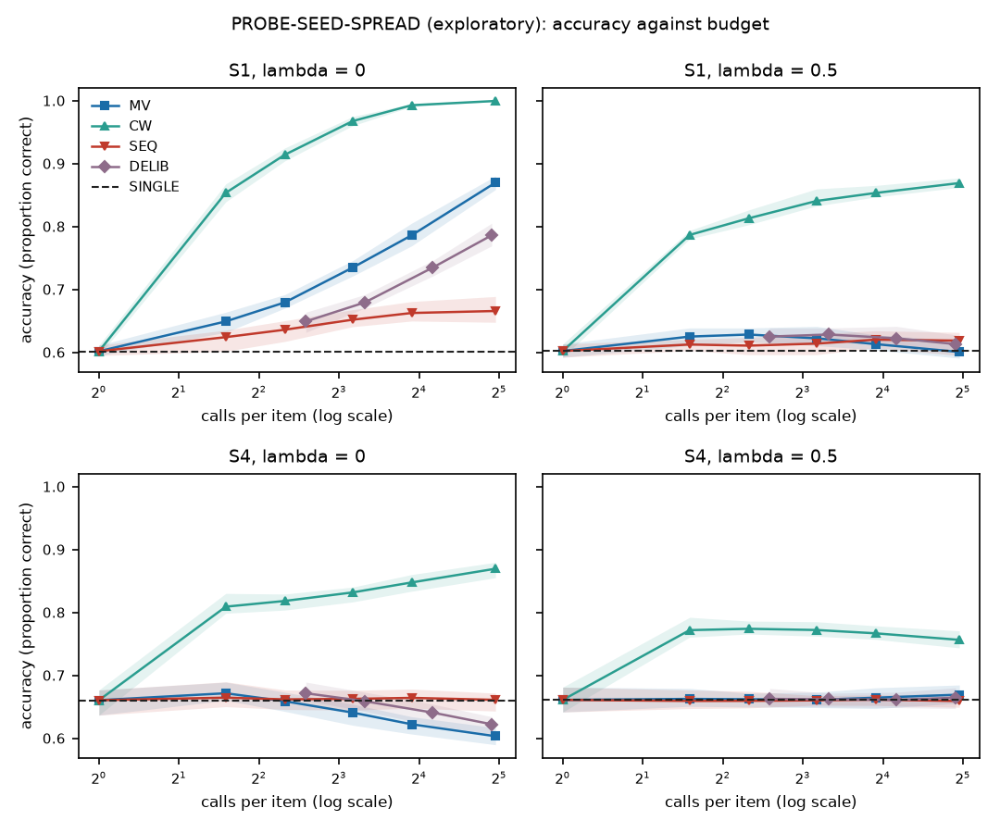

<!-- SPDX-License-Identifier: LicenseRef-PARADOX-NC-Research-1.0 -->
# PROBE-SEED-SPREAD aggregation report (exploratory)

> **EXPLORATORY. Not a finding.** This report comes from an exploratory run made before the owner froze the protocol. It does not test any preregistered hypothesis and must not be cited as a result.

- Experiment id: `PROBE-SEED-SPREAD`; label: **exploratory**; kind: `aggregation`
- Result schema: 1.0.0; config SHA-256: `68cc73aa14012e8fc236d722b08314b5d35e076684725ba55ef1e6fdee2382b6`
- Code revision: `9bfb9d3eaef0fb7676a6b2c1950c121b27e08135`; created (UTC): 2026-11-24T16:07:32Z
- Seeds (10): 3757552657, 673228719, 3241444873, 3685993406, 1216546553, 2078861726, 2471122328, 23012616, 3031610183, 2976135721
- Claims boundary: Synthetic reasoners, not LLMs or people. Values hold only within the stated simulation model. Exploratory results are not findings and do not test any preregistered hypothesis.

Every number below is generated by `paradox report` from `results.json` in this folder; none is typed by hand.

## Run records

40 runs (2000 items each); 0 excluded by invariant checks.

## Accuracy and paired difference from SINGLE

Delta is the mean per-item paired difference in correctness against SINGLE (reasoner 1, one call) of the same run. SD is the between-seed standard deviation of the per-run Delta; the interval is the seed-level t 95% interval. `theory` is the closed-form MV accuracy (odd budgets only).

| Scenario | lambda | Rule | Calls | Accuracy | theory | Delta | SD(Delta) | t95 low | t95 high | seeds |
|---|---|---|---|---|---|---|---|---|---|---|
| S1 | 0 | SINGLE | 1 | 0.6019 | 0.6000 | 0.0000 | 0.0000 | 0.0000 | 0.0000 | 10 |
| S1 | 0 | MV | 1 | 0.6019 | 0.6000 | 0.0000 | 0.0000 | 0.0000 | 0.0000 | 10 |
| S1 | 0 | MV | 3 | 0.6494 | 0.6480 | 0.0474 | 0.0106 | 0.0398 | 0.0551 | 10 |
| S1 | 0 | MV | 5 | 0.6796 | 0.6826 | 0.0776 | 0.0072 | 0.0725 | 0.0828 | 10 |
| S1 | 0 | MV | 9 | 0.7349 | 0.7334 | 0.1330 | 0.0090 | 0.1266 | 0.1394 | 10 |
| S1 | 0 | MV | 15 | 0.7863 | 0.7869 | 0.1844 | 0.0090 | 0.1780 | 0.1908 | 10 |
| S1 | 0 | MV | 31 | 0.8700 | 0.8716 | 0.2681 | 0.0089 | 0.2617 | 0.2744 | 10 |
| S1 | 0 | CW | 1 | 0.6019 |  | 0.0000 | 0.0000 | 0.0000 | 0.0000 | 10 |
| S1 | 0 | CW | 3 | 0.8538 |  | 0.2518 | 0.0113 | 0.2437 | 0.2599 | 10 |
| S1 | 0 | CW | 5 | 0.9143 |  | 0.3124 | 0.0105 | 0.3049 | 0.3198 | 10 |
| S1 | 0 | CW | 9 | 0.9678 |  | 0.3659 | 0.0078 | 0.3603 | 0.3714 | 10 |
| S1 | 0 | CW | 15 | 0.9930 |  | 0.3911 | 0.0057 | 0.3870 | 0.3951 | 10 |
| S1 | 0 | CW | 31 | 0.9998 |  | 0.3979 | 0.0059 | 0.3936 | 0.4021 | 10 |
| S1 | 0 | SEQ | 1 | 0.6019 |  | 0.0000 | 0.0000 | 0.0000 | 0.0000 | 10 |
| S1 | 0 | SEQ | 3 | 0.6244 |  | 0.0224 | 0.0104 | 0.0150 | 0.0299 | 10 |
| S1 | 0 | SEQ | 5 | 0.6362 |  | 0.0342 | 0.0109 | 0.0265 | 0.0420 | 10 |
| S1 | 0 | SEQ | 9 | 0.6522 |  | 0.0502 | 0.0114 | 0.0421 | 0.0583 | 10 |
| S1 | 0 | SEQ | 15 | 0.6628 |  | 0.0609 | 0.0107 | 0.0532 | 0.0685 | 10 |
| S1 | 0 | SEQ | 31 | 0.6660 |  | 0.0640 | 0.0179 | 0.0512 | 0.0768 | 10 |
| S1 | 0 | DELIB | 6 | 0.6494 |  | 0.0474 | 0.0106 | 0.0398 | 0.0551 | 10 |
| S1 | 0 | DELIB | 10 | 0.6796 |  | 0.0776 | 0.0072 | 0.0725 | 0.0828 | 10 |
| S1 | 0 | DELIB | 18 | 0.7349 |  | 0.1330 | 0.0090 | 0.1266 | 0.1394 | 10 |
| S1 | 0 | DELIB | 30 | 0.7863 |  | 0.1844 | 0.0090 | 0.1780 | 0.1908 | 10 |
| S1 | 0.5 | SINGLE | 1 | 0.6023 | 0.6000 | 0.0000 | 0.0000 | 0.0000 | 0.0000 | 10 |
| S1 | 0.5 | MV | 1 | 0.6023 | 0.6000 | 0.0000 | 0.0000 | 0.0000 | 0.0000 | 10 |
| S1 | 0.5 | MV | 3 | 0.6253 | 0.6240 | 0.0230 | 0.0082 | 0.0172 | 0.0288 | 10 |
| S1 | 0.5 | MV | 5 | 0.6285 | 0.6305 | 0.0263 | 0.0093 | 0.0196 | 0.0329 | 10 |
| S1 | 0.5 | MV | 9 | 0.6226 | 0.6278 | 0.0202 | 0.0128 | 0.0111 | 0.0294 | 10 |
| S1 | 0.5 | MV | 15 | 0.6134 | 0.6175 | 0.0111 | 0.0124 | 0.0022 | 0.0199 | 10 |
| S1 | 0.5 | MV | 31 | 0.6008 | 0.6038 | -0.0015 | 0.0137 | -0.0113 | 0.0084 | 10 |
| S1 | 0.5 | CW | 1 | 0.6023 |  | 0.0000 | 0.0000 | 0.0000 | 0.0000 | 10 |
| S1 | 0.5 | CW | 3 | 0.7868 |  | 0.1845 | 0.0087 | 0.1783 | 0.1908 | 10 |
| S1 | 0.5 | CW | 5 | 0.8133 |  | 0.2110 | 0.0115 | 0.2027 | 0.2192 | 10 |
| S1 | 0.5 | CW | 9 | 0.8408 |  | 0.2386 | 0.0131 | 0.2292 | 0.2479 | 10 |
| S1 | 0.5 | CW | 15 | 0.8536 |  | 0.2512 | 0.0114 | 0.2431 | 0.2594 | 10 |
| S1 | 0.5 | CW | 31 | 0.8693 |  | 0.2670 | 0.0109 | 0.2592 | 0.2748 | 10 |
| S1 | 0.5 | SEQ | 1 | 0.6023 |  | 0.0000 | 0.0000 | 0.0000 | 0.0000 | 10 |
| S1 | 0.5 | SEQ | 3 | 0.6127 |  | 0.0104 | 0.0070 | 0.0054 | 0.0154 | 10 |
| S1 | 0.5 | SEQ | 5 | 0.6109 |  | 0.0086 | 0.0130 | -0.0007 | 0.0179 | 10 |
| S1 | 0.5 | SEQ | 9 | 0.6142 |  | 0.0118 | 0.0173 | -0.0005 | 0.0242 | 10 |
| S1 | 0.5 | SEQ | 15 | 0.6204 |  | 0.0181 | 0.0140 | 0.0081 | 0.0281 | 10 |
| S1 | 0.5 | SEQ | 31 | 0.6188 |  | 0.0166 | 0.0155 | 0.0055 | 0.0276 | 10 |
| S1 | 0.5 | DELIB | 6 | 0.6253 |  | 0.0230 | 0.0082 | 0.0172 | 0.0288 | 10 |
| S1 | 0.5 | DELIB | 10 | 0.6285 |  | 0.0263 | 0.0093 | 0.0196 | 0.0329 | 10 |
| S1 | 0.5 | DELIB | 18 | 0.6226 |  | 0.0202 | 0.0128 | 0.0111 | 0.0294 | 10 |
| S1 | 0.5 | DELIB | 30 | 0.6134 |  | 0.0111 | 0.0124 | 0.0022 | 0.0199 | 10 |
| S4 | 0 | SINGLE | 1 | 0.6608 | 0.6600 | 0.0000 | 0.0000 | 0.0000 | 0.0000 | 10 |
| S4 | 0 | MV | 1 | 0.6608 | 0.6600 | 0.0000 | 0.0000 | 0.0000 | 0.0000 | 10 |
| S4 | 0 | MV | 3 | 0.6718 | 0.6696 | 0.0111 | 0.0083 | 0.0051 | 0.0170 | 10 |
| S4 | 0 | MV | 5 | 0.6592 | 0.6601 | -0.0016 | 0.0065 | -0.0063 | 0.0030 | 10 |
| S4 | 0 | MV | 9 | 0.6411 | 0.6390 | -0.0197 | 0.0078 | -0.0253 | -0.0141 | 10 |
| S4 | 0 | MV | 15 | 0.6226 | 0.6200 | -0.0382 | 0.0078 | -0.0439 | -0.0326 | 10 |
| S4 | 0 | MV | 31 | 0.6036 | 0.6038 | -0.0573 | 0.0085 | -0.0633 | -0.0512 | 10 |
| S4 | 0 | CW | 1 | 0.6608 |  | 0.0000 | 0.0000 | 0.0000 | 0.0000 | 10 |
| S4 | 0 | CW | 3 | 0.8095 |  | 0.1487 | 0.0102 | 0.1413 | 0.1560 | 10 |
| S4 | 0 | CW | 5 | 0.8185 |  | 0.1578 | 0.0075 | 0.1524 | 0.1631 | 10 |
| S4 | 0 | CW | 9 | 0.8321 |  | 0.1713 | 0.0103 | 0.1639 | 0.1787 | 10 |
| S4 | 0 | CW | 15 | 0.8479 |  | 0.1871 | 0.0104 | 0.1797 | 0.1946 | 10 |
| S4 | 0 | CW | 31 | 0.8698 |  | 0.2090 | 0.0125 | 0.2000 | 0.2179 | 10 |
| S4 | 0 | SEQ | 1 | 0.6608 |  | 0.0000 | 0.0000 | 0.0000 | 0.0000 | 10 |
| S4 | 0 | SEQ | 3 | 0.6649 |  | 0.0040 | 0.0099 | -0.0030 | 0.0111 | 10 |
| S4 | 0 | SEQ | 5 | 0.6621 |  | 0.0013 | 0.0080 | -0.0044 | 0.0070 | 10 |
| S4 | 0 | SEQ | 9 | 0.6629 |  | 0.0021 | 0.0067 | -0.0027 | 0.0069 | 10 |
| S4 | 0 | SEQ | 15 | 0.6645 |  | 0.0037 | 0.0078 | -0.0019 | 0.0093 | 10 |
| S4 | 0 | SEQ | 31 | 0.6614 |  | 0.0006 | 0.0080 | -0.0052 | 0.0063 | 10 |
| S4 | 0 | DELIB | 6 | 0.6718 |  | 0.0111 | 0.0083 | 0.0051 | 0.0170 | 10 |
| S4 | 0 | DELIB | 10 | 0.6592 |  | -0.0016 | 0.0065 | -0.0063 | 0.0030 | 10 |
| S4 | 0 | DELIB | 18 | 0.6411 |  | -0.0197 | 0.0078 | -0.0253 | -0.0141 | 10 |
| S4 | 0 | DELIB | 30 | 0.6226 |  | -0.0382 | 0.0078 | -0.0439 | -0.0326 | 10 |
| S4 | 0.5 | SINGLE | 1 | 0.6613 | 0.6600 | 0.0000 | 0.0000 | 0.0000 | 0.0000 | 10 |
| S4 | 0.5 | MV | 1 | 0.6613 | 0.6600 | 0.0000 | 0.0000 | 0.0000 | 0.0000 | 10 |
| S4 | 0.5 | MV | 3 | 0.6628 | 0.6648 | 0.0016 | 0.0074 | -0.0037 | 0.0069 | 10 |
| S4 | 0.5 | MV | 5 | 0.6623 | 0.6630 | 0.0010 | 0.0093 | -0.0056 | 0.0077 | 10 |
| S4 | 0.5 | MV | 9 | 0.6614 | 0.6637 | 0.0001 | 0.0107 | -0.0075 | 0.0078 | 10 |
| S4 | 0.5 | MV | 15 | 0.6647 | 0.6674 | 0.0035 | 0.0108 | -0.0042 | 0.0112 | 10 |
| S4 | 0.5 | MV | 31 | 0.6696 | 0.6721 | 0.0083 | 0.0112 | 0.0003 | 0.0164 | 10 |
| S4 | 0.5 | CW | 1 | 0.6613 |  | 0.0000 | 0.0000 | 0.0000 | 0.0000 | 10 |
| S4 | 0.5 | CW | 3 | 0.7721 |  | 0.1109 | 0.0089 | 0.1045 | 0.1173 | 10 |
| S4 | 0.5 | CW | 5 | 0.7743 |  | 0.1130 | 0.0089 | 0.1067 | 0.1194 | 10 |
| S4 | 0.5 | CW | 9 | 0.7723 |  | 0.1111 | 0.0100 | 0.1040 | 0.1182 | 10 |
| S4 | 0.5 | CW | 15 | 0.7671 |  | 0.1058 | 0.0103 | 0.0985 | 0.1132 | 10 |
| S4 | 0.5 | CW | 31 | 0.7567 |  | 0.0955 | 0.0084 | 0.0894 | 0.1015 | 10 |
| S4 | 0.5 | SEQ | 1 | 0.6613 |  | 0.0000 | 0.0000 | 0.0000 | 0.0000 | 10 |
| S4 | 0.5 | SEQ | 3 | 0.6597 |  | -0.0016 | 0.0095 | -0.0084 | 0.0052 | 10 |
| S4 | 0.5 | SEQ | 5 | 0.6598 |  | -0.0015 | 0.0084 | -0.0074 | 0.0045 | 10 |
| S4 | 0.5 | SEQ | 9 | 0.6606 |  | -0.0007 | 0.0107 | -0.0083 | 0.0069 | 10 |
| S4 | 0.5 | SEQ | 15 | 0.6617 |  | 0.0005 | 0.0081 | -0.0054 | 0.0063 | 10 |
| S4 | 0.5 | SEQ | 31 | 0.6594 |  | -0.0018 | 0.0102 | -0.0091 | 0.0055 | 10 |
| S4 | 0.5 | DELIB | 6 | 0.6628 |  | 0.0016 | 0.0074 | -0.0037 | 0.0069 | 10 |
| S4 | 0.5 | DELIB | 10 | 0.6623 |  | 0.0010 | 0.0093 | -0.0056 | 0.0077 | 10 |
| S4 | 0.5 | DELIB | 18 | 0.6614 |  | 0.0001 | 0.0107 | -0.0075 | 0.0078 | 10 |
| S4 | 0.5 | DELIB | 30 | 0.6647 |  | 0.0035 | 0.0108 | -0.0042 | 0.0112 | 10 |

## Secondary metrics (means over seeds)

| Scenario | lambda | Rule | Calls | Brier | ECE | Non-unanimous share |
|---|---|---|---|---|---|---|
| S1 | 0 | SINGLE | 1 | 0.1907 | 0.2103 | 0.0000 |
| S1 | 0 | MV | 1 | 0.3981 | 0.3981 | 0.0000 |
| S1 | 0 | MV | 3 | 0.2394 | 0.1122 | 0.7151 |
| S1 | 0 | MV | 5 | 0.2082 | 0.0269 | 0.9115 |
| S1 | 0 | MV | 9 | 0.1864 | 0.0762 | 0.9890 |
| S1 | 0 | MV | 15 | 0.1754 | 0.1531 | 0.9991 |
| S1 | 0 | MV | 31 | 0.1678 | 0.2581 | 1.0000 |
| S1 | 0 | CW | 1 | 0.3981 | 0.3981 | 0.0000 |
| S1 | 0 | CW | 3 | 0.1333 | 0.1281 | 0.7151 |
| S1 | 0 | CW | 5 | 0.0841 | 0.1049 | 0.9115 |
| S1 | 0 | CW | 9 | 0.0585 | 0.1637 | 0.9890 |
| S1 | 0 | CW | 15 | 0.0475 | 0.1870 | 0.9991 |
| S1 | 0 | CW | 31 | 0.0408 | 0.1905 | 1.0000 |
| S1 | 0 | SEQ | 1 | 0.3981 | 0.3981 | 0.0000 |
| S1 | 0 | SEQ | 3 | 0.3018 | 0.2356 | 0.4202 |
| S1 | 0 | SEQ | 5 | 0.2706 | 0.1907 | 0.6560 |
| S1 | 0 | SEQ | 9 | 0.2403 | 0.1499 | 0.8764 |
| S1 | 0 | SEQ | 15 | 0.2212 | 0.1247 | 0.9699 |
| S1 | 0 | SEQ | 31 | 0.2062 | 0.1276 | 0.9993 |
| S1 | 0 | DELIB | 6 | 0.2954 | 0.2331 | 0.3526 |
| S1 | 0 | DELIB | 10 | 0.2540 | 0.1744 | 0.5977 |
| S1 | 0 | DELIB | 18 | 0.2039 | 0.0977 | 0.8459 |
| S1 | 0 | DELIB | 30 | 0.1652 | 0.0360 | 0.9605 |
| S1 | 0.5 | SINGLE | 1 | 0.1915 | 0.2078 | 0.0000 |
| S1 | 0.5 | MV | 1 | 0.3977 | 0.3977 | 0.0000 |
| S1 | 0.5 | MV | 3 | 0.2798 | 0.1949 | 0.5395 |
| S1 | 0.5 | MV | 5 | 0.2578 | 0.1574 | 0.7368 |
| S1 | 0.5 | MV | 9 | 0.2409 | 0.1449 | 0.9045 |
| S1 | 0.5 | MV | 15 | 0.2333 | 0.1483 | 0.9777 |
| S1 | 0.5 | MV | 31 | 0.2280 | 0.1708 | 0.9991 |
| S1 | 0.5 | CW | 1 | 0.3977 | 0.3977 | 0.0000 |
| S1 | 0.5 | CW | 3 | 0.1976 | 0.1852 | 0.5395 |
| S1 | 0.5 | CW | 5 | 0.1498 | 0.0866 | 0.7368 |
| S1 | 0.5 | CW | 9 | 0.1160 | 0.0281 | 0.9045 |
| S1 | 0.5 | CW | 15 | 0.1009 | 0.0449 | 0.9777 |
| S1 | 0.5 | CW | 31 | 0.0908 | 0.0685 | 0.9991 |
| S1 | 0.5 | SEQ | 1 | 0.3977 | 0.3977 | 0.0000 |
| S1 | 0.5 | SEQ | 3 | 0.3283 | 0.2826 | 0.3140 |
| S1 | 0.5 | SEQ | 5 | 0.3090 | 0.2618 | 0.5017 |
| S1 | 0.5 | SEQ | 9 | 0.2899 | 0.2445 | 0.7176 |
| S1 | 0.5 | SEQ | 15 | 0.2795 | 0.2333 | 0.8655 |
| S1 | 0.5 | SEQ | 31 | 0.2755 | 0.2304 | 0.9787 |
| S1 | 0.5 | DELIB | 6 | 0.3272 | 0.2837 | 0.2729 |
| S1 | 0.5 | DELIB | 10 | 0.3084 | 0.2636 | 0.4526 |
| S1 | 0.5 | DELIB | 18 | 0.2984 | 0.2607 | 0.6748 |
| S1 | 0.5 | DELIB | 30 | 0.2970 | 0.2667 | 0.8473 |
| S4 | 0 | SINGLE | 1 | 0.1667 | 0.1777 | 0.0000 |
| S4 | 0 | MV | 1 | 0.3392 | 0.3392 | 0.0000 |
| S4 | 0 | MV | 3 | 0.2469 | 0.1902 | 0.4139 |
| S4 | 0 | MV | 5 | 0.2292 | 0.1808 | 0.5792 |
| S4 | 0 | MV | 9 | 0.2166 | 0.1866 | 0.7517 |
| S4 | 0 | MV | 15 | 0.2104 | 0.2040 | 0.8744 |
| S4 | 0 | MV | 31 | 0.2060 | 0.2617 | 0.9785 |
| S4 | 0 | CW | 1 | 0.3392 | 0.3392 | 0.0000 |
| S4 | 0 | CW | 3 | 0.1802 | 0.1741 | 0.4139 |
| S4 | 0 | CW | 5 | 0.1400 | 0.0764 | 0.5792 |
| S4 | 0 | CW | 9 | 0.1118 | 0.0184 | 0.7517 |
| S4 | 0 | CW | 15 | 0.0980 | 0.0264 | 0.8744 |
| S4 | 0 | CW | 31 | 0.0883 | 0.0532 | 0.9785 |
| S4 | 0 | SEQ | 1 | 0.3392 | 0.3392 | 0.0000 |
| S4 | 0 | SEQ | 3 | 0.2841 | 0.2535 | 0.2450 |
| S4 | 0 | SEQ | 5 | 0.2691 | 0.2427 | 0.3861 |
| S4 | 0 | SEQ | 9 | 0.2576 | 0.2319 | 0.5636 |
| S4 | 0 | SEQ | 15 | 0.2511 | 0.2262 | 0.7087 |
| S4 | 0 | SEQ | 31 | 0.2501 | 0.2346 | 0.8826 |
| S4 | 0 | DELIB | 6 | 0.2891 | 0.2598 | 0.2050 |
| S4 | 0 | DELIB | 10 | 0.2821 | 0.2608 | 0.3453 |
| S4 | 0 | DELIB | 18 | 0.2809 | 0.2724 | 0.5294 |
| S4 | 0 | DELIB | 30 | 0.2843 | 0.2878 | 0.6903 |
| S4 | 0.5 | SINGLE | 1 | 0.1677 | 0.1741 | 0.0000 |
| S4 | 0.5 | MV | 1 | 0.3387 | 0.3387 | 0.0000 |
| S4 | 0.5 | MV | 3 | 0.2711 | 0.2338 | 0.3100 |
| S4 | 0.5 | MV | 5 | 0.2585 | 0.2197 | 0.4385 |
| S4 | 0.5 | MV | 9 | 0.2494 | 0.2111 | 0.5907 |
| S4 | 0.5 | MV | 15 | 0.2450 | 0.2056 | 0.7235 |
| S4 | 0.5 | MV | 31 | 0.2414 | 0.2153 | 0.8889 |
| S4 | 0.5 | CW | 1 | 0.3387 | 0.3387 | 0.0000 |
| S4 | 0.5 | CW | 3 | 0.2199 | 0.2156 | 0.3100 |
| S4 | 0.5 | CW | 5 | 0.1881 | 0.1380 | 0.4385 |
| S4 | 0.5 | CW | 9 | 0.1629 | 0.1102 | 0.5907 |
| S4 | 0.5 | CW | 15 | 0.1487 | 0.1048 | 0.7235 |
| S4 | 0.5 | CW | 31 | 0.1372 | 0.1106 | 0.8889 |
| S4 | 0.5 | SEQ | 1 | 0.3387 | 0.3387 | 0.0000 |
| S4 | 0.5 | SEQ | 3 | 0.2997 | 0.2790 | 0.1841 |
| S4 | 0.5 | SEQ | 5 | 0.2899 | 0.2691 | 0.2887 |
| S4 | 0.5 | SEQ | 9 | 0.2805 | 0.2609 | 0.4267 |
| S4 | 0.5 | SEQ | 15 | 0.2756 | 0.2573 | 0.5529 |
| S4 | 0.5 | SEQ | 31 | 0.2745 | 0.2579 | 0.7390 |
| S4 | 0.5 | DELIB | 6 | 0.3041 | 0.2855 | 0.1548 |
| S4 | 0.5 | DELIB | 10 | 0.2954 | 0.2785 | 0.2579 |
| S4 | 0.5 | DELIB | 18 | 0.2888 | 0.2750 | 0.4000 |
| S4 | 0.5 | DELIB | 30 | 0.2837 | 0.2696 | 0.5363 |

## Between-seed spread

Across 88 non-baseline cells, SD(Delta) ranges from 0.0000 to 0.0179 (median 0.0090).

## Figure

*Figure 1. Accuracy (proportion of items correct) against calls per item (log2 axis). Mean over 10 seeds of 2000 items; bands show the seed range, not a confidence interval.*
